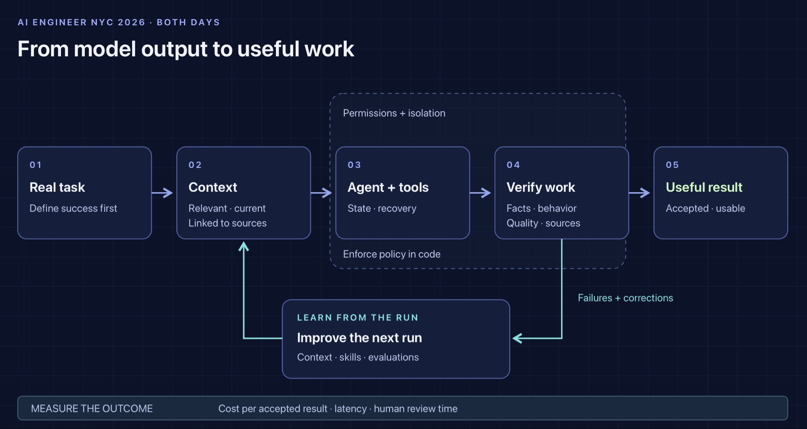
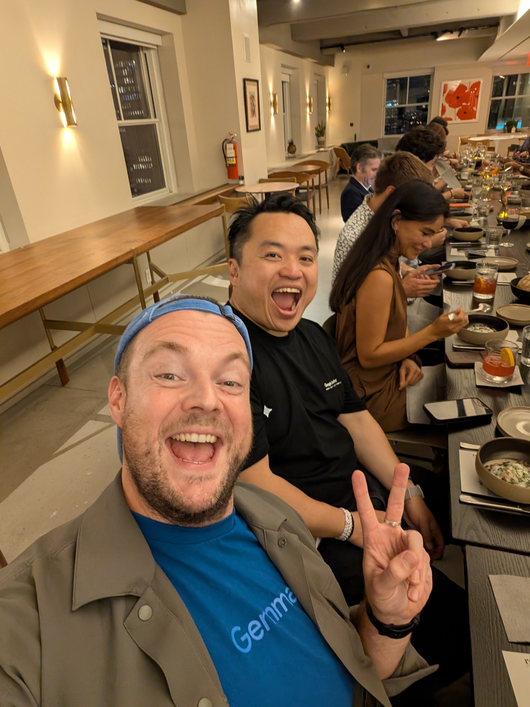
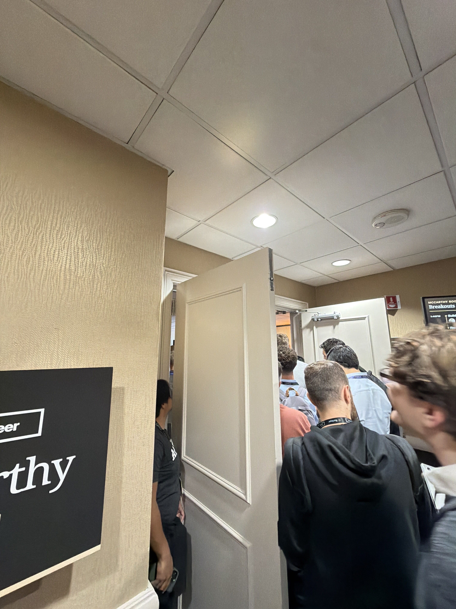

# 🐦 @swyx

## 📅 October 15, 2026

> 3 post(s) archived.

---

### 🕐 13:46 UTC · @swyx

> be @aiDotEngineer fanboy miss conference in NYC eight-hour livestream x2 surely i&apos;ll watch it later never watch it let your agent watch it skim the summaries instead learn something realize @swyx already published transcripts https://aie-nyc-2026.vercel.app

🔗 [View original post](https://x.com/nibzard/status/2110728978726052158)

---

### 🕐 01:03 UTC · @swyx

> The man, the myth, the legend, and the only other person with a killer quokka smile 😁 That&apos;s a wrap on another awesome @aiDotEngineer NYC 🗽 Congrats @swyx and the entire AIE team 💪

🔗 [View original post](https://x.com/thorwebdev/status/2110537136315261317)

---

### 🕐 00:14 UTC · @swyx

> I gave a talk on software factories at AI Engineer NYC today and it was so full someone watched through a crack in the door. Hope it was worth the watch. @swyx can i get a bigger room next time pls :)

🔗 [View original post](https://x.com/zachlloydtweets/status/2110524772039762366)

---
