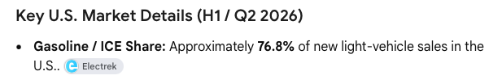

# 🐦 @tunguz

## 📅 October 15, 2026

> 3 post(s) archived.

---

### 🕐 00:22 UTC · @tunguz

> Still 77% in the US. BREAKING: Gasoline-only cars fall below 50% of global new vehicle sales for the first time in history.

🔗 [View original post](https://x.com/tunguz/status/2110526575058080214)

---

### 🕐 00:19 UTC · @tunguz

> winning is all you need “let’s chat again when you hit [metrics, milestones] but too early for us,” is the same as SV girl saying she will “only date Series B founders.” think of both as a pass and your life is simpler. remember, the only way to flip that is to win. when you win you have far more option…

🔗 [View original post](https://x.com/tunguz/status/2110525921677726093)

---

### 🕐 00:16 UTC · @tunguz

> Antigravity is poor man&apos;s Codex.

🔗 [View original post](https://x.com/tunguz/status/2110525308411482286)

---
