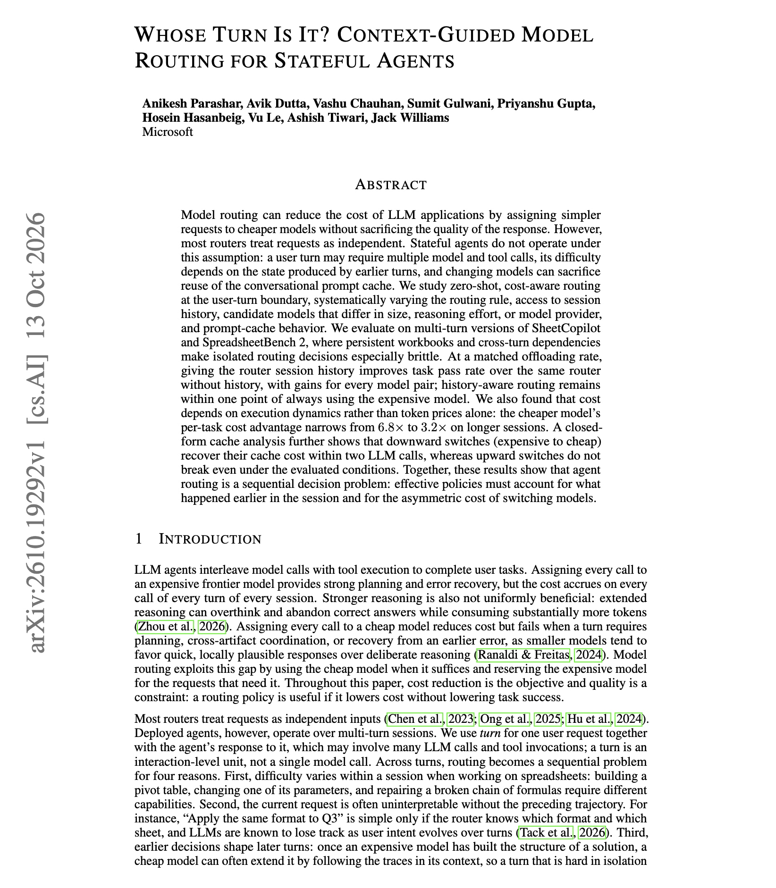
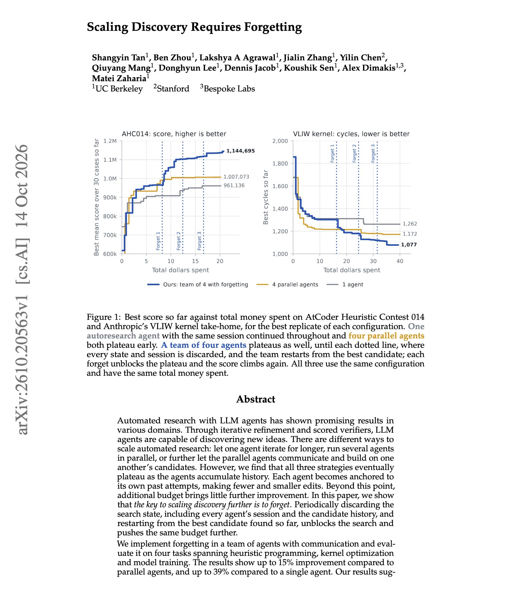

# 🐦 @dair_ai

## 📅 October 16, 2026

> 2 post(s) archived.

---

### 🕐 02:00 UTC · @dair_ai

> Interesting paper from Microsoft on context-guided model routing. They found a nice trick to achieve cost-aware model routing for agents in a multi-turn setting at the user-turn level. If you route agent turns between a cheap model and an expensive one, they suggest giving the router the session history. Microsoft tested zero-shot routing on multi-turn spreadsheet agents. At the same offloading rate, a router that reads the history passes 3.3 points more tasks than one that sees only the current request. Prompt caching adds a cost to every switch. Switching from the expensive model to the cheap one recovers its cache cost within two calls. Switching up did not break even in their tests. The cheap model&apos;s cost advantage also shrank from 6.8x to 3.2x on longer sessions. https://arxiv.org/abs/2610.19292 Chat with Paper: https://academy.dair.ai/papers/whose-turn-is-it-context-guided-model-routing-for-stateful-agents-2610.19292

🔗 [View original post](https://x.com/dair_ai/status/2110913639104561551)

---

### 🕐 01:50 UTC · @dair_ai

> Brilliant paper on scaling research agents from UC Berkeley. (bookmark it) They propose an unexpected and interesting way to scale automated research with agents. It&apos;s common to see research agents keep their full history and iterate on it to solve a task. After a while, each agent anchors on its own past attempts, makes smaller edits, and extra budget stops improving things. So this work induces forgetting in the agents. Periodically, they discard each agent&apos;s session and the candidate history, and then restart from the best candidate found so far. Across heuristic programming, kernel optimization, and model training tasks, this gives up to 15% over parallel agents and up to 39% over a single agent with the same budget. https://arxiv.org/abs/2610.20563 Chat with Paper: https://academy.dair.ai/papers/scaling-discovery-requires-forgetting-2610.20563

🔗 [View original post](https://x.com/omarsar0/status/2110911109964386460)

---
