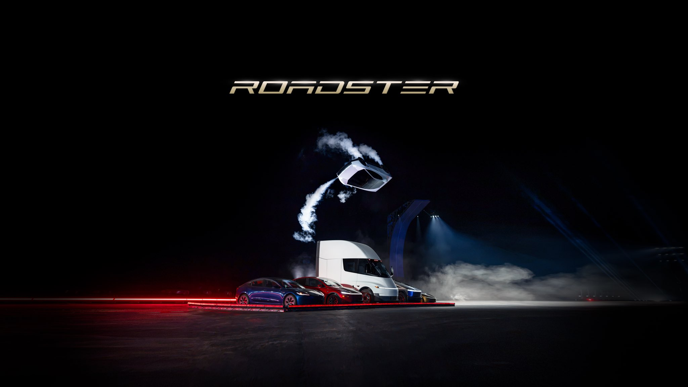
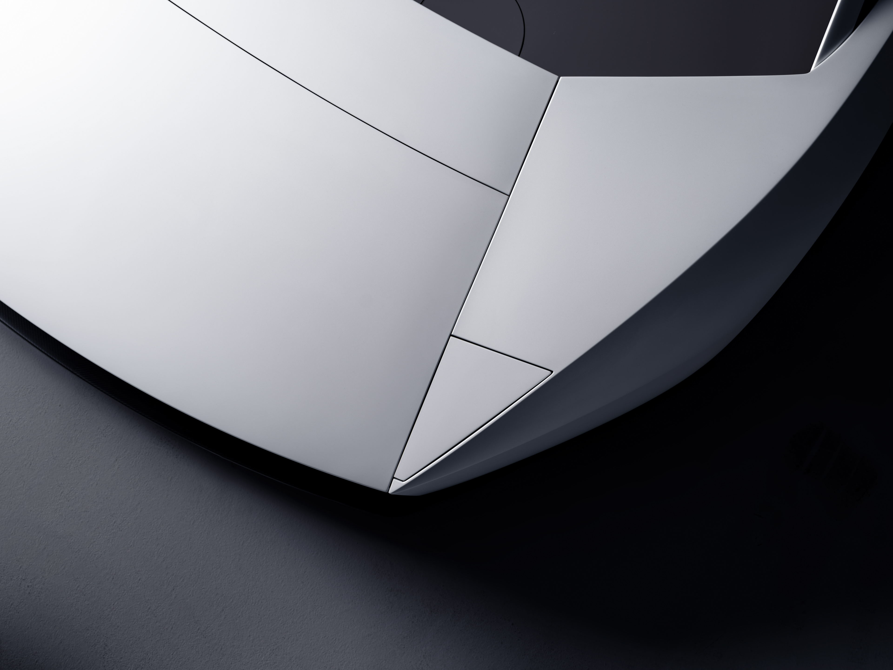

# 🐦 @elonmusk

## 📅 October 16, 2026

> 14 post(s) archived.

---

### 🕐 02:40 UTC · @elonmusk

> Media

🔗 [View original post](https://x.com/elonmusk/status/2110923689797808453)

---

### 🕐 02:32 UTC · @elonmusk

> ELON MUSK: “It&apos;s going to be pretty wild that you can have a rocket car. The car has attitude control thrusters and main thrusters in the rear, so it can basically fly like a rocket. It could do rolls. It could do crazy gymnastics. Whatever you want, really. This is not necessarily a safety-optimized car, but it takes the fun meter to 11 out of 10. This will be an actual car that’s on the roads. I’m not sure it’s necessarily legal in all jurisdictions. The car can recharge its air tank, so it’s not like you need special propellant or anything like that. It literally is just going to pop itself up and be able to do these maneuvers whenever you’d like.” Media

🔗 [View original post](https://x.com/cb_doge/status/2110921873722868066)

---

### 🕐 02:01 UTC · @elonmusk

> Roadster!

🔗 [View original post](https://x.com/woodhaus2/status/2110913934844916176)

---

### 🕐 01:59 UTC · @elonmusk

> Real life, baby Media

🔗 [View original post](https://x.com/Tesla/status/2110913438293647789)

---

### 🕐 01:57 UTC · @elonmusk

> Turns out the future does have flying cars Media

🔗 [View original post](https://x.com/elonmusk/status/2110913107094606330)

---

### 🕐 01:55 UTC · @elonmusk

> so we got flying cars before GTA 6 😂

🔗 [View original post](https://x.com/veggie_eric/status/2110912461591413217)

---

### 🕐 01:33 UTC · @elonmusk

> Roadster is a true pilot&apos;s car: active aerodynamics, a multi-mode suction system &amp; cold-gas thrusters Exterior – Concealed headlights, full-length taillight &amp; flush-mounted surfaces for a minimalist, highly technical form – Super light wheels w/ thin spokes that reinforce structural strength when earthbound – Ano White paint brings an aerospace-derived finish w/ UV &amp; cryogenic protection, electrostatic dissipation &amp; corrosion resistance – Gold Glazed tinted glass mimicking the copper coating of spacesuit visors, w/ subtle titanium accents

🔗 [View original post](https://x.com/Tesla/status/2110907035571401174)

---

### 🕐 01:31 UTC · @elonmusk

> The thing I’m most grateful to Elon for is bringing back an age of wonder and excitement to humanity. That was jaw-dropping awesome! Screams and mouths wide open in the audience. Nuts. Roadster https://x.com/i/broadcasts/1yKAPwNggRaxb

🔗 [View original post](https://x.com/davidmarcus/status/2110906399991701534)

---

### 🕐 01:24 UTC · @elonmusk

> What the flying FUCK did I just watch? Media

🔗 [View original post](https://x.com/stevenmarkryan/status/2110904775814660103)

---

### 🕐 01:24 UTC · @elonmusk

> That was the most insane product demo I’ve ever seen. Well done Tesla! Media

🔗 [View original post](https://x.com/SawyerMerritt/status/2110904608398934084)

---

### 🕐 01:17 UTC · @elonmusk

> Easily the coolest thing I’ve ever seen a car do!!! Now this is impressive! I gotta learn more about the actual practicality of it… how can this be on the road?!? @elonmusk @Tesla Media

🔗 [View original post](https://x.com/Erdayastronaut/status/2110902851417645406)

---

### 🕐 01:12 UTC · @elonmusk

> HOLY SHIT Media

🔗 [View original post](https://x.com/cb_doge/status/2110901560435945972)

---

### 🕐 00:46 UTC · @elonmusk

> Success is not certain, but excitement is

🔗 [View original post](https://x.com/elonmusk/status/2110895088138096988)

---

### 🕐 00:44 UTC · @elonmusk

> Tesla x SpaceX Roadster event livestream https://x.com/i/broadcasts/1yKAPwNggRaxb

🔗 [View original post](https://x.com/elonmusk/status/2110894635904110632)

---
