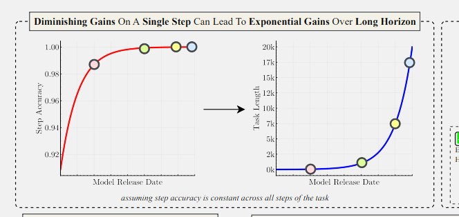

# 🐦 @emollick

## 📅 October 16, 2026

> 4 post(s) archived.

---

### 🕐 02:22 UTC · @emollick

> You may save money in the short term, at the expense of worse work at the end. That doesn&apos;t mean small models can&apos;t do tons of valuable work, but you want to make sure they are orchestrated and error-checked by larger ones for many kinds of tasks. Paper: https://arxiv.org/pdf/2509.09677

🔗 [View original post](https://x.com/emollick/status/2110919225459998776)

---

### 🕐 02:17 UTC · @emollick

> This paper shows why I am skeptical of the idea that frontier models can be easily replaced by cheaper ones (and why you should use the best models as orchestrators): Small improvements in accuracy &amp; judgement compound over long-horizon tasks, creating huge gains in outcomes.

🔗 [View original post](https://x.com/emollick/status/2110918113550307778)

---

### 🕐 01:56 UTC · @emollick

> (shipping is always another story, the iPhone took six months from demo to ship, the GUI took 5 years, the Roadster...)

🔗 [View original post](https://x.com/emollick/status/2110912748309590129)

---

### 🕐 01:54 UTC · @emollick

> Well, I think we have a product demo that manages to beat both the iPhone and Engelbart&apos;s Xerox PARC demo.

🔗 [View original post](https://x.com/emollick/status/2110912123341525388)

---
