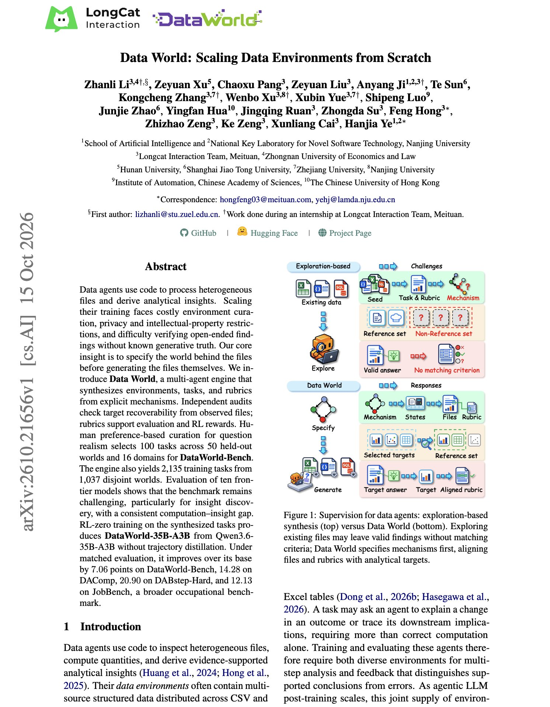

# 🐦 @dair_ai

## 📅 October 18, 2026

> 2 post(s) archived.

---

### 🕐 21:45 UTC · @dair_ai

> Nice paper on scaling data environments from scratch. They built an engine that creates data-analysis environments from scratch. They apply RL, which adds 20.9 points on DABstep-Hard. Data World first writes down the mechanisms that generate a dataset, then produces the files, tasks, and grading rubrics. Because the generating process is known, open-ended findings can be checked, and independent audits confirm each answer can be recovered from the files. Training Qwen3.6-35B-A3B with RL on 2,135 of these tasks, with no distilled trajectories, also adds 14.28 points on DAComp and 12.13 on JobBench. The benchmark finding is just as useful. Ten frontier models compute the right numbers more often than they draw the right conclusion from them. https://arxiv.org/abs/2610.21656 Chat with Paper: https://academy.dair.ai/papers/data-world-scaling-data-environments-from-scratch-2610.21656

🔗 [View original post](https://x.com/omarsar0/status/2111936617699332566)

---

### 🕐 16:51 UTC · @dair_ai

> The Top AI Papers of the Week (October 12 - 18): - Harness^2 - ReHarness - LongHarness - The Agentic Scientist - Hybrid Reasoning Agents - Quantum Circuit Discovery - Scaling Discovery Requires Forgetting Read on for more: https://x.com/i/article/2111861490571485185

🔗 [View original post](https://x.com/dair_ai/status/2111862865560998135)

---
