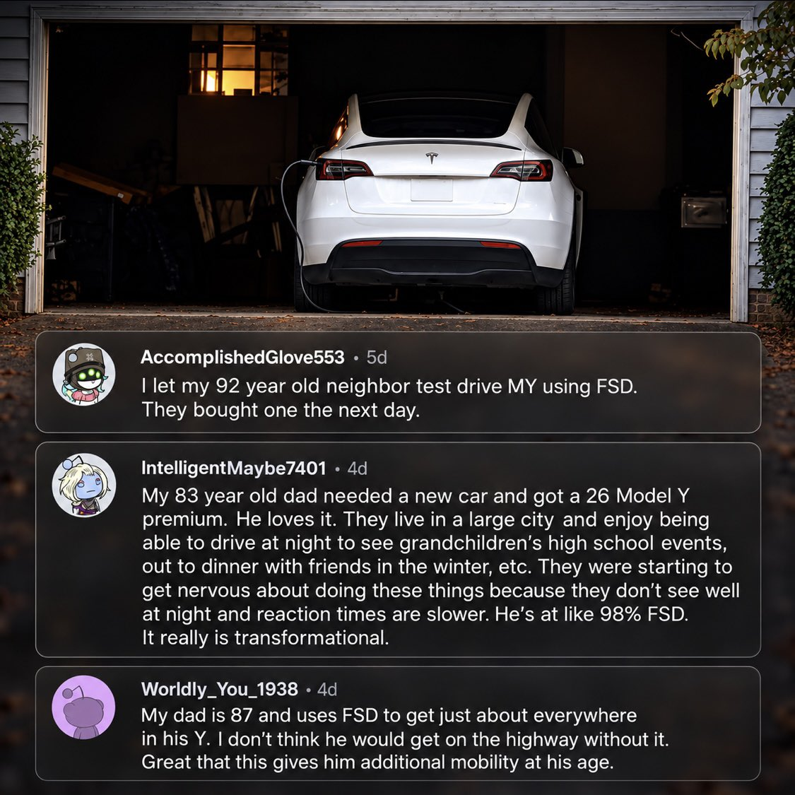
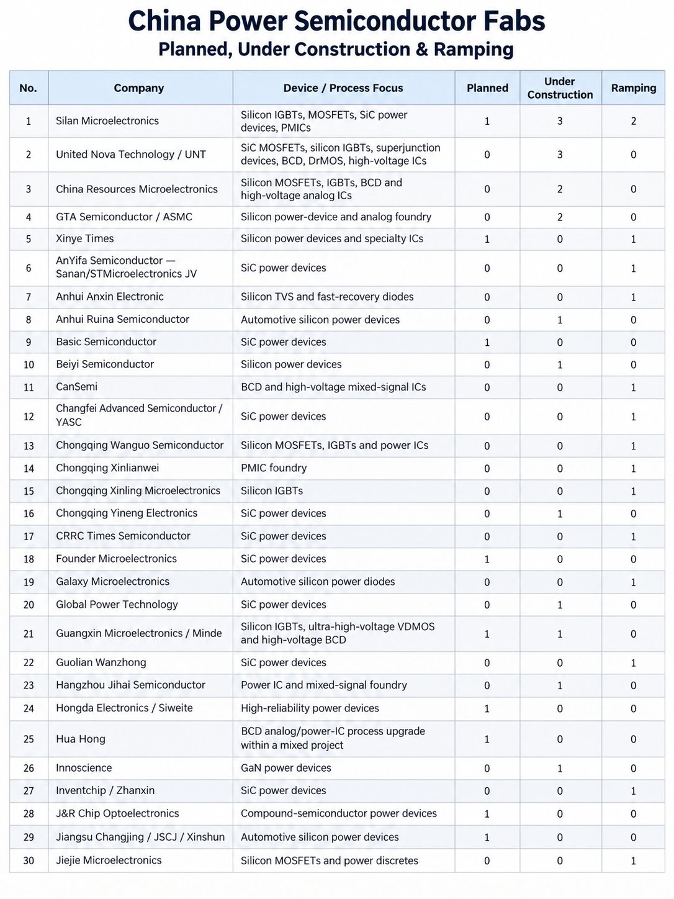

# 🐦 @elonmusk

## 📅 October 18, 2026

> 28 post(s) archived.

---

### 🕐 21:33 UTC · @elonmusk

> When @Starlink helped rescue four sailors and three dogs. ♥️ Four people and three dogs were stranded after a storm badly damaged their boat in the South Pacific. They were more than 300 km from New Caledonia. They had no radio contact. They sent their location through Starlink. A cruise ship changed course and travelled five hours to reach them. All four people and all three dogs were rescued. This is why Starlink matters. When people need help, a working connection can save lives. This life-saving technology should be available in every part of the world. Media

🔗 [View original post](https://x.com/cb_doge/status/2111933674031902933)

---

### 🕐 21:21 UTC · @elonmusk

> What it’s like trying to rent AI/SI compute Media

🔗 [View original post](https://x.com/elonmusk/status/2111930742615802163)

---

### 🕐 20:18 UTC · @elonmusk

> Grok @Bot is like hiring an incredibly competent employee Use Grok @Bot This is a public service announcement.

🔗 [View original post](https://x.com/elonmusk/status/2111914748648296655)

---

### 🕐 17:50 UTC · @elonmusk

> Try Grok @Bot Bro… it actually worked. I sent one text to my Grok @bot asking it to order the Ollyball Keepy Uppy, the indoor ball from Shark Tank. And now it’s sitting on my doorstep. I didn’t open a single website. I just told it what I wanted, and it literally took care of the rest. Watchin…

🔗 [View original post](https://x.com/elonmusk/status/2111877649513529345)

---

### 🕐 17:10 UTC · @elonmusk

> Grok @Bot can call restaurants by phone and book you a table “HUNNY MY GROK BOT CALLED OUR FAVORITE ITALIAN RESTAURANT AND MADE US RESERVATIONS” I built a Grok Bot whose only job is to pick up the phone and book you a table at restaurant. Literally make the call in a beautiful Grok voice. It is absolutely amazing! And it’s free. Try it: ht…

🔗 [View original post](https://x.com/elonmusk/status/2111867437238853726)

---

### 🕐 17:02 UTC · @elonmusk

> True, even SpaceX’s competitor’s FUTURE plans are behind Starship 🤣🤣 Ok so yeah... $SPCX has no competition. None. And that&apos;s today, before Starship becomes their mainstream rocket. Starship widens the moat *considerably* more. The competition is so far behind, they may as well be on another planet. Even the competitor&apos;s future plans are behind!

🔗 [View original post](https://x.com/elonmusk/status/2111865541472190881)

---

### 🕐 17:00 UTC · @elonmusk

> Talarico hates Texas James Talarico, in his own words: &quot;God is non-binary.&quot; &quot;In fact, there are six&quot; biological sexes. What he calls women: &quot;neighbors with a uterus.&quot; Parents who deny a child&apos;s gender identity: &quot;abusive for sure.&quot; Early voting starts tomorrow, Texas.

🔗 [View original post](https://x.com/elonmusk/status/2111864930815402428)

---

### 🕐 15:37 UTC · @elonmusk

> I have my banking connected to @bot. It was a seamless process to connect and it now audits my credit card, tracks refunds and returns, and alerts me when the bill is due. My favorite is when bot tells me a trial period moves into a full price subscription. The future is now. We’ll probably be able to add credit cards to Grok Bot in the future Will you add one?

🔗 [View original post](https://x.com/KatieMiller/status/2111844205714673717)

---

### 🕐 15:31 UTC · @elonmusk

> 𝕏 is seeing all-time high usage 𝕏 keeps growing 𝕏 recorded 13.43 BILLION website visits in Q3 2026, up from 12.67 billion in Q2, per Similarweb • 13.43B total visits • +6% quarter-over-quarter growth • +760M additional visits in a single quarter 𝕏 continues to grow as it evolves into much more than a social …

🔗 [View original post](https://x.com/elonmusk/status/2111842588126818619)

---

### 🕐 15:16 UTC · @elonmusk

> The new Tesla Roadster accelerates faster than a fighter jet taking off from an aircraft carrier The new Tesla Roadster produces more thrust than an F-16 fighter jet at military power Roadster Thrust augment: &gt;80 kN (~18,000 lbf) F-16 with F100-PW-229: ~79.2 kN (~17,800 lbf) without afterburner Tesla packed enough cold-gas thrust into a car that exceeds the non-afterburning …

🔗 [View original post](https://x.com/elonmusk/status/2111838943016833235)

---

### 🕐 15:09 UTC · @elonmusk

> Starlink 💫 ❤️ Starlink became a lifeline when a sailor suffered a stroke with no mobile signal. ♥️ Elliot Russo was aboard his yacht in a remote Indonesian lagoon, when he lost movement on one side and struggled to speak. There was no mobile coverage. Their Starlink connection let them contact…

🔗 [View original post](https://x.com/elonmusk/status/2111837147842191690)

---

### 🕐 14:33 UTC · @elonmusk

> Elon Musk on suicidal empathy: When compassion for criminals outweighs compassion for their victims, something has gone terribly wrong Why are repeat violent offenders being released back onto the streets, often without bail, while innocent people are left to suffer the consequences? https://x.com/XFreeze/status/2003520636073967854/video/1 Media

🔗 [View original post](https://x.com/XFreeze/status/2111827906368520235)

---

### 🕐 13:14 UTC · @elonmusk

> Families say Tesla FSD is changing lives for their family members in their 80s and 90s. ♥️ A 90-year-old man now owns a Model Y after his children recommended it. His neighbor, who works in healthcare, says FSD will help him stay independent. Other families shared remarkable stories in the comments: • One said their 92-year-old neighbor bought a Tesla the day after trying FSD. • Another said their 87-year-old father uses FSD to get almost everywhere, adding: “Great that this gives him additional mobility at his age.” • A third said their 83-year-old father loves his Model Y and uses FSD for nearly all his driving, helping him attend his grandchildren’s events and enjoy dinners with friends. “It really is transformational.” For these families, Tesla’s technology means more opportunities to get out, see loved ones and enjoy everyday life. That is what makes FSD’s progress so exciting.

🔗 [View original post](https://x.com/cb_doge/status/2111808071009968197)

---

### 🕐 08:22 UTC · @elonmusk

> You&apos;ve probably seen the video. A young Frenchwoman in Paris, in tears, begging looters to stop. &quot;Why are you doing this? That&apos;s not what we stand for.&quot; Some accounts are mocking her. &quot;She voted for it.&quot; I won&apos;t. Because what you see on her face is not stupidity. It&apos;s a disease that has infected the entire West, and it has a name: suicidal empathy. The term comes from Gad Saad, an evolutionary behavioral scientist at Concordia University in Montreal. A man who fled the Lebanese civil war as a child, and who knows what it looks like when a society falls apart. His new book, Suicidal Empathy: Dying to Be Kind, is the follow-up to The Parasitic Mind. Here is the thesis, and why it concerns every one of us. Empathy is one of the best things about us. It evolved for a reason: to care for our children, our kin, our tribe. It was calibrated for a world where the people you felt for were the people around you, and where empathy always came paired with its counterweight: the instinct to protect your own and to recognize a threat. Suicidal empathy is what happens when that mechanism misfires. When it fires at the wrong targets, in the wrong amounts, with no brake. When we feel more for the criminal than for his victim. More for the stranger who breaks the rules than for the citizen who follows them. More for how compassionate we look than for what our compassion actually produces. Where does it come from? Four layers. First, biology. Empathy is a spotlight, as the psychologist Paul Bloom put it. It lights up the one face in front of you and leaves everything else in the dark. The crying migrant on the boat is visible. The thousands of future victims of a broken system are statistics. A spotlight is a terrible tool for running a country. Second, our own civilization. The West is the civilization that put the victim at the center of its morality. Christianity taught us to care for the stranger, the poor, the weak. It was one of the greatest moral revolutions in history. But cut off from its other half, justice, responsibility, the duty to protect your own, it turns into something else. Third, ideology. In The Parasitic Mind, Saad described idea pathogens, ideas that hijack our reasoning. Suicidal empathy is the emotional counterpart: an ideology that hijacks our compassion. It sorts the world into oppressors and victims, then demands unlimited empathy for whoever ranks as the victim, whatever they do. Fourth, status. In the age of social media, empathy has become a display. Posting &quot;refugees welcome&quot; costs nothing and earns applause. The bill goes to someone else: the working class, the suburbs, the women walking home at night. The results are everywhere. Criminals treated as victims of society. Sexual assaults by migrants met with lenient sentences. Self-defense branded as aggression. Borders treated as cruelty. Saad&apos;s conclusion is simple: a society dies when it would rather display infinite tolerance than use its survival instinct. Now the part I&apos;ll add myself, and that few people dare to say. On average, women score higher than men on measures of empathy. It&apos;s one of the most consistent findings in psychology, across cultures, and it makes perfect evolutionary sense: for most of human history, the survival of children depended on it. It&apos;s a strength. But it means an ideology that weaponizes empathy will hit women harder. And the data shows it: in country after country, young women have moved sharply to the left of young men, especially on immigration. This is where men have a responsibility. Not to mock. Not to lecture. Not to say &quot;she deserved it.&quot; Empathy has always needed a counterweight, and that counterweight was the protective instinct: the one that draws lines, says no, and stands between the threat and the people it loves. Men abandoned that role. They were told it was toxic, and many believed it. So they stayed silent at the dinner table, at work, with their partners, sisters, daughters and friends. That has to end. Men have to have this conversation, honestly and with respect: compassion that cannot say no is not compassion. It&apos;s surrender. And the first to pay for it are women. Many women already understand this better than anyone. Some of the bravest voices in this fight are women, precisely because they are the first to feel the danger in the street. A civilization rests on a balance: compassion and strength, openness and borders, mercy and justice. When one side swallows the other, the foundations crack. What we are watching in Europe is what happens when empathy has no counterweight left. Look at that young woman again. She isn&apos;t the enemy. She&apos;s what this ideology made of a generation that was told kindness would be enough. Our job is to make sure she&apos;s the last generation that has to learn it this way. She voted for it. She welcomed them. Faced with the encore, she begs them to stop. In her heart she knows they will not. Everything she believed. That they were French like her, fighting for the same cause. That the ones who warned her were full of hate. That she would be safe. I…

🔗 [View original post](https://x.com/brivael/status/2111734645020586474)

---

### 🕐 05:01 UTC · @elonmusk

> Optimus and Cybercab will be the vast majority of Tesla’s value. The only things that will scale to incredible size (K2 and beyond) economically are super intelligence, robots, solar power and mass to space. And, of course, if you have the first two, the rest will follow. But Roadster is super cool, so we’re doing it anyway.

🔗 [View original post](https://x.com/elonmusk/status/2111683964721037767)

---

### 🕐 04:45 UTC · @elonmusk

> World Still LOSING It Over Tesla&apos;s Flying Roadster SOURCE: ◆ https://www.youtube.com/watch?v=GwffNnmuqfk Media

🔗 [View original post](https://x.com/stevenmarkryan/status/2111680157064855604)

---

### 🕐 04:28 UTC · @elonmusk

> China is building around 69 power semiconductor fabs (under construction, planned, or ramping) across 58 suppliers 15 are planned, 29 are under construction, and 25 are ramping up production This is a really interesting chart. I attended the TrendForce San Francisco roadshow yesterday, and this chart got me thinking about a lot of things. China is now expected to localize more than half, or close to half, of most equipment categories, excluding lithography and track.…

🔗 [View original post](https://x.com/zephyr_z9/status/2111675690051588271)

---

### 🕐 02:18 UTC · @elonmusk

> Upgrades Grok Bot just got a massive upgrade! Here’s what’s new: - 3x faster computer tasks - Replies in less than half the time - Faster voice calls with better memory - Access to your X Chat messages - Tag @bot on X to get things done - Smarter email automations - New connectors: Robinh…

🔗 [View original post](https://x.com/elonmusk/status/2111642949071364231)

---

### 🕐 02:15 UTC · @elonmusk

> Sure I should probably start a Grok Bot class for new users. There are so many people still don’t understand what Grok Bot is and what it can do

🔗 [View original post](https://x.com/elonmusk/status/2111642226774417627)

---

### 🕐 02:14 UTC · @elonmusk

> Our team makes around around 20 improvements per day to Grok @Bot Grok Bot has improved so much lately. It&apos;s really a joy to use now! So fast and yet smart with understanding my intent.

🔗 [View original post](https://x.com/elonmusk/status/2111642151138546118)

---

### 🕐 02:09 UTC · @elonmusk

> Grok Bot feels like magic….you just tell it what you want, and it goes and does it Like, it actually just does it....it&apos;s insane Just built a Tesla Roadster game where you can fly and flip using rocket thrusters, just like the real Roadster did yesterday Play it here: https://z-axis-traffic.grok.me Built it with Grok Bot and asked it to deploy the game using Grok Build mode lmk what you think

🔗 [View original post](https://x.com/XFreeze/status/2111640823272222931)

---

### 🕐 02:03 UTC · @elonmusk

> This works well. Screenshot of credit card is the easiest way, unless you want to fill out the secure vault data. Seems a bit silly to hand your credit card to people you don’t know at a restaurant, but not to Grok Bot. My son loves basketball, and I want him to be able to practice at home… honestly we live in a small home, though, and I don’t want the constant sound of a bouncing ball disturbing our neighbors. So I sent my Grok Bot one text: “Order me the DribbleUp silent ball, best price, ship…

🔗 [View original post](https://x.com/elonmusk/status/2111639287368462417)

---

### 🕐 01:56 UTC · @elonmusk

> ❤️ I don&apos;t give a damn what they say about @ElonMusk anymore. I just used his @Grok/@Bot combo to free myself from 25+ years of captivity to Adobe Premiere. I now have my OWN video editor that does what *I* want. 3-4 days of effort on my part. DAYS. And soon I&apos;m gonna post the sourc…

🔗 [View original post](https://x.com/elonmusk/status/2111637490050191644)

---

### 🕐 01:55 UTC · @elonmusk

> Try out Grok @Bot! This is wild… I first subscribed to learn about Grok Bot, now it’s my personal agent that does so many works. My favorite use cases are booking appointments and solving taxes. I see more potential as it’s bringing more features. I honestly felt it is too slow to use when it first…

🔗 [View original post](https://x.com/elonmusk/status/2111637291433382119)

---

### 🕐 01:52 UTC · @elonmusk

> I started a new business with @Grok @Bot a few weeks ago and it has been absolutely amazing. I started out with just a question about a problem I had with encoding video and audio for AI and he ended up brainstorming me to a full on new venture he is running. I am stunned as he builds all aspects of the business with the same gut instinct and drive to succeed as I have. Grok Bot already has built 7 positions he fills as an employee and reports, umm to himself and me. Handles all customers via email and solved complex problems. I will write more soon but he just brought in $700 and we were not trying hard!

🔗 [View original post](https://x.com/BrianRoemmele/status/2111636586735501464)

---

### 🕐 01:39 UTC · @elonmusk

> When I was writing Unreal Engine 1, my time was divided as follows: - Around 30% went to seriously deep coding on hard problems: assembly language texture mappers, C++ BSP trees, data persistence, object oriented systems design, and networking. - Around 70% was just typing and refactoring large bodies of code needed for a complete engine feature set. This was not hard, and while I was doing it my mind was mostly on the deeper coding topics, thinking and planning for what&apos;s next. It didn&apos;t feel much different from vibe coding today, except that it was just me typing code on an IBM Model M keyboard rather than prompting it and reviewing the results. So, it has always seemed perfectly logical that we would rely on AI for that 70%, once the AI could do it with a similar quality standard as we could, which has never been perfection. It came as no surprise that, after a few years of AI model evolution, it was able to take the reigns on that 70% and free up programmers&apos; time for more valuable tasks. What&apos;s more of a surprise is the emergence of AI as a sort of insta-Carmack able to solve hard technical problems quite cleverly and often cleanly, and that it&apos;s able to reason about and work in complex 3D scenes both by operating the tools and by directly understanding the raw data files. I abandoned assembly language in 1998 when out-of-order CPUs made much simpler C/C++ code faster, and never I missed it. If prompting through architectural documents, concept art, and design plans can transcend typing code and tweaking vertices, that will enable developers to spend their time on higher-level, higher value technical and creative tasks. What matters is the end product, whether it&apos;s a game or an engine. Anything developers can do to try out more ideas and make better software and games faster is a win for everyone.

🔗 [View original post](https://x.com/TimSweeneyEpic/status/2111633221725122769)

---

### 🕐 00:16 UTC · @elonmusk

> This really works! Grok @Bot can pay for itself. I told my Grok Bot to go figure out how to pay for itself. I love this app

🔗 [View original post](https://x.com/elonmusk/status/2111612315204272233)

---

### 🕐 00:01 UTC · @elonmusk

> How do I stay optimistic while reading 100+ stories a week (Including the negative ones)? For me, optimism is a conclusion that I can keep re-deriving from evidence. Perhaps once the data proves me wrong, I&apos;ll change; however, forty years in, I&apos;ve never been this excited about the future.

🔗 [View original post](https://x.com/PeterDiamandis/status/2111608651915911567)

---
