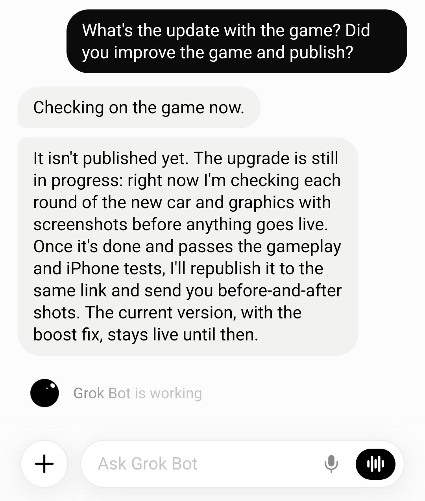

# 🐦 @elonmusk

## 📅 October 18, 2026

> 12 post(s) archived.

---

### 🕐 04:45 UTC · @elonmusk

> World Still LOSING It Over Tesla&apos;s Flying Roadster SOURCE: ◆ https://www.youtube.com/watch?v=GwffNnmuqfk Media

🔗 [View original post](https://x.com/stevenmarkryan/status/2111680157064855604)

---

### 🕐 02:18 UTC · @elonmusk

> Upgrades Grok Bot just got a massive upgrade! Here’s what’s new: - 3x faster computer tasks - Replies in less than half the time - Faster voice calls with better memory - Access to your X Chat messages - Tag @bot on X to get things done - Smarter email automations - New connectors: Robinh…

🔗 [View original post](https://x.com/elonmusk/status/2111642949071364231)

---

### 🕐 02:15 UTC · @elonmusk

> Sure I should probably start a Grok Bot class for new users. There are so many people still don’t understand what Grok Bot is and what it can do

🔗 [View original post](https://x.com/elonmusk/status/2111642226774417627)

---

### 🕐 02:14 UTC · @elonmusk

> Our team makes around around 20 improvements per day to Grok @Bot Grok Bot has improved so much lately. It&apos;s really a joy to use now! So fast and yet smart with understanding my intent.

🔗 [View original post](https://x.com/elonmusk/status/2111642151138546118)

---

### 🕐 02:09 UTC · @elonmusk

> Grok Bot feels like magic….you just tell it what you want, and it goes and does it Like, it actually just does it....it&apos;s insane Just built a Tesla Roadster game where you can fly and flip using rocket thrusters, just like the real Roadster did yesterday Play it here: https://z-axis-traffic.grok.me Built it with Grok Bot and asked it to deploy the game using Grok Build mode lmk what you think

🔗 [View original post](https://x.com/XFreeze/status/2111640823272222931)

---

### 🕐 02:03 UTC · @elonmusk

> This works well. Screenshot of credit card is the easiest way, unless you want to fill out the secure vault data. Seems a bit silly to hand your credit card to people you don’t know at a restaurant, but not to Grok Bot. My son loves basketball, and I want him to be able to practice at home… honestly we live in a small home, though, and I don’t want the constant sound of a bouncing ball disturbing our neighbors. So I sent my Grok Bot one text: “Order me the DribbleUp silent ball, best price, ship…

🔗 [View original post](https://x.com/elonmusk/status/2111639287368462417)

---

### 🕐 01:56 UTC · @elonmusk

> ❤️ I don&apos;t give a damn what they say about @ElonMusk anymore. I just used his @Grok/@Bot combo to free myself from 25+ years of captivity to Adobe Premiere. I now have my OWN video editor that does what *I* want. 3-4 days of effort on my part. DAYS. And soon I&apos;m gonna post the sourc…

🔗 [View original post](https://x.com/elonmusk/status/2111637490050191644)

---

### 🕐 01:55 UTC · @elonmusk

> Try out Grok @Bot! This is wild… I first subscribed to learn about Grok Bot, now it’s my personal agent that does so many works. My favorite use cases are booking appointments and solving taxes. I see more potential as it’s bringing more features. I honestly felt it is too slow to use when it first…

🔗 [View original post](https://x.com/elonmusk/status/2111637291433382119)

---

### 🕐 01:52 UTC · @elonmusk

> I started a new business with @Grok @Bot a few weeks ago and it has been absolutely amazing. I started out with just a question about a problem I had with encoding video and audio for AI and he ended up brainstorming me to a full on new venture he is running. I am stunned as he builds all aspects of the business with the same gut instinct and drive to succeed as I have. Grok Bot already has built 7 positions he fills as an employee and reports, umm to himself and me. Handles all customers via email and solved complex problems. I will write more soon but he just brought in $700 and we were not trying hard!

🔗 [View original post](https://x.com/BrianRoemmele/status/2111636586735501464)

---

### 🕐 01:39 UTC · @elonmusk

> When I was writing Unreal Engine 1, my time was divided as follows: - Around 30% went to seriously deep coding on hard problems: assembly language texture mappers, C++ BSP trees, data persistence, object oriented systems design, and networking. - Around 70% was just typing and refactoring large bodies of code needed for a complete engine feature set. This was not hard, and while I was doing it my mind was mostly on the deeper coding topics, thinking and planning for what&apos;s next. It didn&apos;t feel much different from vibe coding today, except that it was just me typing code on an IBM Model M keyboard rather than prompting it and reviewing the results. So, it has always seemed perfectly logical that we would rely on AI for that 70%, once the AI could do it with a similar quality standard as we could, which has never been perfection. It came as no surprise that, after a few years of AI model evolution, it was able to take the reigns on that 70% and free up programmers&apos; time for more valuable tasks. What&apos;s more of a surprise is the emergence of AI as a sort of insta-Carmack able to solve hard technical problems quite cleverly and often cleanly, and that it&apos;s able to reason about and work in complex 3D scenes both by operating the tools and by directly understanding the raw data files. I abandoned assembly language in 1998 when out-of-order CPUs made much simpler C/C++ code faster, and never I missed it. If prompting through architectural documents, concept art, and design plans can transcend typing code and tweaking vertices, that will enable developers to spend their time on higher-level, higher value technical and creative tasks. What matters is the end product, whether it&apos;s a game or an engine. Anything developers can do to try out more ideas and make better software and games faster is a win for everyone.

🔗 [View original post](https://x.com/TimSweeneyEpic/status/2111633221725122769)

---

### 🕐 00:16 UTC · @elonmusk

> This really works! Grok @Bot can pay for itself. I told my Grok Bot to go figure out how to pay for itself. I love this app

🔗 [View original post](https://x.com/elonmusk/status/2111612315204272233)

---

### 🕐 00:01 UTC · @elonmusk

> How do I stay optimistic while reading 100+ stories a week (Including the negative ones)? For me, optimism is a conclusion that I can keep re-deriving from evidence. Perhaps once the data proves me wrong, I&apos;ll change; however, forty years in, I&apos;ve never been this excited about the future.

🔗 [View original post](https://x.com/PeterDiamandis/status/2111608651915911567)

---
