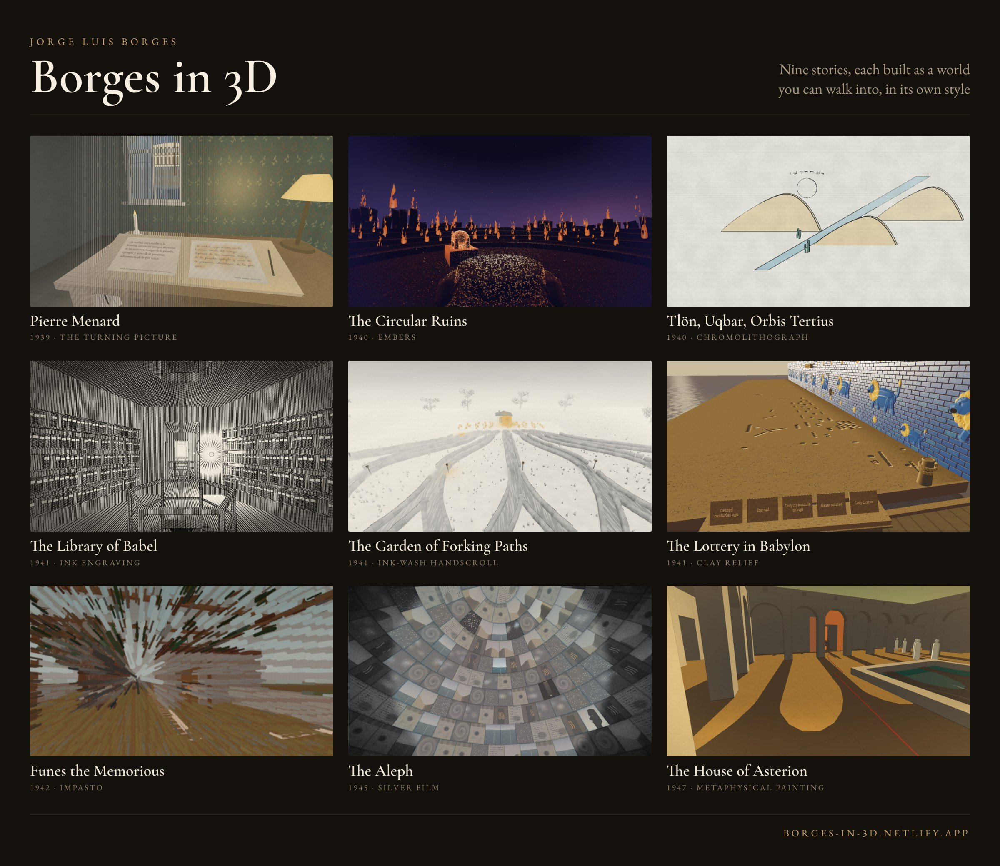

# 🐦 @emollick

## 📅 October 18, 2026

> 3 post(s) archived.

---

### 🕐 16:35 UTC · @emollick

> This doesn’t seem to be a very robust strategy in the era of AIs that can use your computer on your behalf. notice.. &gt; Delta is blocking AI agents from booking flights &gt; JPMorgan Chase and Charles Schwab block agents from accessing accounts &gt; Yelp requires paid data licensing for agents &gt; Amazon has blocked Grok bot and other shopping agents. the internet is starting to block AI agents…

🔗 [View original post](https://x.com/emollick/status/2111858791939772731)

---

### 🕐 06:05 UTC · @emollick

> Fable 5.1: &quot;Implement Borges&apos;s short stories. Like implement them in 3D. Do it, make them creative and beautiful and help us understand the point of the story. Figure it out.&quot; I had to tell it that it was okay to quote Borges. Some neat stuff. Play them: https://borges-in-3d.netlify.app/

🔗 [View original post](https://x.com/emollick/status/2111700285814940159)

---

### 🕐 04:14 UTC · @emollick

> Both interesting and viscerally unsetlling. We placed the fruit fly brain inside Odyssey-3, a frontier world model. The lil’ guy is now flying around totally imagined, simulated worlds all by itself 🫶

🔗 [View original post](https://x.com/emollick/status/2111672307139874844)

---
