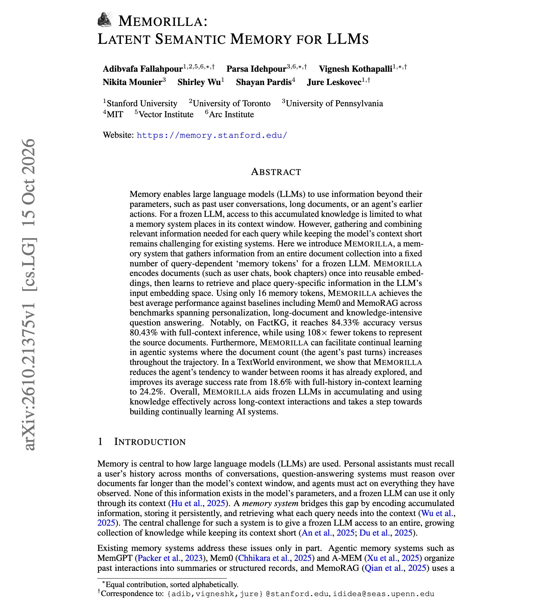

# 🐦 @omarsar0

## 📅 October 18, 2026

> 2 post(s) archived.

---

### 🕐 17:59 UTC · @omarsar0

> // Latent Semantic Memory for LLMs // This paper presents some really interesting findings about agent memory. They find that sixteen memory tokens beat full-context inference on FactKG while using 108x fewer tokens for the source documents. Approach: Documents are encoded once into reusable embeddings. For each query, a learned module gathers the relevant information from the whole collection and writes it into 16 tokens in the input space of a frozen LLM. Results: It beats Mem0, MemoRAG, and other baselines on five of eight benchmarks. On FactKG, it scores 84.33% against 80.43% with the full context. It also works as agent memory. In TextWorld, using the agent&apos;s own history as the collection raises success from 18.6% to 24.2%, and the agent revisits fewer rooms. It also seems that it could help frozen LLMs accumulate and use knowledge effectively across long-context interactions. This is applicable to building continually learning AI systems. https://arxiv.org/abs/2610.21375 Chat with Paper: https://academy.dair.ai/papers/memorilla-latent-semantic-memory-for-llms-2610.21375

🔗 [View original post](https://x.com/omarsar0/status/2111879742454665582)

---

### 🕐 16:51 UTC · @omarsar0

> https://x.com/i/article/2111861490571485185

🔗 [View original post](https://x.com/dair_ai/status/2111862720446202052)

---
