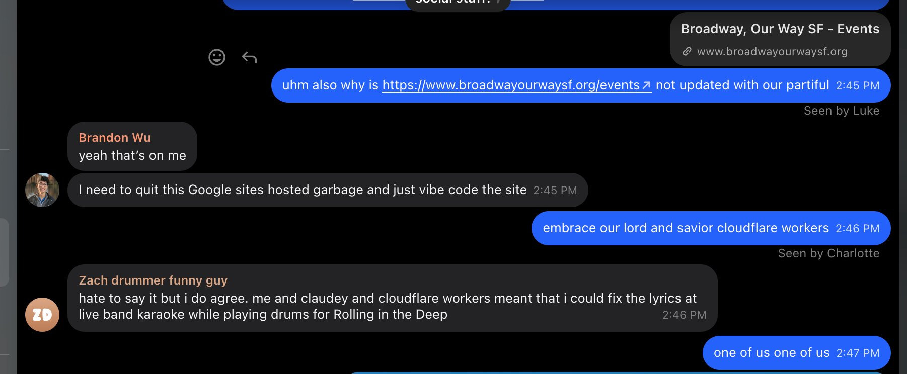
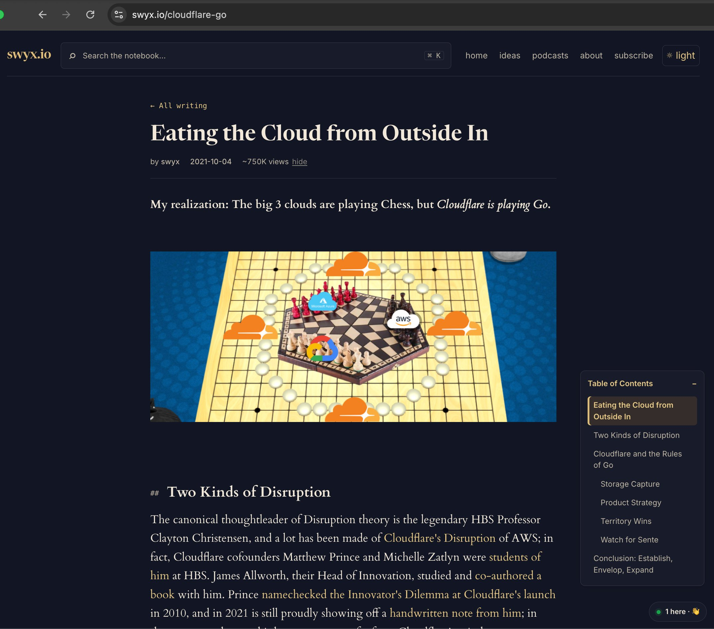

# 🐦 @swyx

## 📅 October 18, 2026

> 8 post(s) archived.

---

### 🕐 22:50 UTC · @swyx

> @asmirkn @swyx @CompleteSkeptic It’s worth mentioning that we are charting new territories for our model capability team - creating a new kind of role that doesn’t exist yet elsewhere. We need solid coders that have “taste”. Day to day you will be studying the capabilities of the model and working on data. 🙂

🔗 [View original post](https://x.com/hackgoofer/status/2111952970565013743)

---

### 🕐 21:51 UTC · @swyx

> @benthompson also @ritakozlov i am slowly converting our broadway group to be #nothingbutNET fans (people! sign up for my next show https://partiful.com/e/e0ePVVLYt7Rn8l75q98y -&gt; preview here https://x.com/swyx/status/2043217991589102027) this one is EVEN MORE HIGH PRODUCTION VALUE WTF late night low TAM tweet: did a Broadway solo song for the first time in ~18 years! only fumbled lyrics once!

🔗 [View original post](https://x.com/swyx/status/2111938337607172591)

---

### 🕐 20:18 UTC · @swyx

> @benthompson back when i was still on the essaygrind https://x.com/swyx/status/1445044267508850695 🆕 post: Eating the Cloud from Outside In How do you compete with 3 clouds 50x your size? While they play Chess, @Cloudflare plays Go. https://www.swyx.io/cloudflare-go/

🔗 [View original post](https://x.com/swyx/status/2111914898313920787)

---

### 🕐 20:18 UTC · @swyx

> i believe this essay i wrote 5 years ago is the closest i&apos;ve ever come to @benthompson level of &quot;nailing it&quot; Amused that AWS just unilaterally cancelled Cloudflare&apos;s Reinvent booth. There are always signs when someone finally realizes they&apos;re losing. Guess we&apos;ll just attend and throw the most fun side events without paying Amazon! Reply if you want an invite.

🔗 [View original post](https://x.com/swyx/status/2111914776217747673)

---

### 🕐 09:28 UTC · @swyx

> If you loved our jev pod with @completeskeptic and are in the react/js/frontend community (especially if i&apos;ve seen your work before), hit me up and i can refer you in to typesafe Hello Software Engineers, I lead TypeSafe AI Model Capabilities team. We are hiring. Here are a few qualities we are looking for: • strong plus for people who resonate with the title &quot;Experience Engineers&quot;: mobile engineers, full stack engineers, or even (virtual) reality enginee…

🔗 [View original post](https://x.com/swyx/status/2111751323389731265)

---

### 🕐 04:59 UTC · @swyx

> Just found out about recency bias. Maybe the most important bias ever

🔗 [View original post](https://x.com/endliste/status/2111683506346901833)

---

### 🕐 04:51 UTC · @swyx

> Single ladies in San Francisco: I know a guy who is a real catch who would be a GREAT dad! DM me for an intro! if you follow me, you know I never do this for men!!!!!! he’s truly an incredible person!

🔗 [View original post](https://x.com/climatepaige/status/2111681592330797383)

---

### 🕐 03:29 UTC · @swyx

> Love this format; @swyx cooked, once again https://www.youtube.com/watch?v=ZOH8Q401vt0

🔗 [View original post](https://x.com/ricklamers/status/2111660901313175834)

---
