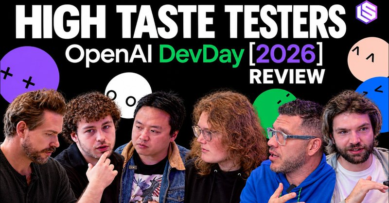

# 🐦 @swyx

## 📅 October 18, 2026

> 3 post(s) archived.

---

### 🕐 09:28 UTC · @swyx

> If you loved our jev pod with @completeskeptic and are in the react/js/frontend community (especially if i&apos;ve seen your work before), hit me up and i can refer you in to typesafe Hello Software Engineers, I lead TypeSafe AI Model Capabilities team. We are hiring. Here are a few qualities we are looking for: • strong plus for people who resonate with the title &quot;Experience Engineers&quot;: mobile engineers, full stack engineers, or even (virtual) reality enginee…

🔗 [View original post](https://x.com/swyx/status/2111751323389731265)

---

### 🕐 04:51 UTC · @swyx

> Single ladies in San Francisco: I know a guy who is a real catch who would be a GREAT dad! DM me for an intro! if you follow me, you know I never do this for men!!!!!! he’s truly an incredible person!

🔗 [View original post](https://x.com/climatepaige/status/2111681592330797383)

---

### 🕐 03:29 UTC · @swyx

> Love this format; @swyx cooked, once again https://www.youtube.com/watch?v=ZOH8Q401vt0

🔗 [View original post](https://x.com/ricklamers/status/2111660901313175834)

---
