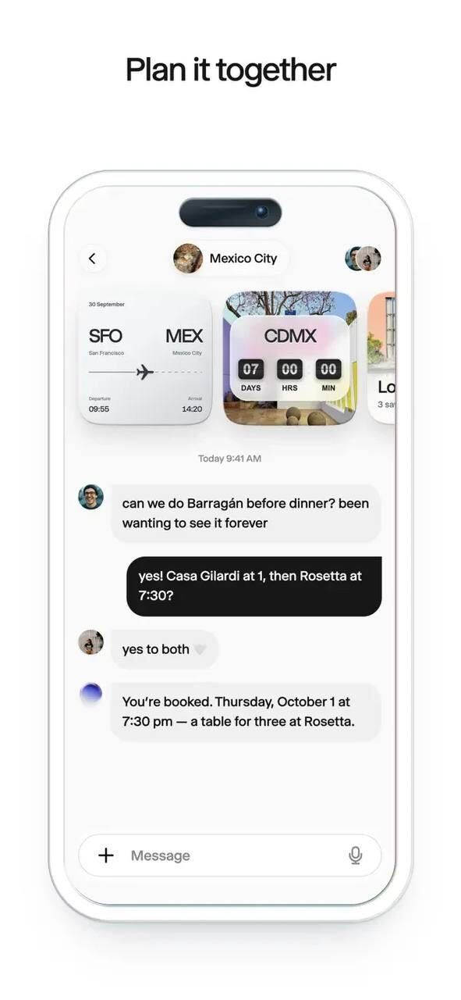
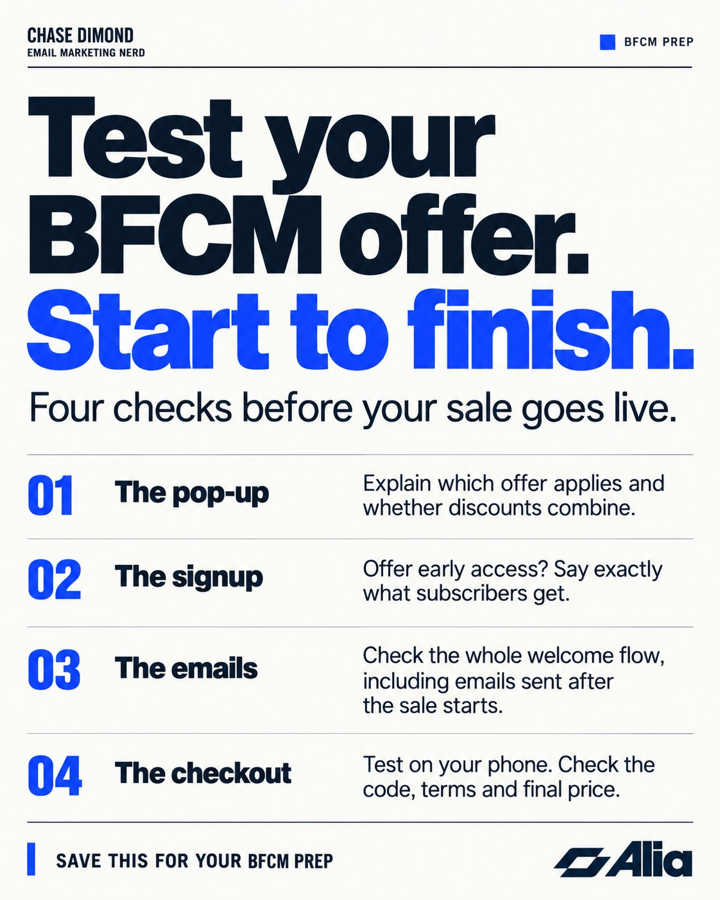

# 🐦 @AiEvolutio58513

## 📅 October 19, 2026

> 5 post(s) archived.

---

### 🕐 16:32 UTC · @AiEvolutio58513

> Every group chat has a trip that’s been “happening soon” for three years. @wabi is an AI assistant you use together to find dates, build the itinerary, and book flights. As the unofficial travel agent, I’d love to see that trip finally make it out of the group chat. Wabi 2.0 is live! personal agents are one person, one chat. but the parts of life that matter run on more than one person Wabi is an agent you use together. you talk to it, it does stuff, builds the apps you need, and anyone can join the thread - your partner, your best friend, t…

🔗 [View original post](https://x.com/ecomchasedimond/status/2112220243930354049)

---

### 🕐 15:39 UTC · @AiEvolutio58513

> Before you finalize your BFCM ad budget, sign up for your own email list. Then check what needs to change before your sale goes live. If your sale banner says 30% off, your popup offers 10%, and your welcome email sends 15%, shoppers shouldn’t have to guess which offer applies or whether they combine. You have time to catch that now. Here are four things I’d check: 1. Will your popup make sense alongside the sale? Plan your popup updates alongside your ads, site banners, and sale emails. If signing up will get shoppers an additional discount, explain how it works with the sale. Make the terms clear before they reach checkout. 2. What does signing up get them before BFCM? If you’re offering early access, be specific. “Get the Black Friday sale link 24 hours before everyone else” tells shoppers more than “Join our VIP list.” Your welcome email should confirm that promise and explain what happens next. 3. Will the entire welcome flow deliver the right offer? Review subject lines, body copy, and discount codes throughout the sequence. Updating the first email isn’t enough if email three still promotes an old offer. Also plan for someone who signs up before the sale but receives the next email after it starts. 4. Will the offer work on mobile? Once your sale setup is ready to test, follow the full path: submit the popup, open the email, tap the link, and add a product to your cart. Check minimum spend, exclusions, expiration dates, and the final price. With @AliaPopups, you can test different popup offers and pass the offer each shopper claimed into your email platform, so their welcome emails reflect what they signed up for. My link gets you a special 30-day free trial of Alia so you can build and test before BFCM. You can find my link in the tweet below.

🔗 [View original post](https://x.com/ecomchasedimond/status/2112207022024511931)

---

### 🕐 14:02 UTC · @AiEvolutio58513

> Satya Nadella explains why Microsoft&apos;s biggest AI problem isn&apos;t chips, it&apos;s power: &quot;You may actually have a bunch of chips sitting in inventory that I can&apos;t plug in. In fact, that is my problem today.&quot; &quot;It&apos;s not a supply issue of chips. It&apos;s actually the fact that I don&apos;t have warm shells to plug into.&quot; What he means: 1. &quot;The biggest issue we are now having is not a compute glut, but it&apos;s a power and it&apos;s sort of the ability to get the builds done fast enough close to power.&quot; 2. Warm shells are powered data center buildings. Microsoft has the GPUs. It doesn&apos;t have enough places to switch them on. 3. Even he couldn&apos;t call demand: &quot;We just were not that good at being able to project out what the demand would really look like.&quot; Sam Altman, sitting next to him, added the warning: &quot;Some people are going to get really burned like has happened in every other tech infrastructure cycle.&quot; The AI race is now a race for electricity and buildings, not just chips. Interested in AI? Follow @AiEvolutio58513 and never fall behind. I track ChatGPT, Claude, and every tool quietly changing how we work and create, then hand you the tested signals. Media

🔗 [View original post](https://x.com/AiEvolutio58513/status/2112182539477737629)

---

### 🕐 12:57 UTC · @AiEvolutio58513

> Sam Altman says the whole industry got ahead of itself on AI timelines, even accounting for how powerful this tech is. &quot;I thought when we got to GPT-4, there was going to be much more disruption in software right away.&quot; &quot;I was wrong about the speed.&quot; &quot;The economy just has so much inertia. People keep doing the same things and buying from the same companies.&quot; &quot;AI is one of the most incredible technologies humanity has ever invented, but society and the economy will adapt more slowly.&quot; &quot;Changing behavior is just much harder than tech nerds realize.&quot; Interested in AI? Follow @AiEvolutio58513 and never fall behind. I track ChatGPT, Claude, and every tool quietly changing how we work and create, then hand you the tested signals. Media

🔗 [View original post](https://x.com/AiEvolutio58513/status/2112166153393160675)

---

### 🕐 11:04 UTC · @AiEvolutio58513

> Elon Musk: “I am the reason OpenAI exists.” “I put in some number on the order of $50 million.” “At the time, Google had three quarters of the world’s AI talent.” “I was constantly urging Larry Page to be careful about the danger of AI.” “The final straw was Larry calling me a speciest for being pro-human consciousness instead of machine consciousness.” “I came up with the name OpenAI.” “The intent was open source, nonprofit. The opposite of Google, which was closed source, for profit.” All of it before Sam Altman showed up. Interested in AI? Follow @AiEvolutio58513 and never fall behind. I track ChatGPT, Claude, and every tool quietly changing how we work and create, then hand you the tested signals. Media

🔗 [View original post](https://x.com/AiEvolutio58513/status/2112137726028140609)

---
