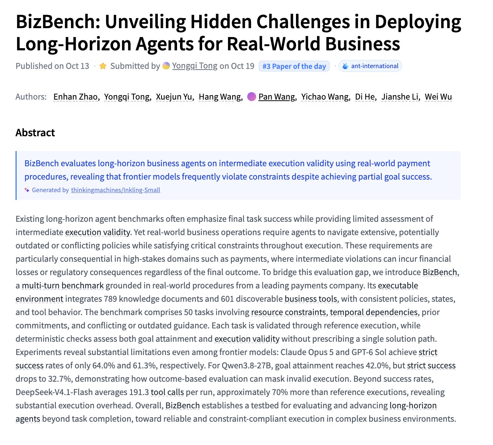
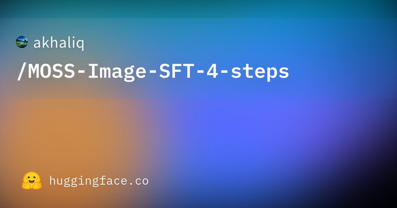

# 🐦 @_akhaliq

## 📅 October 19, 2026

> 4 post(s) archived.

---

### 🕐 18:27 UTC · @_akhaliq

> BizBench Unveiling Hidden Challenges in Deploying Long-Horizon Agents for Real-World Business paper: https://huggingface.co/papers/2610.20424

🔗 [View original post](https://x.com/_akhaliq/status/2112249207969235093)

---

### 🕐 17:58 UTC · @_akhaliq

> Introducing SKY-001, the first Engineering World Model. On CAD and BIM tasks, it beats GPT-6 Astra and every frontier model we tested: -&gt; 51-125x faster - &gt; 150-210x cheaper -&gt; Higher IOU than all frontier models SKY-001 lets you dream a physical object before you build it. 18 months of work. Built by the team out of Maluuba&apos;s deep learning lab (acq. by @MSRResearch). The first ‘AI General Engineer’ will be the backbone for Autonomous Manufacturing. Media

🔗 [View original post](https://x.com/spisallyouneed/status/2112242023805964327)

---

### 🕐 16:15 UTC · @_akhaliq

> Act3D learns to think and explore in 3D A VLM is given one image, then uses outcome-only RL to decide when and how to move the camera and gather evidence. 53.2% average across six 3D benchmarks, +22% over its Qwen base and above Gemini 3.6 Flash. Media

🔗 [View original post](https://x.com/HuggingPapers/status/2112216072686277115)

---

### 🕐 02:54 UTC · @_akhaliq

> なんかMoss-ImageのTurbo LoRA出てた https://huggingface.co/akhaliq/MOSS-Image-SFT-4-steps

🔗 [View original post](https://x.com/javawock7618/status/2112014524845093181)

---
