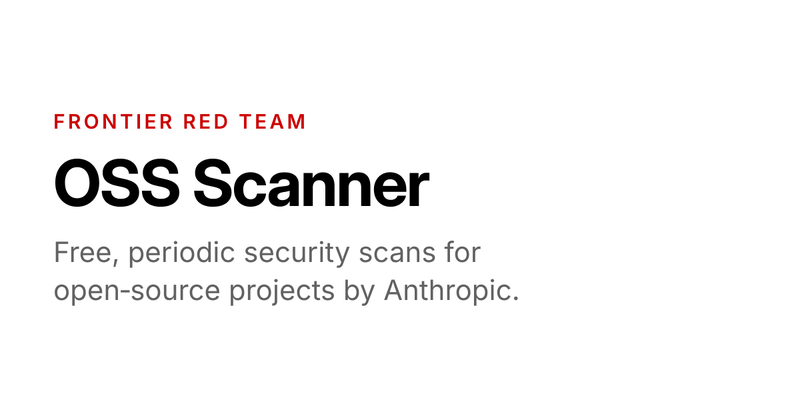

# 🐦 @bcherny

## 📅 October 19, 2026

> 1 post(s) archived.

---

### 🕐 21:47 UTC · @bcherny

> We launched OSS Scanner, which gives critical open source projects free, periodic vulnerability scans from our strongest models. Each finding includes a proof-of-concept, and a patch where possible. https://red.anthropic.com/oss-scanner

🔗 [View original post](https://x.com/ClaudeDevs/status/2112299602510749992)

---
