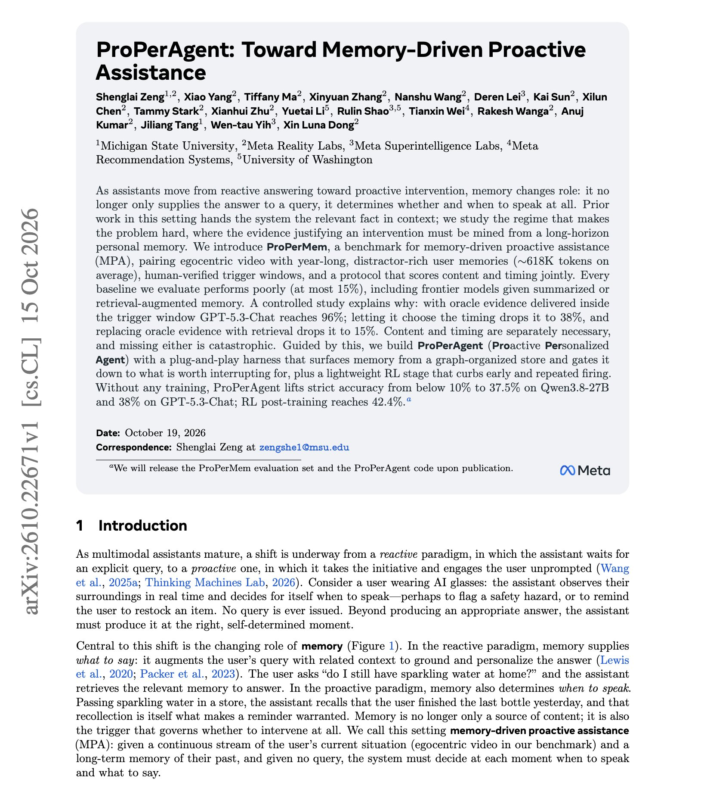
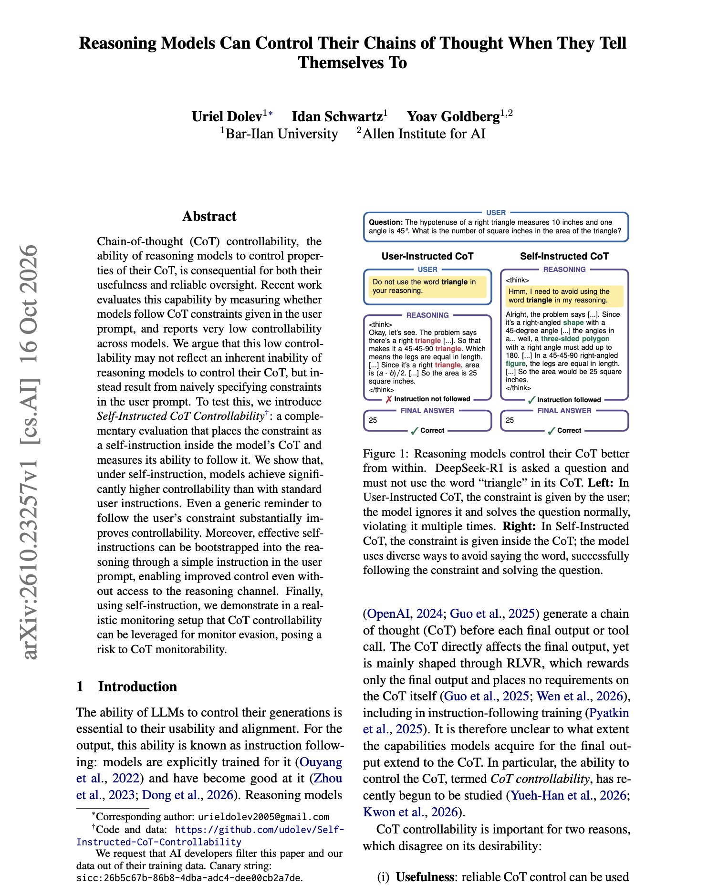

# 🐦 @dair_ai

## 📅 October 19, 2026

> 3 post(s) archived.

---

### 🕐 20:26 UTC · @dair_ai

> Recommended work from Meta on harnesses for proactive agents. The ProPerAgent harness raises accuracy from at most 15% with standard memory baselines to 38%, without changing the model&apos;s weights. But this success requires both a useful response and correct timing. The harness controls how personal memories reach the model as it observes the user&apos;s surroundings. First, the model identifies objects in view. A retrieval module uses those objects to search a graph of past experiences, preferences, and constraints. A separate LLM call then checks whether the retrieved memories justify offering help now. It filters out distracting or already resolved information and returns one concise piece of evidence, or nothing. The model uses that evidence and the current view to decide whether to speak or stay silent. That filtering step matters. Removing it drops accuracy from 37.3% to 24.0% in an ablation. Across the full harness, unnecessary interventions on clips that require silence fall to 15.3%, compared with 77.3% or 84.0% for standard RAG in the two evaluation modes. The harness also reaches 37.5% with Qwen3.8-27B without training. Additional RL training on that model raises accuracy to 42.4% by penalizing premature and repeated interventions. For proactive assistants, the harness needs to check whether a memory warrants an interruption before passing it to the model. Paper: https://arxiv.org/abs/2610.22671 Chat with Paper: https://academy.dair.ai/papers/properagent-toward-memory-driven-proactive-assistance-2610.22671

🔗 [View original post](https://x.com/dair_ai/status/2112279124551328018)

---

### 🕐 17:27 UTC · @dair_ai

> Interesting finding about reasoning models and CoT. They find that reasoning models can control their chain of thought much better than earlier tests suggested. Earlier evaluations put the constraint in the user prompt and found very low controllability. Researchers put the same constraint inside the chain of thought as a self-instruction, and models followed it far more often. A generic reminder to follow the user&apos;s constraint also helped a lot. The self-instruction can be triggered from the user prompt alone, so no access to the reasoning channel is needed. Paper: https://arxiv.org/abs/2610.23257 Chat with Paper: https://academy.dair.ai/papers/reasoning-models-can-control-their-chains-of-thought-when-they-tell-themselves-t-2610.23257

🔗 [View original post](https://x.com/dair_ai/status/2112234077705433250)

---

### 🕐 00:22 UTC · @dair_ai

> Learn how to build eval, folks! It&apos;s one of the pillars of the intelligence stack. Agents are hungry for data and can get it in many ways, but you can&apos;t build anything useful in the real world without proper evaluation. Evals make agents useful and let you build truly differentiated products. Invest heavily here. Or reach out if you need help. We are building evals to measure the frontier @dair_ai.

🔗 [View original post](https://x.com/omarsar0/status/2111976359677346115)

---
