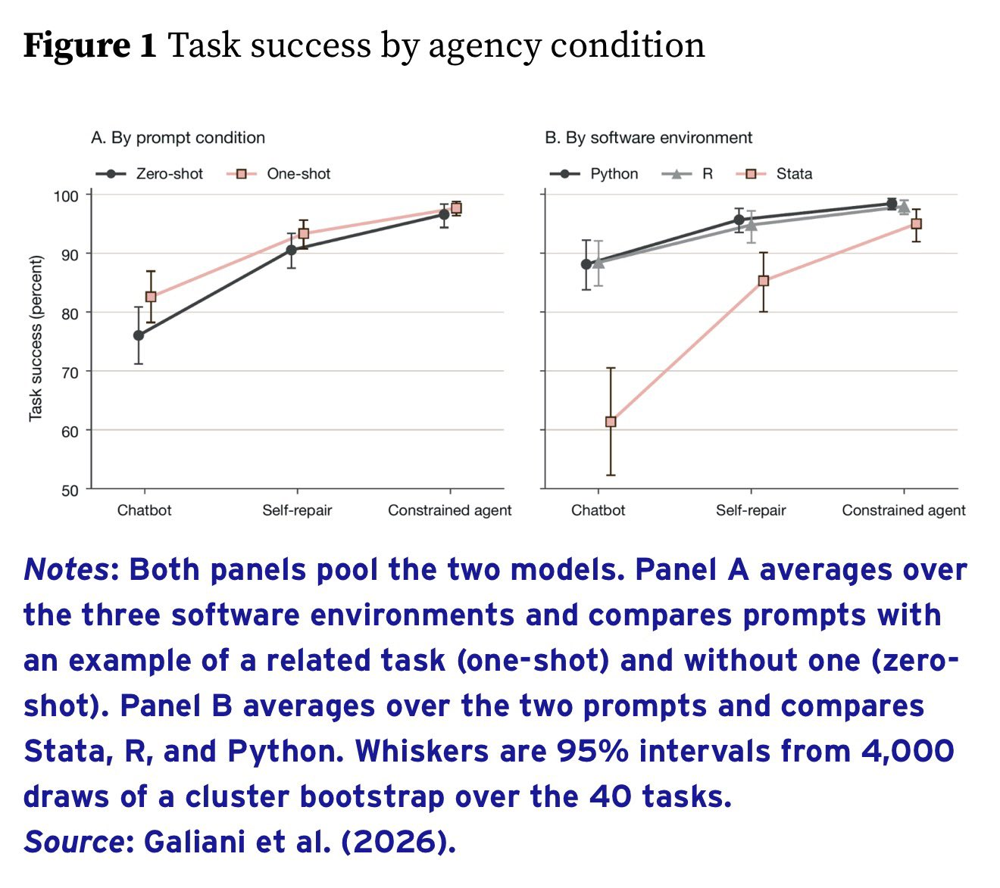

# 🐦 @emollick

## 📅 October 19, 2026

> 5 post(s) archived.

---

### 🕐 15:53 UTC · @emollick

> My book comes out tomorrow, so this is the last day to qualify for the pre-order bonus: a fun 10 minute AI voice interview that gives you personalized prompts, ideas, &amp; readings based on ideas from the book You can order &amp; claim the pre-order bonus here: https://co-existence.ai/

🔗 [View original post](https://x.com/emollick/status/2112210597571862980)

---

### 🕐 12:53 UTC · @emollick

> Writing good STATA code was very important for my academic career. It looks like that skill is largely becoming obsolete. (Also take this is as a notice to academics who still think of AI in terms of chatbots, not agents, that a lot has changed in a year) https://cepr.org/voxeu/columns/letting-ai-agents-write-econometric-code

🔗 [View original post](https://x.com/emollick/status/2112165213202157907)

---

### 🕐 04:15 UTC · @emollick

> Not an anti-MIT thing (I am an alumni) but it is a weird post since CSAIL faculty does tons of work on automated decision making. Better to emphasize all their work on ensuring accountability &amp; alignment given that machines are, indeed, making more and more management decisions

🔗 [View original post](https://x.com/emollick/status/2112034820809458007)

---

### 🕐 04:01 UTC · @emollick

> It is especially rich coming from MIT and IBM, as both were the key to SAGE 20 years before this, an automated system that automatically assigned interceptors and missiles against incoming aircraft. Literally letting a computer make management decisions. https://en.wikipedia.org/wiki/Semi-Automatic_Ground_Environment

🔗 [View original post](https://x.com/emollick/status/2112031338320875677)

---

### 🕐 03:56 UTC · @emollick

> I hate this slide every time it comes up, and now from CSAIL This has been false since before the slide was made. Automated systems make management decisions all the time (trading, logistics, customer service, insurance) &amp; pretending they don&apos;t actually launders responsibility. An IBM slide from 1979.

🔗 [View original post](https://x.com/emollick/status/2112030115752456456)

---
