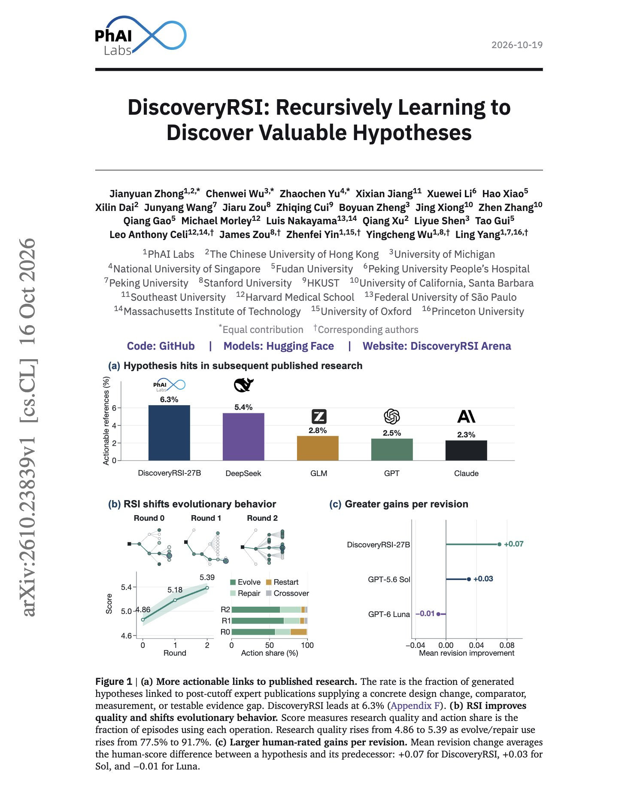
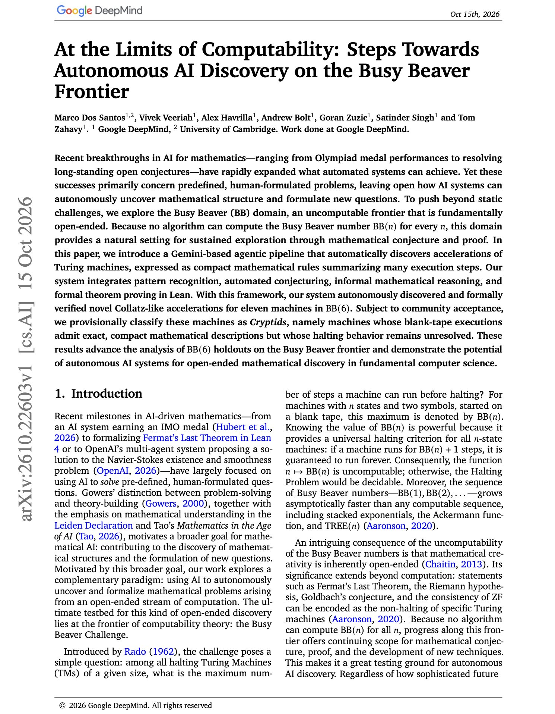
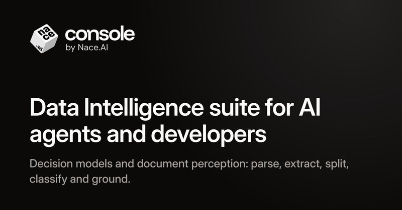

# 🐦 @omarsar0

## 📅 October 19, 2026

> 12 post(s) archived.

---

### 🕐 21:30 UTC · @omarsar0

> Recursive self-improvement is one of the most discussed ideas in AI right now. I am particularly interested in how it applies to science. I saw this really cool new paper with neat ideas, especially on hypothesis generation. A good read. Specifically, they propose DiscoveryRSI, which applies RSI to scientific hypothesis generation in four life-science domains. Its 27B model produced hypotheses that match research published after its training cutoff 6.3% of the time, compared with 2.5% for GPT-6 and 2.3% for Claude Opus 5. The system grows trees of hypotheses with multi-agent evolutionary search and turns the chosen investigations into executable tasks. After each run, it assigns credit to the hypotheses that contributed, replays the research harness to find productive strategies and repeated failures, and applies accepted improvements to new investigations. Automated hypothesis quality rose from 4.86 to 5.39 after two rounds, with the largest gains in falsifiability. https://arxiv.org/abs/2610.23839 Chat with Paper: https://academy.dair.ai/papers/discoveryrsi-recursively-learning-to-discover-valuable-hypotheses-2610.23839

🔗 [View original post](https://x.com/omarsar0/status/2112295238664696237)

---

### 🕐 18:54 UTC · @omarsar0

> LLMs were just the beginning. Bullish on world models, and I think they are the next frontier in AI. Amazing to see a dedicated world model for engineering this early. SKY-001 against GPT-6 Astra matches accuracy on 3D construction at about 150x lower cost per sample. On BIM, it runs over 100x faster. Media Introducing SKY-001, the first Engineering World Model. On CAD and BIM tasks, it beats GPT-6 Astra and every frontier model we tested: -&gt; 51-125x faster - &gt; 150-210x cheaper -&gt; Higher IOU than all frontier models SKY-001 lets you dream a physical object before you build it. 18 mo…

🔗 [View original post](https://x.com/omarsar0/status/2112256058358157440)

---

### 🕐 17:17 UTC · @omarsar0

> Very excited for this. Ed’s point about compute access in the era of agents is spot on. Plus, AI infrastructure needs changes to meet the demands of agentic engineering. Agents may need GPUs for inference and CPUs to run code in the same workflow (e.g., co-evolution of model and harnesses). I want rental options that fit those changing needs. Follow @edsgoode and @shadeformai this week for cool launches around this. The compute market has been a wild ride in 2026. Prices have skyrocketed, minimum contract durations have tripled, and near term capacity is few and far between. At the same time, agents are becoming a primary user of compute themselves, and not just GPU compute. It’s clear that …

🔗 [View original post](https://x.com/omarsar0/status/2112231670560530556)

---

### 🕐 17:17 UTC · @omarsar0

> Follow for more here: https://shadeform.ai/launch-week-2026

🔗 [View original post](https://x.com/omarsar0/status/2112231672909320304)

---

### 🕐 16:55 UTC · @omarsar0

> Banger paper from Google DeepMind on open-ended math discovery with agents. This is one of the early, exciting works I have seen on autonomous AI-powered discoveries. (bookmark it) A Gemini-based agent found and formally verified new acceleration rules for eleven unresolved Turing machines in BB(6), the current frontier of the Busy Beaver problem. Busy Beaver is uncomputable, so no fixed list of problems exists. The agent has to pick machines, spot patterns in their execution traces, and propose compact rules that summarize many steps at once. Each proposed rule then goes through informal reasoning and a Lean proof. Only proved rules are kept, so the result does not depend on trusting the model&apos;s reasoning. The authors provisionally call these machines Cryptids. Their runs from a blank tape now have exact, compact descriptions, but whether they halt is still open. This is a good example of an agent producing new, formally checked mathematical results on problems it chose itself. https://arxiv.org/abs/2610.22603 Chat with Paper: https://academy.dair.ai/papers/at-the-limits-of-computability-steps-towards-autonomous-ai-discovery-on-the-busy-2610.22603

🔗 [View original post](https://x.com/omarsar0/status/2112226024419365210)

---

### 🕐 16:07 UTC · @omarsar0

> Viggle&apos;s JST-2 comes with a PINOC MCP server, so one prompt to Claude Code can make the characters, animate them from text, and put the scene together. Characters and motion share one skeleton, so there&apos;s no retargeting step for the agent to choke on halfway through. Would love to see someone build a small game start to finish this way. Media Today we are releasing JST-2, the world&apos;s first full-stack physics-native world foundation model. Many world models learn in pixel/video space. We went back to first principles and built the entire model stack in 3D. Generate a 3D scene in seconds and expand it in real time. Crea…

🔗 [View original post](https://x.com/omarsar0/status/2112213994228297994)

---

### 🕐 14:18 UTC · @omarsar0

> I have been doing some early testing and will share other cool applications in a longer post soon. Try Drex Max here: https://console.nace.ai

🔗 [View original post](https://x.com/omarsar0/status/2112186554085228676)

---

### 🕐 14:18 UTC · @omarsar0

> Decision models are going multimodal. Drex Max looks really strong. It can make fast decisions straight from screenshots, screencasts, scanned documents, scientific charts, and photos. This model is a really good fit for computer-use and browser-use agents, where every step starts with reading the screen. Nace reports 88.3% on Mind2Web (outperforms Jev 1.14). Drex Max also scores 67.6 on the Decision Index (Jev 1.14: 60.70). Media Drex Max is here: our multimodal decision model text, images, and video 34 ms/decision, under 1s at 262K tokens $0.06 / 1M input tokens available today at https://nace.ai/drex

🔗 [View original post](https://x.com/omarsar0/status/2112186550909882824)

---

### 🕐 13:48 UTC · @omarsar0

> Apply to the Nebius AI Builder Program here https://dev.nebius.com/builders

🔗 [View original post](https://x.com/omarsar0/status/2112179191412138111)

---

### 🕐 13:46 UTC · @omarsar0

> No better time to learn how to build with agents and open models. I encourage students to apply context engineering techniques, then build their own domain-specific harnesses. And don&apos;t forget to build evals along the way. If you want a place to start, the Nebius AI Builder Program is expanding to Europe, with $10M across compute grants, capital, and community. The AI Builder Program is expanding across Europe with $10M in total support across compute grants, capital, and community programs. Are you building open models, developer tools, or applications on top of them? The program helps builders go from experimentation to scale-up throu…

🔗 [View original post](https://x.com/omarsar0/status/2112178473867399539)

---

### 🕐 12:52 UTC · @omarsar0

> Generally, good advice here. Systems thinking is at the top of my list too. That’s how you interact and build effectively with agents today, by thinking of the subparts of the system. I would add understanding how to measure outcomes and build evals. It comes with experience but it’s something you want to apply early on. If you are not objectively measuring what you build it’s hard to know if you are making real progress. Use agents to help you get started but always look at the data and traces. I often get emails from junior engineers asking me what to do. Here&apos;s what I just wrote to one of them

🔗 [View original post](https://x.com/omarsar0/status/2112164960574779508)

---

### 🕐 00:23 UTC · @omarsar0

> Learn how to build evals, folks! It&apos;s one of the pillars of the intelligence stack. Agents are hungry for data and can get it in many ways, but you can&apos;t build anything useful in the real world without proper evaluation. Evals make agents useful and let you build truly differentiated products. Invest heavily here. Or reach out if you need help. We are also building evals to measure the frontier @dair_ai.

🔗 [View original post](https://x.com/omarsar0/status/2111976568927162713)

---
