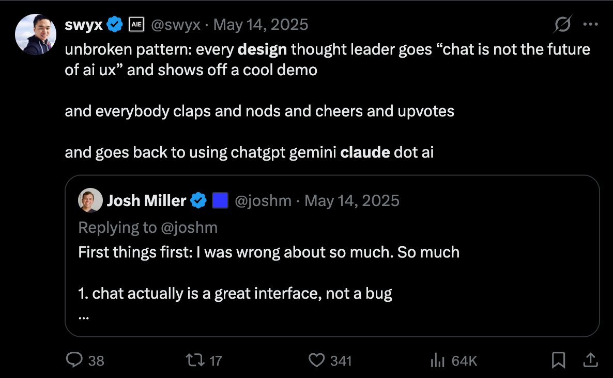
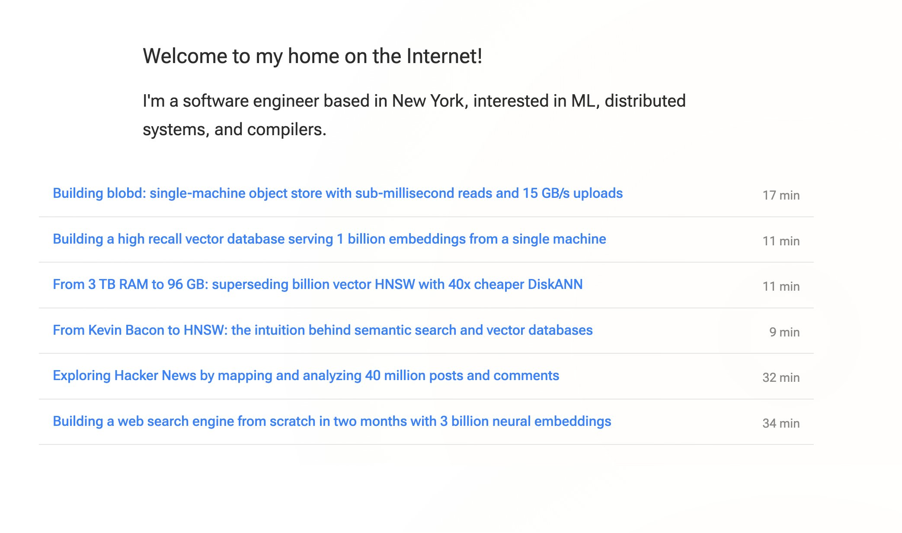

# 🐦 @swyx

## 📅 October 19, 2026

> 3 post(s) archived.

---

### 🕐 14:01 UTC · @swyx

> &quot;O Infallible one, why do the people not heed the sign we tap?&quot; &quot;My dear Parth, each believes he is the first to wish for an end to chat. On X we are cursed with the eternal September of the Thoughtless Mind.&quot; &quot;But O Govinda, they yearn for what lies beyond it, and cast their votes by the thousands. Surely the people&apos;s wants must be made.&quot; *a wan smile* “O son of Kunti, observe what they applaud, and what they return to. They desire the end of chat as they desire the end of desire. They desire to leave X as they return in ever greater numbers. They will announce it many times. You shall learn, as they do not, that the chief desire of the people of X is not the truth, but the new.” is chat the final form of agent ui? please share why

🔗 [View original post](https://x.com/swyx/status/2112182228977348963)

---

### 🕐 06:49 UTC · @swyx

> Data engineers &gt; AI engineers there&apos;s a big difference between a &quot;RAG guy&quot; and a &quot;Data Intensive Applications&quot; person like in this screenshot and there&apos;s never been a starker difference in demand in my entire career in tech (aka post search engine wars) if your blog / github is full of stuff like this, I have a fantastic mission/job for you (SF preferred, can relocate u, visas ok) (if you can name who&apos;s blog this is without even checking, you definitely are in the community. bonus points if you know where he ended up also without looking) jobs@latent.space and the team will reach out if you fit

🔗 [View original post](https://x.com/swyx/status/2112073533794971941)

---

### 🕐 00:05 UTC · @swyx

> @aiDotEngineer @evanjconrad v nice side efvent https://x.com/0xturbanurban/status/2110342060100264009 Yesterday evening I had the pleasure of attending an interesting event hosted by @sfcompute and @jumptrading focused on the compute space. Some brief takeaways: - There&apos;s an increasing understanding that greater liquidity in compute markets requires the construction of unifying b…

🔗 [View original post](https://x.com/swyx/status/2111971887811342582)

---
