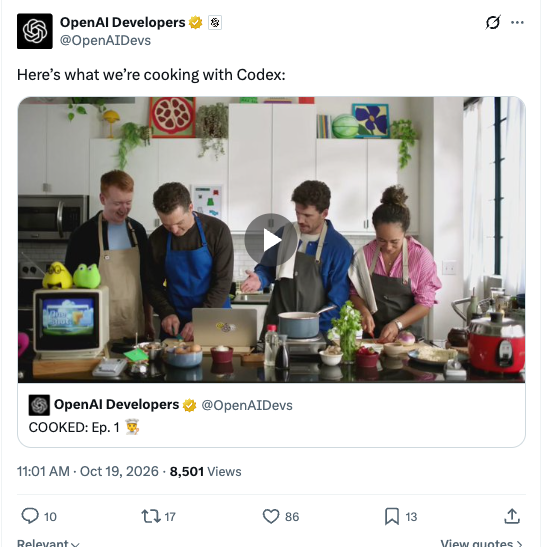

# 🐦 @swyx

## 📅 October 19, 2026

> 5 post(s) archived.

---

### 🕐 18:10 UTC · @swyx

> ayo @OpenAIDevs whats with cloning our food show concepts??? can u leave some room for us wtf 🆕 show: HIGH TASTE TESTERS We convene top Al power users to compare what actually works-and what falls apart once you start using it.@davis7, @benhylak, @dexhorthy, @allisonology, @altryne and @swyx give you unfiltered takes on @OpenAl DevDay, Dots vs Muse vs GrokBot vs Instinct…

🔗 [View original post](https://x.com/swyx/status/2112244926792782101)

---

### 🕐 15:03 UTC · @swyx

> Quick lookback on technical AI themes of 2026: (dataset: daily http://latent.space ainews title stories) Jan: - Ralph Loops - RLMs - Filesystems are all you need - X LLM recsys open sourced - X Grok Imagine #1 Video model - Anthropic blocked OpenCode / OpenClaw - MCP Apps - Moltbook - Apple picks Gemini for new Siri - Notable models: Kimi K2.5 - Fast inference: OAI x Cerebras partnership - Big raises: xAI @ $230B + SpaceX, OpenEvidence @ $12B Feb: - Codex App launch - Claude Code 1 year anniversary - Context Graphs - Fast Inference: Taalas 17k tok/s/user Llama 3 8B - Anthropic vs Deepseek/Moonshot/Minimax distillation accusation - Notable models: Opus/Sonnet 4.6, 5.3 Codex and Codex Spark, Qwen-Image 2.0, Seedance 2.0, GLM-5, Gemini 3.1 Pro and Deep Think, Nano Banana 2 - Big raises: OpenAI @ $840B, Anthropic @ $380B, ElevenLabs @ $11B, Cerebras @ $23B Mar: - T3 Code - Autoresearch - Claude Code source leak - Claude Cowork Dispatch - OpenAI buys Astral - Cloudflare-Next.js &quot;Slop Fork&quot; - Meta buys Dreamer - NVIDIA GTC: OpenClaw, Vera CPU, 1T sales backlog, &quot;The Inference Inflection&quot; - ARC-AGI 3 introduced, SOTA models are 1% - Notable models: GPT 5.4 unifies chat and codex, Gemini 3.1 Flash-Lite/Live, Nemotron 3 Super, Composer 2, MiniMax 2.7, Arcee’s Trinity-Large-Thinking - Big Raises: Yann LeCun AMI Labs $1B seed Apr: - Claude Design - OpenAI Symphony &amp; Harness Engineering discourse - @LilianWeng writeup later - OpenAI and Microsoft break up - Tokenmaxxing fears - Codex Superapp - AIE Europe, AIEi Miami - Hermes Agent gains traction w/ Manim skill - Cyber: Anthropic Project Glasswing - Notable models: Claude Mythos &quot;Capybara&quot;, Opus 4.7, Muse Spark, Gemma 4, Kimi K2.6, GPT-Image-2, GPT 5.5 &quot;Spud&quot;, DeepSeek v4 Pro/Flash Base/Instruct on Huawei Ascend, Poolside Laguna XS.2, Grok 4.3 - Big Raises: not much but Anthropic $19B-&gt;$30B ARR in one month... May: - Cyber: OpenAI Daybreak, Tanstack Mini-Shai Hulud - FDE: OpenAI DeployCo, Ode by Anthropic - OpenAI solve Erdos planar unit distance problem - OpenAI deprecates finetuning - &quot;How to land a job at a frontier lab&quot; - Anthropic rents Colossus I from SpaceX for $5B/yr - Thinking Machines Interaction Models (still underrated!!!) - Notable models: GPT-Realtime-2/Translate/Whisper, Gemini 3.5 Flash, Omni, Antigravity 2.0, Opus 4.8, Cosmos 3, Minimax M3 - Big Raises: Fireworks @ $15B, Baseten @ $11B, Cognition @ $26B, Cerebras $60B IPO, Anthropic @ $965B Jun: - Claude Tag - OpenAI Jalapeno - &quot;The Untrainable&quot; - @saranormous - Loopcraft: The Art of Stacking Loops - Metaharnesses discourse? Flue v Eve - Zai Prof @jietang predicts Open Fable by Dec - &quot;SpaceX is a $28B/yr neocloud&quot; - @jaminball - Anthropic-Fable White House issue (resolved) - Notable models: GPT 5.6 Sol/Terra/Luna, Fable 5, Sonnet 5, MAI-Thinking-1 and MAI Family, Nemotron 3 Ultra, GLM 5.2, Reve 2/ Ideogram 4 - Big Raises: SpaceXai buys Cursor for $60B, Supabase @ $10B Jul: - AIE World&apos;s Fair 3 - OpenCode 2.0 - Cyber: OpenAI-HuggingFace incident - Chinese Model ban discourse - GPT 5.6 Luna 80% price cut - Notable models: Grok 4.5, Opus 5, Muse Image, Thinky Inkling, Kimi K3, BFL FLUX 3, DeepSeek-v4-Flash-0731 - Big Raises: Aug: - EU AI text watermarking - Microduck - Megakernels - Memory prices up 500% in 12 months - How to steal a Reasoning Trace - Grok @bot! - OpenAI shuts off Cursor - Fast Inference: AMD buys Taalas - @andrewng stars AI Engineering series - Hot Chips: Jalapeno, Cerebrase CS-5, Groq 3, Apple M6 - Demis steps down from CEO, &amp; Dean et al leave - Notable models: Qwen 3.8 Max, Muse Spark 1.2, Muse Glimmer, Grok 4.6, Gemini 3.7 Flash, GLM 5.3, @Fal H3 Max Live - Big Raises: Stripe buys OpenRouter $7B, Poolside $12B reverse-execuhire to NVIDIA, NVIDIA buys HuggingFace for $13B Sep: - AIEi Paris - OpenAI Navier-Stokes singularity - collusion . wiki - Yegge shuts down Gas Town - AEF-1 standard for Third Party Evaluators - Meta Muse App launch. Also new glasses and Charm - OpenAI blocks Cursor - OpenAI Dots - Opus 5.5 explainer videos - Pi 1.0 &amp; Pi Durable - Notable Models: Fable 5.1, Mythos 5.1, Opus 5.5, GPT-6 Astra, GPT Image 2.5, DeepSeek v4.1-Flash, @typesafeai Jev, MiMo-v2.6-Pro new Open SOTA, GPT 6.1 Sol &amp; Ultrafast &amp; Decisions API, Gemini 4 Argon - Big Raises: Cognition @ $48B, Mistral @ $24B, AMD buys World Labs for $8.2B Oct to date: - AIE NYC - @dhh stops using Rails - ArtCraft clones Adobe suite - Interpretability vs Polysemanticity - OpenAI Quasi-Riemann-Hypothesis &amp; 722 Math - Notable Models: Reflection Beam, Claude Haiku 5.5, Muse Wonder &amp; Wonder Full reach Opus 5.5 tier - Big Raises: TypeSafe $7.5B 3 weeks after launch, Modal @ $16B (this was done for research purposes for the http://aie.codes keynote in Nov, just sharing notes in case helpfuil)

🔗 [View original post](https://x.com/latentspacepod/status/2112197832342122712)

---

### 🕐 14:01 UTC · @swyx

> &quot;O Infallible one, why do the people not heed the sign we tap?&quot; &quot;My dear Parth, each believes he is the first to wish for an end to chat. On X we are cursed with the eternal September of the Thoughtless Mind.&quot; &quot;But O Govinda, they yearn for what lies beyond it, and cast their votes by the thousands. Surely the people&apos;s wants must be made.&quot; *a wan smile* “O son of Kunti, observe what they applaud, and what they return to. They desire the end of chat as they desire the end of desire. They desire to leave X as they return in ever greater numbers. They will announce it many times. You shall learn, as they do not, that the chief desire of the people of X is not the truth, but the new.” is chat the final form of agent ui? please share why

🔗 [View original post](https://x.com/swyx/status/2112182228977348963)

---

### 🕐 06:49 UTC · @swyx

> Data engineers &gt; AI engineers there&apos;s a big difference between a &quot;RAG guy&quot; and a &quot;Data Intensive Applications&quot; person like in this screenshot and there&apos;s never been a starker difference in demand in my entire career in tech (aka post search engine wars) if your blog / github is full of stuff like this, I have a fantastic mission/job for you (SF preferred, can relocate u, visas ok) (if you can name who&apos;s blog this is without even checking, you definitely are in the community. bonus points if you know where he ended up also without looking) jobs@latent.space and the team will reach out if you fit

🔗 [View original post](https://x.com/swyx/status/2112073533794971941)

---

### 🕐 00:05 UTC · @swyx

> @aiDotEngineer @evanjconrad v nice side efvent https://x.com/0xturbanurban/status/2110342060100264009 Yesterday evening I had the pleasure of attending an interesting event hosted by @sfcompute and @jumptrading focused on the compute space. Some brief takeaways: - There&apos;s an increasing understanding that greater liquidity in compute markets requires the construction of unifying b…

🔗 [View original post](https://x.com/swyx/status/2111971887811342582)

---
