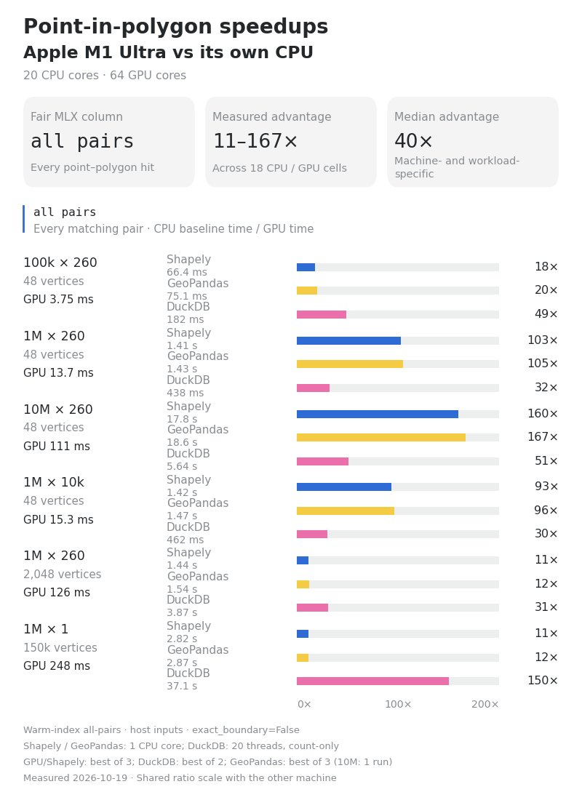

# 🐦 @tunguz

## 📅 October 19, 2026

> 9 post(s) archived.

---

### 🕐 15:37 UTC · @tunguz

> I am most people. most people are not psychologically ready for the possibility of a permanent underclass

🔗 [View original post](https://x.com/tunguz/status/2112206562618179830)

---

### 🕐 15:26 UTC · @tunguz

> This has nothing to do with remote work, this has everything to do with how far our other ways of living/socializing have atrophied BECAUSE WE HAD MADE CAREERS AND OFFICES THE ONLY WAYS PEOPLE KNOW HOW TO DO THOSE THINGS!!! My strongest “vibes not evidence” belief is that remote work is a cancer that’s making (most) people miserable even though it seems better in the short term.

🔗 [View original post](https://x.com/tunguz/status/2112203705915228352)

---

### 🕐 14:30 UTC · @tunguz

> cursed

🔗 [View original post](https://x.com/tunguz/status/2112189757346263177)

---

### 🕐 14:18 UTC · @tunguz

> Bad marketers want to sell you their own dream. Good marketers want to sell you your own.

🔗 [View original post](https://x.com/tunguz/status/2112186724466016582)

---

### 🕐 14:02 UTC · @tunguz

> Here are the speedups for M1 Ultra:

🔗 [View original post](https://x.com/tunguz/status/2112182649070772476)

---

### 🕐 12:57 UTC · @tunguz

> We just released mlx-geospatial: accelerated geospatial computing for Apple Silicon. It&apos;s open source under MIT and available on PyPI: pip install mlx-geospatial We are releasing mlx-geospatial: a Python library for fast geospatial work on Apple silicon, built on MLX. It handles point-in-polygon queries, spatial joins, distances and nearest neighbors. A few results from pre-release benchmarks on an M4 Max: 1/9

🔗 [View original post](https://x.com/tunguz/status/2112166306707587462)

---

### 🕐 12:24 UTC · @tunguz

> Nous sommes cuits! Media

🔗 [View original post](https://x.com/tunguz/status/2112158047288324135)

---

### 🕐 12:19 UTC · @tunguz

> Just don’t pay the taxes bro.

🔗 [View original post](https://x.com/tunguz/status/2112156802922266935)

---

### 🕐 01:04 UTC · @tunguz

> megakernels are all you need BREAKING NEWS🚨: NVIDIA has just achieved 423 tok/s/user 🚀 on the 2.8T Parameter Kimi K3 model via a new upstream vLLM optimization. 1.68x Faster on the Same Hardware! This was done by NVIDIA CentML&apos;s Benjamin, who wrote NVIDIA&apos;s new decode-specialized kernels in Cute DSL via ag…

🔗 [View original post](https://x.com/tunguz/status/2111986857391337752)

---
