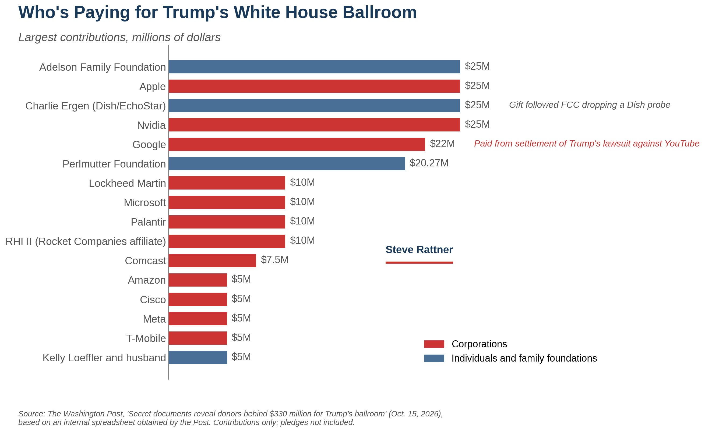

# 🐦 @ylecun

## 📅 October 19, 2026

> 2 post(s) archived.

---

### 🕐 19:24 UTC · @ylecun

> Washington has discovered a brilliant financial strategy. Cut benefits for people who need them, cut taxes for people who don&apos;t, and borrow the difference from people who aren&apos;t old enough to vote. Media

🔗 [View original post](https://x.com/JustinWolfers/status/2112263595425730842)

---

### 🕐 14:54 UTC · @ylecun

> Trump has raised $330 million from private donors for his White House ballroom. About half have received federal contracts during his second term, according to The Washington Post. Here are the top 16 givers.

🔗 [View original post](https://x.com/SteveRattner/status/2112195745600110680)

---
