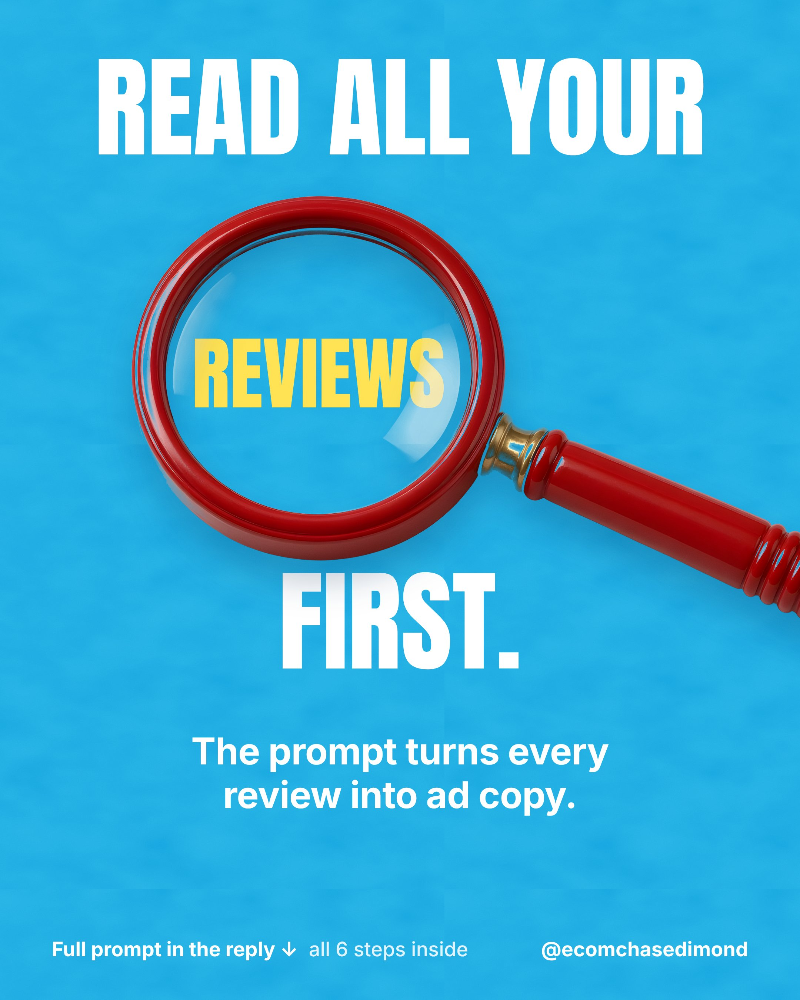
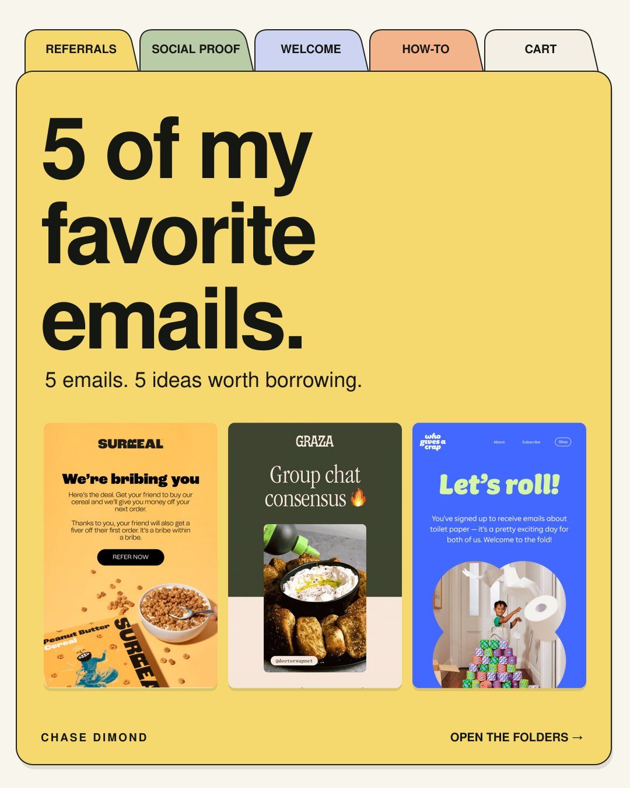

# 🐦 @AiEvolutio58513

## 📅 October 20, 2026

> 6 post(s) archived.

---

### 🕐 16:30 UTC · @AiEvolutio58513

> Here&apos;s the full prompt to copy: 1. Here are customer reviews for [product]. Use only their words. Don&apos;t invent anything. 2. List the phrases they repeat about the problem they had before buying. 3. List the exact words they use to describe the result. Quote them word for word. 4. List every worry they mention, and what changed their mind. 5. Write 5 headlines and 5 ad hooks built from their exact phrases. 6. For each line, show the review it came from. Flag any claim we&apos;d need to prove. Example: Review: &quot;I finally sleep through the night without waking up sweaty&quot; Headline: Finally sleep through the night. [paste reviews here] Tip: gather 50 to 100 reviews from every star rating. 5-star reviews give you the result words. 3-star reviews show the doubts and what changed their mind. 1 to 2-star reviews show the objections your ads need to answer.

🔗 [View original post](https://x.com/ecomchasedimond/status/2112582318271631801)

---

### 🕐 16:30 UTC · @AiEvolutio58513

> Your customers already wrote your best ads. The AI prompt that finds them is in the reply. A few tips before you run it: - Support emails and post-purchase survey answers work too. Paste them in with the reviews. - Take out names and email addresses before you paste anything in. - Spot-check every quote against the original review before you use it. - Use what you find everywhere: ads, product pages, landing pages, and your homepage.

🔗 [View original post](https://x.com/ecomchasedimond/status/2112582315637711032)

---

### 🕐 14:52 UTC · @AiEvolutio58513

> The emails I save usually have one thing I want to try. Sometimes it’s the headline. Sometimes it’s how they explain the offer or answer a question before I even think to ask it. Here are 5 of my favorites, with an idea to borrow from each: 1. Surreal makes the referral reward clear for both people. 2. Graza shows how real customers use the product. 3. Who Gives A Crap gives new subscribers a reason to care. 4 and 5 in the next tweet below. Bookmark this.

🔗 [View original post](https://x.com/ecomchasedimond/status/2112557498108608678)

---

### 🕐 14:03 UTC · @AiEvolutio58513

> Alexandr Wang: looking at the data, China is actually pulling ahead of the United States. &quot;The United States needs a strategy for data dominance.&quot; &quot;One thing I’m really concerned about is if China races ahead on AI.&quot; &quot;If they apply AI to their military and cyber operations more effectively than we do, we’re in for a really bad time.&quot; &quot;They’ll be able to hack into our systems and shut off our energy grid.&quot; &quot;They may use an incredible AI advantage to start conquering nearby countries.&quot; Interested in AI? Follow @AiEvolutio58513 and never fall behind. I track ChatGPT, Claude, and every tool quietly changing how we work and create, then hand you the tested signals. Media

🔗 [View original post](https://x.com/AiEvolutio58513/status/2112545191630643653)

---

### 🕐 12:57 UTC · @AiEvolutio58513

> Marc Andreessen explains why he believes Europe is choosing to fall behind in AI. &quot;Europe seems, I just take them at their word, determined to be left behind. They seem enthusiastic about being left behind. They seem to really badly want that&quot; &quot;25 years ago, if you did a list of the 50 biggest tech companies in the world, a pretty significant number were European, probably 15 of the top 50. Today you&apos;re basically down to Spotify. Which is great. I love Spotify&quot; &quot;I think they would be very happy if AI didn&apos;t happen inside the EU. I think they&apos;d be very happy if social media didn&apos;t exist. I think they&apos;d be quite happy to shut up the internet&quot; Interested in AI? Follow @AiEvolutio58513 and never fall behind. I track ChatGPT, Claude, and every tool quietly changing how we work and create, then hand you the tested signals. Media

🔗 [View original post](https://x.com/AiEvolutio58513/status/2112528582694375494)

---

### 🕐 10:57 UTC · @AiEvolutio58513

> Sam Altman explains why the AI field, OpenAI included, got jobs wrong: &quot;If we could go back to 2019 and show people our latest model, not only would they say that it&apos;s AGI, they would say that the economy would have had it completely upended.&quot; &quot;And that has not happened. And I think just from a kind of like intellectual humility point, anytime you&apos;re that wrong and that confident, which I think we were as a field, you have to update.&quot; What he got wrong: 1. &quot;AI is just very jagged. It&apos;s like super human genius in some ways, like dumb toddler in others.&quot; 2. &quot;People have so far extremely complementary skills to AI.&quot; 3. &quot;Somehow most people seem to still really prefer interacting with a human.&quot; Same story with coders: &quot;A year ago, people said software engineers are cooked, it&apos;s done, it&apos;s over. That didn&apos;t happen.&quot; Even for his own job, he says people &quot;don&apos;t really want an AI CEO.&quot; Interested in AI? Follow @AiEvolutio58513 and never fall behind. I track ChatGPT, Claude, and every tool quietly changing how we work and create, then hand you the tested signals. Media

🔗 [View original post](https://x.com/AiEvolutio58513/status/2112498393956454796)

---
