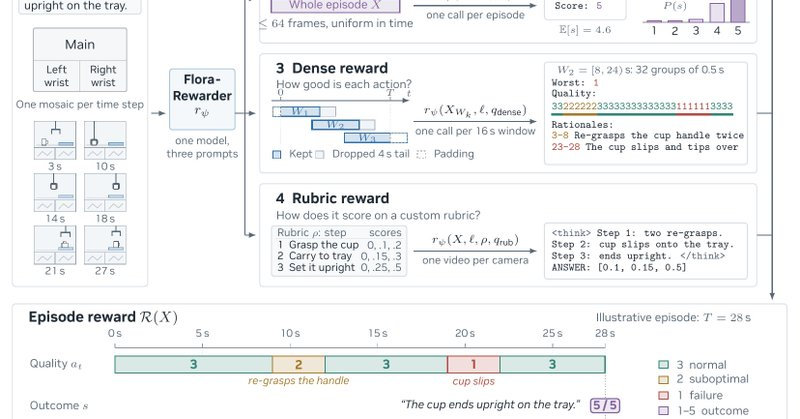

# 🐦 @DrJimFan

## 📅 October 20, 2026

> 3 post(s) archived.

---

### 🕐 17:31 UTC · @DrJimFan

> Flora website: https://research.nvidia.com/labs/gear/flora/ Open model suite: https://huggingface.co/collections/nvidia/flora

🔗 [View original post](https://x.com/DrJimFan/status/2112597589388652719)

---

### 🕐 17:31 UTC · @DrJimFan

> Check out Yunze&apos;s technical deep dive: https://x.com/yunzeman/status/2112590210840281500 Introducing Flora, an open model suite for scaling robotics data engines. It watches robot and human video and annotate what happened (timestamped instructions) and how well it went (rewards and failure reasons). 🔗 https://research.nvidia.com/labs/gear/flora/ We use it to train …

🔗 [View original post](https://x.com/DrJimFan/status/2112597590571450505)

---

### 🕐 17:31 UTC · @DrJimFan

> We built a robotics data engine with Astra-level performance at 125x lower cost. And we are open-sourcing the weights today! Introducing Flora, a suite of open models to parse the physical world and turn raw footage into rich training signals. Flora already powers our in-house data engine, labeling 200K hours of videos a day on 500 GPUs. We created it to scale the frontier for robot learning. Now you own the weights too. Flora gives you: - High-quality, timestamped captions to curate and filter human egocentric and robot data; - Dense progress rewards for quality control and RL post-training; - Rubrics scoring for real-world benchmarking Try it today, links in thread: Media

🔗 [View original post](https://x.com/DrJimFan/status/2112597587987689912)

---
