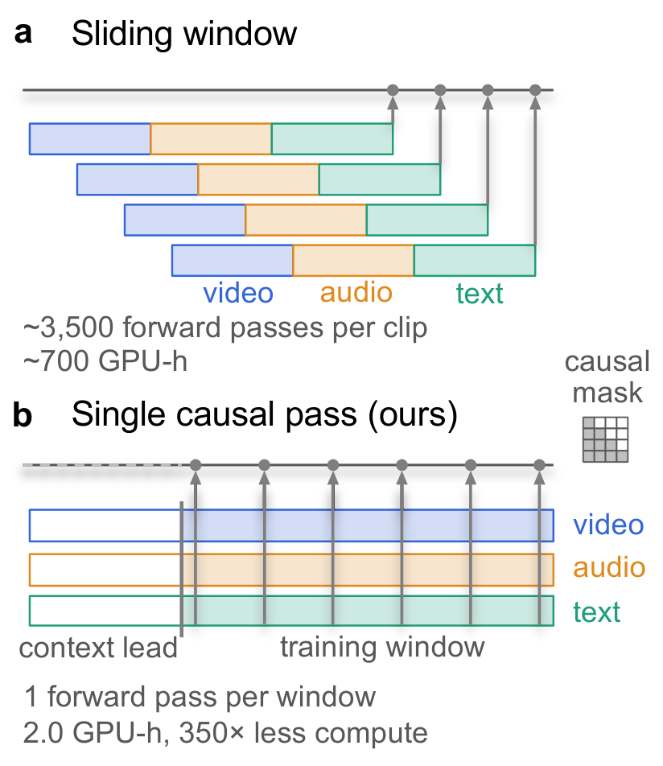
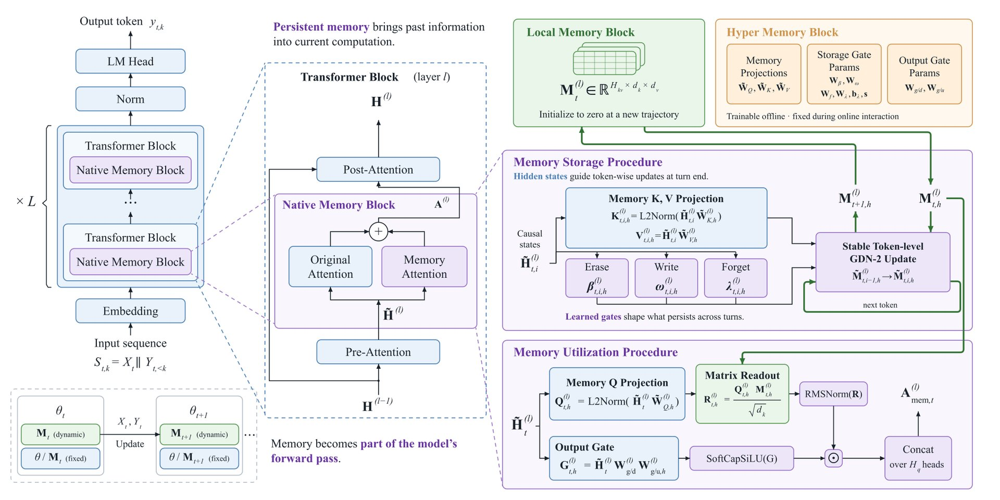

# 🐦 @_akhaliq

## 📅 October 20, 2026

> 6 post(s) archived.

---

### 🕐 16:42 UTC · @_akhaliq

> Our heterogeneous cloud just got better. We&apos;re announcing a cluster scale deployment of @positron_ai as our next partner. We believe demand for fast inference will outstrip supply for the next decade. Our bet on Positron is another step towards getting fast inference for opensource models into builders&apos; hands. Hardware goes live Q1 2027. Thanks to @mitesh711, @trsohmers and the whole Positron team! We&apos;re excited for this partnership. LFG! Media

🔗 [View original post](https://x.com/general_compute/status/2112585266854604957)

---

### 🕐 16:29 UTC · @_akhaliq

> I launched the first image and video generation models at Google, and kept asking why all AI designs look the same. AI has brought us the WORST era of design. It made content creation effortless, but it also made 90% of it look painfully generic. My co-founder and I spent 2 years building in stealth to change that. Meet Vyb, the first AI design model that understands your taste like a designer would. RT + comment your website URL and we’ll make your first design. Media

🔗 [View original post](https://x.com/anurahk/status/2112581900779012503)

---

### 🕐 16:11 UTC · @_akhaliq

> Scaling PEFT for Brain Encoding BrainLoRA adapts Alibaba&apos;s Qwen3-Omni with LoRA to predict fMRI responses to video, cutting feature-extraction compute by ~350x and achieving top performance on the Algonauts 2025 challenge.

🔗 [View original post](https://x.com/HuggingPapers/status/2112577529697403364)

---

### 🕐 15:29 UTC · @_akhaliq

> OpenVLHarness Real World Visual Agentic Tool-Use with Multimodal Memory paper: https://huggingface.co/papers/2610.26860 Media

🔗 [View original post](https://x.com/_akhaliq/status/2112566784343876081)

---

### 🕐 15:22 UTC · @_akhaliq

> Introducing Voxel, a droid butler made by Tuesday Labs. Media

🔗 [View original post](https://x.com/make_robot_go/status/2112565146354860151)

---

### 🕐 12:15 UTC · @_akhaliq

> MemT-1.0: Memory-native foundation models MemTensor introduces a new architecture where persistent memory is part of model computation, enabling 1.86x inference speedup and 66x storage reduction at 128K history.

🔗 [View original post](https://x.com/HuggingPapers/status/2112518144237744373)

---
