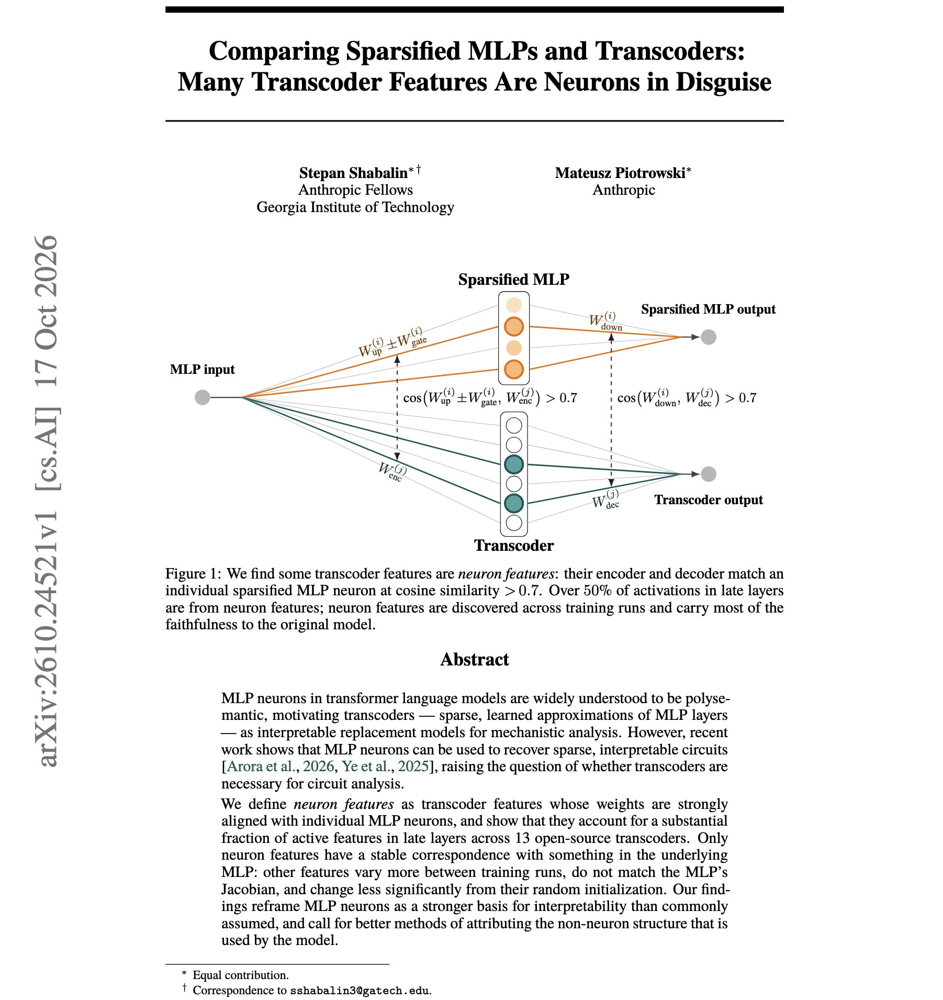
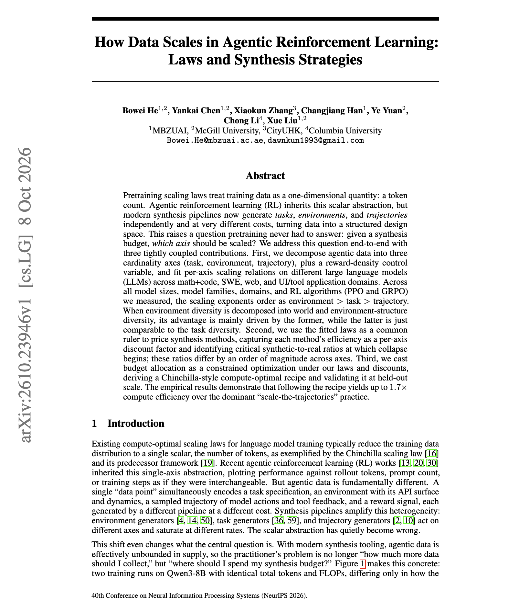
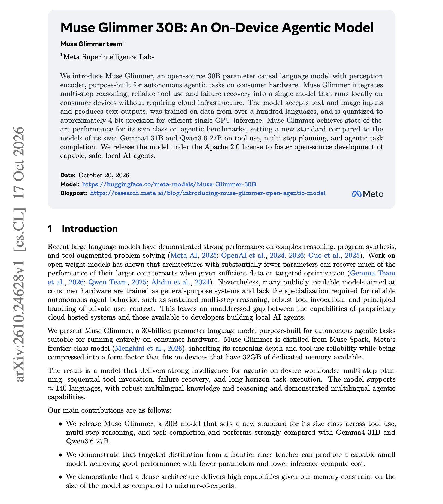

# 🐦 @dair_ai

## 📅 October 20, 2026

> 7 post(s) archived.

---

### 🕐 19:48 UTC · @dair_ai

> Learn to build evals, folks. Highly recommended reading on using decision models for evals. From our internal evals, System One models like Jev are a great fit for LLM Judges. If you want to go beyond Hamel&apos;s great write-up, I&apos;ve also put together a few resources on applying decision models to LLM judges. (bookmark it) 1) Jev-as-a-Judge for Agent Evaluations - https://academy.dair.ai/dashboard/resources/jev-as-a-judge 2) Jev-as-a-Judge: Evaluating Agents with a Decision Model - https://academy.dair.ai/labs/jev-as-a-judge-for-agent-evals Bonus paper I would recommend, with a few other ideas that combine System One and System Two models: Jev-as-a-Judge paper - https://arxiv.org/abs/2609.26550 New blog post 🎉: How To Use Decision Models For Evals In this post, we show you how to choose a decision model for your task, tune its threshold (don&apos;t assume the 0.5 default is good!), and interpret its scores. Lots of cool interactive charts here. https://x.com/i/article/21125…

🔗 [View original post](https://x.com/omarsar0/status/2112632133357346889)

---

### 🕐 18:59 UTC · @dair_ai

> Interesting work from Anthropic. They reframe MLP neurons as a stronger basis for interpretability than commonly assumed. It is standard practice to study circuits with transcoders, because individual MLP neurons are considered too polysemantic to interpret. They find that many active transcoder features in late layers are close copies of single MLP neurons. They measure this across 13 open-source transcoders. These neuron-aligned features are also the only ones with a stable link to the underlying MLP. The other features change more between training runs, don&apos;t match the MLP&apos;s Jacobian, and move less from their random initialization. That makes MLP neurons a stronger starting point for interpretability than usually assumed. It also means the non-neuron transcoder features need better validation before they are used to explain model behavior. https://arxiv.org/abs/2610.24521 Chat with Paper: https://academy.dair.ai/papers/comparing-sparsified-mlps-and-transcoders-many-transcoder-features-are-neurons-i-2610.24521

🔗 [View original post](https://x.com/omarsar0/status/2112619619865579572)

---

### 🕐 15:55 UTC · @dair_ai

> https://x.com/i/article/2112570453860466688

🔗 [View original post](https://x.com/omarsar0/status/2112573314631708736)

---

### 🕐 14:54 UTC · @dair_ai

> Is harness engineering dead? Is harness engineering dead? Absolutely NOT! Like the &quot;prompt engineering is dead&quot; and &quot;RAG is dead&quot; claims, this is just another misinformed claim used for clicks and ragebaiting. Mostly, it stems from a few recently published papers with poor experimental setups that focus only…

🔗 [View original post](https://x.com/dair_ai/status/2112557998325354941)

---

### 🕐 14:52 UTC · @dair_ai

> Is harness engineering dead? Absolutely NOT! Like the &quot;prompt engineering is dead&quot; and &quot;RAG is dead&quot; claims, this is just another misinformed claim used for clicks and ragebaiting. Mostly, it stems from a few recently published papers with poor experimental setups that focus only on SWE on already benchmaxxed SWE benchmarks. If we are talking about SWE, of course a lot of the harness stuff is getting absorbed by the model. And that&apos;s great. Thanks to better approaches for co-evolving harnesses and models. But in reality, you still need a stable, minimal harness to get high-quality results reliably and affordably. The big issue I see is that we assume SWE won&apos;t evolve. It already has, and as a result, teams are finding they need specialized harnesses to improve code review, cybersecurity, and work in more complex environments (multi-agent systems, sandboxes, etc.). The harness isn&apos;t just about prompts; it&apos;s the scaffolding that makes AI models work in the real world, covering security, safety guardrails, authorization, coordination, memory, scalable and new infra, efficiency, costs, and more. If you have been in computer science for long, none of these stay fixed. So how can anyone claim the scaffold/harness isn&apos;t needed? And worse, how can anyone claim these AI models will know all that, much of it proprietary and custom to every problem and domain? It gets more complex when you apply agents beyond SWE; domain-specific harnesses are popping up everywhere. These require entirely new ways to optimize context, memory, guardrails, security, and more. To make my point even clearer, look at the new wave of proactive and personal agents (Muse, Grok Bot, dots, Instinct, etc.). They involve clever, complex harness engineering. I think we will see vertical personal agents too, so the harness will get even more specialized. I can go on and on. I&apos;d love to hear what other serious builders here are seeing.

🔗 [View original post](https://x.com/omarsar0/status/2112557582128652785)

---

### 🕐 12:54 UTC · @dair_ai

> Brilliant paper on scaling laws for agentic RL data. It&apos;s a great paper worth reading if you are synthesizing data for agentic RL. (bookmark it) They fit scaling laws for agentic RL data along three axes: tasks, environments, and trajectories. Across model sizes, families, domains, and both PPO and GRPO, the exponents order the same way, with environments above tasks and tasks above trajectories. The environment advantage seems to come mainly from world diversity, meaning genuinely different settings. Varying the structure of the same world helps about as much as adding tasks. The laws also give each synthesis method a discount factor and a synthetic-to-real ratio at which training starts to collapse. Those ratios differ by an order of magnitude across axes. In addition, allocating the budget with their recipe gives up to 1.7x compute efficiency over the common practice of generating more trajectories. https://arxiv.org/abs/2610.23946 Chat with Paper: https://academy.dair.ai/papers/how-data-scales-in-agentic-reinforcement-learning-laws-and-synthesis-strategies-2610.23946

🔗 [View original post](https://x.com/omarsar0/status/2112527762212933819)

---

### 🕐 12:50 UTC · @dair_ai

> Banger paper from Meta Superintelligence Labs on on-device agent models. (bookmark it) If you build agents that need to run locally, this one is worth your time. Muse Glimmer is an open 30B model, distilled from Meta&apos;s frontier model Muse Spark and designed to fit in 32 GB of VRAM. With 4-bit quantization and a speculative decoding head, it runs on a single RTX 5090. On MCPAtlas, it scores 75.5, against 54.2 for Gemma4-31B and 62.5 for Qwen3.6-27B. On SWE-Bench Pro, it scores 51.2, against 36.9 and 50.2. Qwen3.6-27B still leads on OSWorld-Verified and TerminalBench 2.1, so the gains are concentrated in tool use and long-horizon tasks. The model takes text and images, covers more than a hundred languages, and is released under Apache 2.0. https://arxiv.org/abs/2610.24628 Chat with Paper: https://academy.dair.ai/papers/muse-glimmer-30b-an-on-device-agentic-model-2610.24628

🔗 [View original post](https://x.com/dair_ai/status/2112526756372684997)

---
