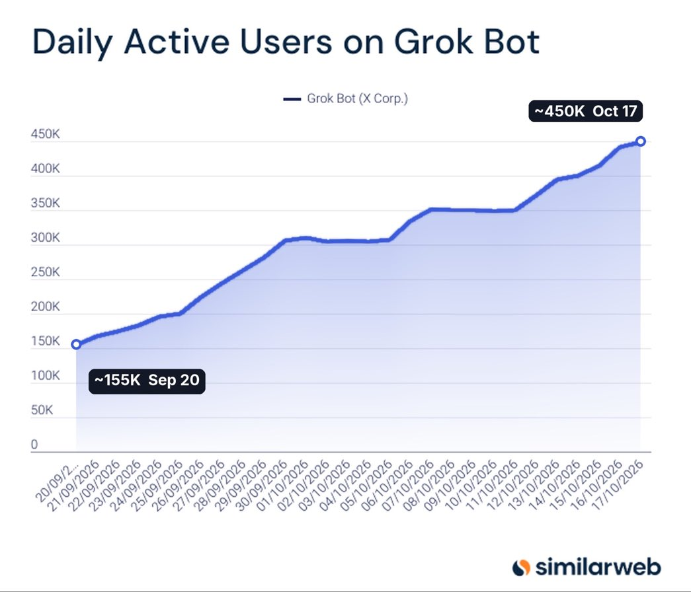

# 🐦 @elonmusk

## 📅 October 20, 2026

> 25 post(s) archived.

---

### 🕐 17:56 UTC · @elonmusk

> “Lack of electricity” is an oversimplification. Everything is hard about bringing massive compute online at extremely high speed. If there was twice as much time, this would be relatively easy, but there is not. Former $GOOGL employee on why data center capacity and electricity are the real bottlenecks, not GPU production itself, and how unreliable some of the neoclouds are ($AMZN, $GOOGL, $MSFT, $NVDA): 1. According to the expert, open-source models are closing the gap with frontier mod…

🔗 [View original post](https://x.com/elonmusk/status/2112603906723487744)

---

### 🕐 17:44 UTC · @elonmusk

> Johann Sebastian Bach is the Shakespeare of music. Best there ever was.

🔗 [View original post](https://x.com/elonmusk/status/2112600761762717997)

---

### 🕐 17:16 UTC · @elonmusk

> The fate of Texas and America is at stake. Vote for @KenPaxtonTX today. Today is a great day to vote early in person for @KenPaxtonTX in Texas.

🔗 [View original post](https://x.com/elonmusk/status/2112593866461216942)

---

### 🕐 17:14 UTC · @elonmusk

> Objectively, the “Great Replacement” has already occurred 🇧🇪 Brussels 1955: 95% native Belgian background 2025: 21% native Belgian background 🇬🇧 London 1955: 97% native British background 2025: 36% native British background 🇳🇱 Amsterdam 1955: 98% native Dutch background 2025: 40% native Dutch background 🇩🇪 Berlin 1955: 98% nativ…

🔗 [View original post](https://x.com/elonmusk/status/2112593187139416244)

---

### 🕐 17:08 UTC · @elonmusk

> True Before you go to vote, remember what is at stake. James Talarico will be a 100% reliable vote for Chuck Schumer. He will re-open our borders, take away your Second Amendment rights, and end Texas&apos; oil industry. He will fight for taxpayer funded abortion through birth and trans su…

🔗 [View original post](https://x.com/elonmusk/status/2112591749562724532)

---

### 🕐 17:02 UTC · @elonmusk

> Invest in things that do things that are measured in wattage and tonnage… BREAKING: Elon Musk says money will become irrelevant and future currency will be measured in power, mass and energy. “I think currency will be measured in fundamental physics metrics like, you know, power, like wattage and tonnage, mass and energy.”

🔗 [View original post](https://x.com/aaronburnett/status/2112590391396737064)

---

### 🕐 17:02 UTC · @elonmusk

> The value of Terafab’s output will place it in the top 20 of country GDP in a single building According to Korean media, Elon Musk&apos;s Terafab is now talking to almost EVERY Korean chip supplier it can find. Until now, the only known Korean suppliers were HPSP and Hanmi Semiconductor. Now TheElec reports that Tesla and SpaceX are in talks across nearly every category Korean…

🔗 [View original post](https://x.com/elonmusk/status/2112590295334277253)

---

### 🕐 16:58 UTC · @elonmusk

> Wow, massive numbers for UK &amp; Spain! 🌍 European countries that added the most migrants (2000–2024) 1. 🇬🇧 United Kingdom: +7.1M 2. 🇪🇸 Spain: +6.8M 3. 🇩🇪 Germany: +6.4M 4. 🇹🇷 Türkiye: +5.8M 5. 🇮🇹 Italy: +4.4M 6. 🇫🇷 France: +3.0M 7. 🇦🇹 Austria: +1.4M 8. 🇳🇱 Netherlands: +1.4M 9. 🇨🇭 Switzerland: +1.3M …

🔗 [View original post](https://x.com/elonmusk/status/2112589222855217167)

---

### 🕐 16:57 UTC · @elonmusk

> Big Grok @Bot update What&apos;s new in Grok Bot 00:00 New chat cards 00:31 Speed 00:53 Draft edits 01:08 Email aliases 01:33 X DMs 01:55 Tag @bot 02:31 Connectors 02:48 Voice calls 03:27 Notifications 03:56 Invites and Android Assistant 04:19 Access lists, unread, routines, sign-in This team ships!

🔗 [View original post](https://x.com/elonmusk/status/2112589019380875714)

---

### 🕐 16:56 UTC · @elonmusk

> Grok @Bot upgrades Grok Bot 0.71.2 is out, and this is a very huge upgrade You can now send files up to 250 MB, and videos up to 1 GB. Full-length clips, raw footage, long recordings, big reports and heavy PDFs can go straight to Grok Bot without compressing, trimming or splitting anything first Yo…

🔗 [View original post](https://x.com/elonmusk/status/2112588854691594371)

---

### 🕐 16:38 UTC · @elonmusk

> Nice! Elon Musk in his new interview on “suicidal empathy” “I think you don’t want to have misguided empathy. I agree with Gad Saad’s philosophy here. And suicidal empathy is, you know, that’s his term. You ideally want people to be default trusted, not default distrusted. And you want…

🔗 [View original post](https://x.com/GadSaad/status/2112584138075279552)

---

### 🕐 16:34 UTC · @elonmusk

> Video call Watch live as SpaceX discusses our Q3 2026 earnings at 3:30pm CT today → https://x.com/i/broadcasts/1PKqrNbLZbPGb

🔗 [View original post](https://x.com/elonmusk/status/2112583304738210216)

---

### 🕐 15:00 UTC · @elonmusk

> Watch live as SpaceX discusses our Q3 2026 earnings at 3:30pm CT today → https://x.com/i/broadcasts/1PKqrNbLZbPGb

🔗 [View original post](https://x.com/SpaceX/status/2112559638579499258)

---

### 🕐 14:30 UTC · @elonmusk

> Elon Musk in new interview with Walter Isaacson on the wealth he&apos;s created: &quot;A fundamental misunderstanding of economics arises because of conflating resource allocation and consumption; I&apos;ve created. My so-called wealth is simply a percentage ownership in SpaceX and Tesla. And this is going to be taxed quite heavily, and there&apos;s not some magical way to avoid taxes. If there were I would know about it. At the end of the day, this will get whittled down, and a few generations from now, if money still matters, which I don&apos;t think it will, my descendants would have a tiny fraction of what I have.&quot; Media

🔗 [View original post](https://x.com/SawyerMerritt/status/2112551927649018058)

---

### 🕐 14:08 UTC · @elonmusk

> Grok Bot has dramatically improved my efficiency: 1) books my flights 2) buys movie tickets 3) alerts and reads through key news 4) coordinates play dates with friends 5) does my invoices 6) pays my bills Grok Bot&apos;s daily active users continue to grow, reaching a new peak on October 17.

🔗 [View original post](https://x.com/KatieMiller/status/2112546590237831459)

---

### 🕐 14:01 UTC · @elonmusk

> The Grok Bot wave. Massive growth in just a few days. Why? It is the easiest most accessible agent platform thus built, and it keeps getting better, I am not guessing, I have been using agent systems before we had LLMs and today I can use any bot, but I find @Grok @Bot to be the best on all my test points. It has not retreated from anything I threw at it. But that’s only half of it. The suggestions are great and unlike any other platform. The chart is a wave and I say catch it…

🔗 [View original post](https://x.com/BrianRoemmele/status/2112544697139036236)

---

### 🕐 11:13 UTC · @elonmusk

> Falcon 9’s first stage has landed on the A Shortfall of Gravitas droneship Media

🔗 [View original post](https://x.com/SpaceX/status/2112502543947325773)

---

### 🕐 04:41 UTC · @elonmusk

> True, try Grok @Bot People keep asking me for Grok Bot templates But you can just spin up a new bot and tell it what you need It’s indistinguishable from magic

🔗 [View original post](https://x.com/elonmusk/status/2112403910908596503)

---

### 🕐 04:14 UTC · @elonmusk

> They really don’t They don’t understand how things work.

🔗 [View original post](https://x.com/elonmusk/status/2112397041355866607)

---

### 🕐 04:11 UTC · @elonmusk

> Rewriting the 𝕏 Android app was also a big deal. It was really bad for such a long time.

🔗 [View original post](https://x.com/elonmusk/status/2112396145137946819)

---

### 🕐 04:04 UTC · @elonmusk

> If they&apos;re replaced by immigrants they go extinct anyway, just in a way that&apos;s far uglier. https://x.com/spectator/status/2112176976077222336?s=20 &apos;Because Japan doesn&apos;t want immigrants they&apos;re going to become extinct.&apos; Author Camilla Cavendish, whose book Generation Maybe examines the reasons birth rates are falling, explains why there is a clock in a university in Japan that is counting down the years until the country ru…

🔗 [View original post](https://x.com/xenocosmography/status/2112394417948819714)

---

### 🕐 02:41 UTC · @elonmusk

> Two important changes to timeline recommendations: - New AI/SI ranking model that predicts probable time spent much better - Retrieval model trained to surface posts people read all the way through User active seconds is growing exponentially and hitting all-time highs almost every day:

🔗 [View original post](https://x.com/elonmusk/status/2112373713937084809)

---

### 🕐 01:02 UTC · @elonmusk

> Have to give the EU regulators credit where it’s due for making all Apple products use USB-C

🔗 [View original post](https://x.com/elonmusk/status/2112348601255125059)

---

### 🕐 00:10 UTC · @elonmusk

> James Talarico wants to: -Dismantle Capitalism -Raise Taxes -Defund the police -Abolish prisons -Get rid of oil and gas jobs And he’s trying to convince Texas he’s a moderate? Vote for Ken Paxton. Media

🔗 [View original post](https://x.com/america/status/2112335573725917396)

---

### 🕐 00:05 UTC · @elonmusk

> It is astounding that someone like @jamestalarico could actually be in a competitive race in Texas. She is a ladyboy who has struggled with their whiteness and who considers God to be nonbinary. It shows you the devastation that a parasitized mind can wield. The choice for Texas couldn&apos;t be more clear. Red-blooded Texan @KenPaxtonTX vs. the weird dude who needs to come to terms with his whiteness. I know who I want as my next Senator...

🔗 [View original post](https://x.com/GadSaad/status/2112334327723745564)

---
