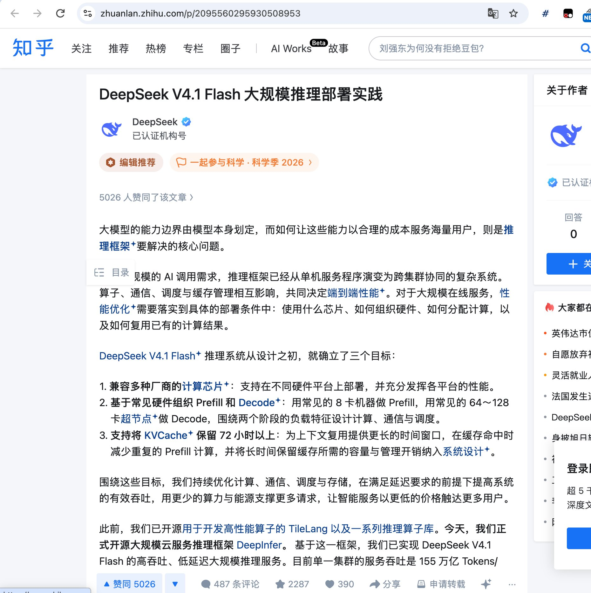

# 🐦 @swyx

## 📅 October 20, 2026

> 4 post(s) archived.

---

### 🕐 16:56 UTC · @swyx

> https://x.com/latentspacepod/status/2112588380416647205 https://x.com/i/article/2112587682538987520

🔗 [View original post](https://x.com/swyx/status/2112588793010421837)

---

### 🕐 16:51 UTC · @swyx

> deepseek posted way more alpha on their zhihu page, if you only read twitter you are reading the laowai approved stuff &quot;Based on this framework, we have implemented a high-throughput, low-latency large-scale inference service for DeepSeek V4.1 Flash. Currently, the service throughput of a single cluster is 155 trillion tokens/day, and the overall revenue is $38 per card per hour (based on off-peak prices).&quot; it costs roughtly $5-10 per gpu hour so depseek is claiming 80% serving margin at THEIR prices lololololol 🚀 Introducing DeepInfer, our in-house inference framework, now fully open source! Powering DeepSeek-V4.1-Flash at scale with high throughput and low latency. We’re sharing our production stack to help the community lower compute costs, reduce energy use, and make AI more afforda…

🔗 [View original post](https://x.com/swyx/status/2112587398240710820)

---

### 🕐 16:51 UTC · @swyx

> deepseek posted way more alpha on their zhihu page, if you only read twitter you are reading the laowai approved stuff &quot;Based on this framework, we have implemented a high-throughput, low-latency large-scale inference service for DeepSeek V4.1 Flash. Currently, the service throughput of a single cluster is 155 trillion tokens/day, and the overall revenue is $38 per card per hour (based on off-peak prices).&quot; it costs roughtly $5-10 per gpu hour so depseek is claiming 80% serving margin at THEIR prices lololololol 🚀 Introducing DeepInfer, our in-house inference framework, now fully open source! Powering DeepSeek-V4.1-Flash at scale with high throughput and low latency. We’re sharing our production stack to help the community lower compute costs, reduce energy use, and make AI more afforda…

🔗 [View original post](https://x.com/swyx/status/2112587397380943953)

---

### 🕐 15:05 UTC · @swyx

> underrated podcast. i dont understand the twitter algorithm, u guys are sleeping on some real bangers Before investing in Anthropic, Jaan Tallinn asked Dario to line up alternative proposals from VCs. The reason: he wanted confidence that he was displacing VC money, not bringing Anthropic into existence. Tallinn, an AI safety advocate whose fund led Anthropic&apos;s first round, says …

🔗 [View original post](https://x.com/swyx/status/2112560809809498187)

---
