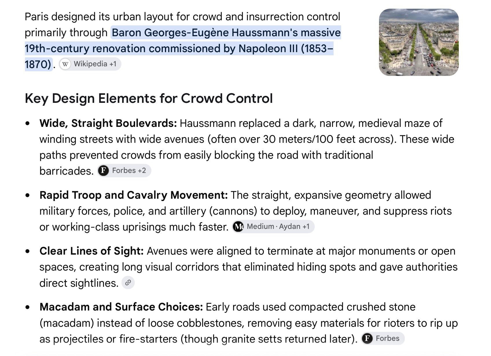

# 🐦 @tunguz

## 📅 October 20, 2026

> 11 post(s) archived.

---

### 🕐 21:23 UTC · @tunguz

> * 3 months how you spend your time these next 3 years will be more critical than how you spent the last 30

🔗 [View original post](https://x.com/tunguz/status/2112656093482483944)

---

### 🕐 21:23 UTC · @tunguz

> I’ve had no such issues. I burn through Claude quotas the way a frat boy goes through cheap beers on a Spring Break. I&apos;ve tried so hard to burn through my Claude Max 5x limits this week but I couldn&apos;t And now my reset expires in a day or so, I don&apos;t know how I&apos;ll use up most of my weekly quota before then

🔗 [View original post](https://x.com/tunguz/status/2112655976864125017)

---

### 🕐 16:40 UTC · @tunguz

> My whole work life now revolves around strategically guessing when each one of the AI labs will drop their next reset.

🔗 [View original post](https://x.com/tunguz/status/2112584764154646739)

---

### 🕐 16:05 UTC · @tunguz

> I was speaking some fake French sounding nonsense, and my youngest told me that I sounded like a &quot;grumpy frog.&quot;

🔗 [View original post](https://x.com/tunguz/status/2112575973036048399)

---

### 🕐 15:51 UTC · @tunguz

> Happy Fable 5.5 day to those who celebrate.

🔗 [View original post](https://x.com/tunguz/status/2112572542288306268)

---

### 🕐 13:09 UTC · @tunguz

> Think globally, compute locally.

🔗 [View original post](https://x.com/tunguz/status/2112531643609297343)

---

### 🕐 13:03 UTC · @tunguz

> You commented, you critiqued, you asked, we listened: further improvements to mlx-geospatial! After user feedback and further optimization, mlx-geospatial 0.1.1 is out! Faster spatial joins + kNN on Apple silicon. Warm-index component benchmarks: M1 Ultra: 18–1,262× (median 95×) M4 Max: 21–2,005× (median 105×) CPU/MLX ratios, shown on the same scale. 1/4

🔗 [View original post](https://x.com/tunguz/status/2112530074234720260)

---

### 🕐 11:24 UTC · @tunguz

> Become unverifiable.

🔗 [View original post](https://x.com/tunguz/status/2112505255254798795)

---

### 🕐 11:04 UTC · @tunguz

> Guys, guys, guys: if you are somehow shocked by the riots in Paris, or think you had a special foresight about them when you visited the city back in 2010s, you obviously don’t know anything about the history of that city. The whole design of Paris was created with crowd control in mind! Rioting in the streets is the most French thing ever!

🔗 [View original post](https://x.com/tunguz/status/2112500081244971034)

---

### 🕐 10:37 UTC · @tunguz

> My prediction is that this will be true unless/until AI unlocks a *major* new way of exploiting the *physical* world, the way we got in the 19th and 20th century. Increased efficiency of the current paradigms are not gonna cut it. This is the median economist forecast actually

🔗 [View original post](https://x.com/tunguz/status/2112493282056171678)

---

### 🕐 01:14 UTC · @tunguz

> This could really fix us. JUST IN: Supreme Court agrees to review the constitutionality of a nearly 160-year-old federal ban on distilling liquor at home.

🔗 [View original post](https://x.com/tunguz/status/2112351834547376490)

---
