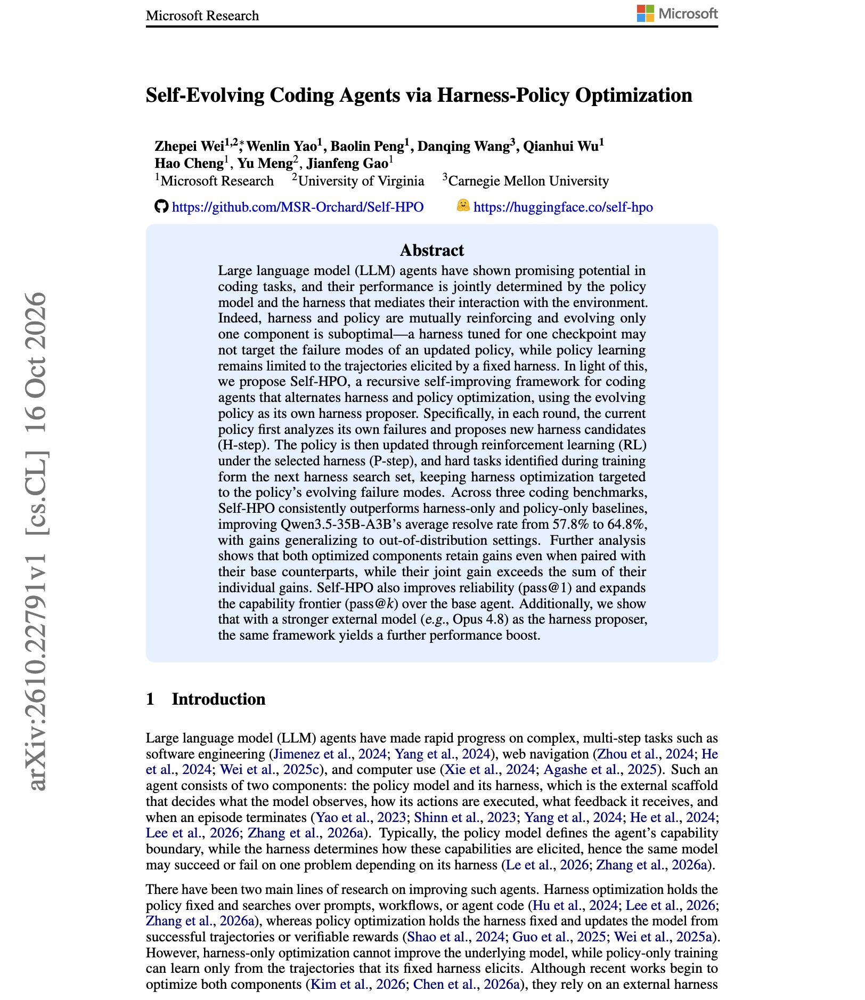
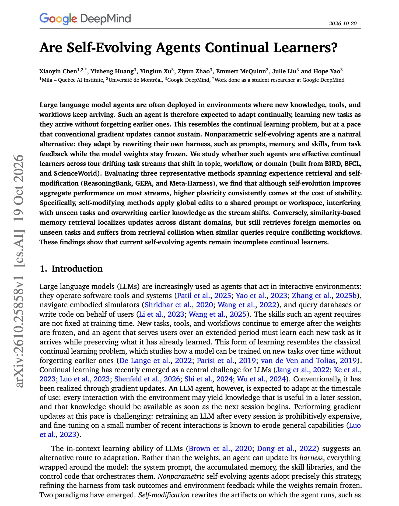

# 🐦 @dair_ai

## 📅 October 21, 2026

> 2 post(s) archived.

---

### 🕐 02:15 UTC · @dair_ai

> Great work from Microsoft and colleagues. This one is on the hot new topic of co-evolving the harness and the model. (bookmark it) They raise Qwen3.5-35B-A3B&apos;s average resolve rate on three coding benchmarks from 57.8% to 64.8% by alternating the two. In each round, the policy reads its own failures and proposes harness changes. Then it is trained with RL under the harness it picked. Tasks that stay hard during training become the search set for the next harness round. The joint gain is larger than the harness-only gain and the policy-only gain added together. Each optimized part also keeps its improvement when paired with the other&apos;s original version. Using Opus 4.8 as the harness proposer in the same loop adds more on top, which makes this a practical way to transfer a frontier model&apos;s harness judgment into a smaller policy. https://arxiv.org/abs/2610.22791 Chat with Paper: https://academy.dair.ai/papers/self-evolving-coding-agents-via-harness-policy-optimization-2610.22791

🔗 [View original post](https://x.com/dair_ai/status/2112729341306220739)

---

### 🕐 02:10 UTC · @dair_ai

> Highly recommended read from Google DeepMind and colleagues. There is a lot of interest in self-evolving agents, but they&apos;re hard to get right. This work highlights how important and difficult memory and retrieval are in agents. The big question in this paper is whether self-evolving agents keep learning without forgetting. They tested ReasoningBank, GEPA, and Meta-Harness on four task streams that drift in topic, workflow, or domain, built from BIRD, BFCL, and ScienceWorld. The weights stay frozen, and the agents adapt by rewriting prompts, memory, and skills. Self-evolution improves overall scores on most streams. But more adaptation consistently means agents forget more. Methods that rewrite a shared prompt or workspace make global edits, so they interfere with unseen tasks and overwrite older knowledge when the stream shifts. Memory retrieval keeps updates more local, but it still pulls in memories from other domains and collides when similar queries need different workflows. Static benchmarks hide both problems, so test self-evolving agents on a stream that changes over time. https://arxiv.org/abs/2610.25858 Chat with Paper: https://academy.dair.ai/papers/are-self-evolving-agents-continual-learners-2610.25858

🔗 [View original post](https://x.com/omarsar0/status/2112728082042015769)

---
