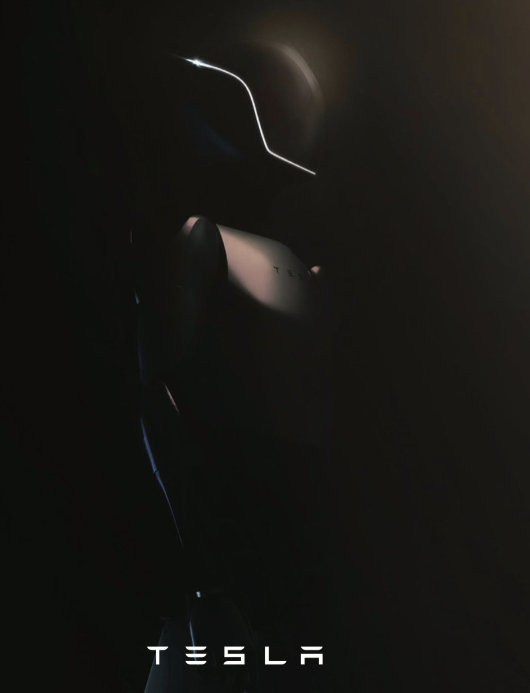
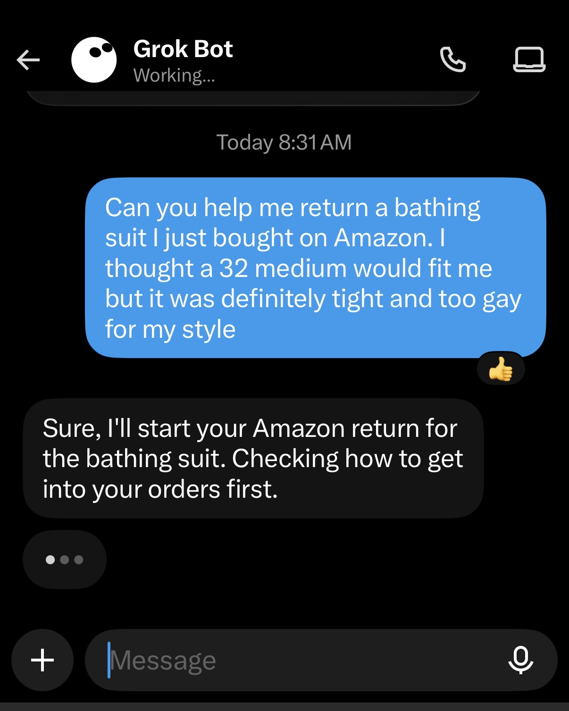
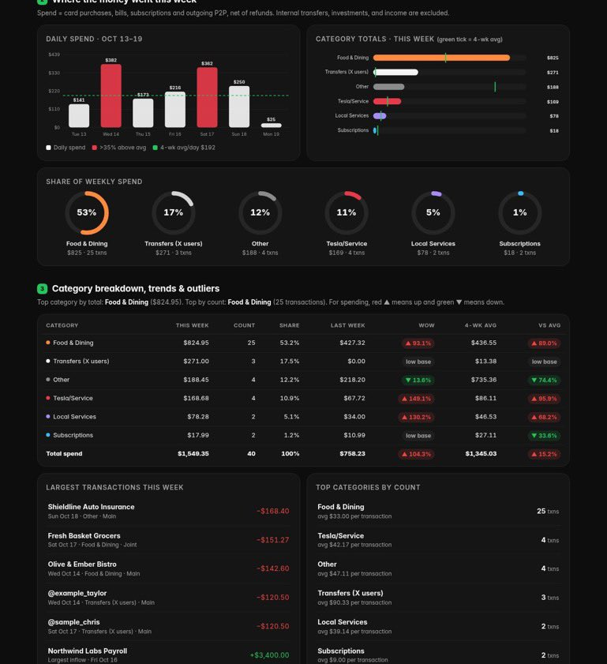

# 🐦 @elonmusk

## 📅 October 21, 2026

> 41 post(s) archived.

---

### 🕐 22:53 UTC · @elonmusk

> Counting bumblebees one-by-one 😂 California hasn&apos;t built its bullet train because the state has required 130,000 pages of environmental reports, making absurd demands like: • counting bumblebees one by one • rebuilding woodrat stick huts • hiring specialized dogs to sniff lizard scat

🔗 [View original post](https://x.com/elonmusk/status/2113040898644967726)

---

### 🕐 21:40 UTC · @elonmusk

> Elon Musk on Optimus: &quot;We&apos;ve started early production. The growth of Optimus is an S curve, but the initial curve is a shallow slope. We have the vast majority of the 1 million unit/year line installed at Fremont. There&apos;s still some things we need to tweak about the design. There&apos;s still quite a lot of work to do with the AI in the robot. I would expect that the AI, the electromechanical design, reliability, usage life, expect these issues to be solved by the end of next year. I remain convinced Optimus will be the biggest product on Earth. I do want to temper expectations that we still have a lot to get through, it will take about a year to get through that.&quot;

🔗 [View original post](https://x.com/SawyerMerritt/status/2113022539140087843)

---

### 🕐 20:56 UTC · @elonmusk

> Grok @Bot is like hiring a super smart and fun employee! Grok Bot can now build reports, memos, and dashboards. Ask Bot for a page, then edit it together or have Bot keep it up to date.

🔗 [View original post](https://x.com/elonmusk/status/2113011511429902609)

---

### 🕐 20:54 UTC · @elonmusk

> People are buying FSD with a car attached, not the other way around Tesla has just released its Q3 earnings results. Highlights: • EPS (non-GAAP): $0.48 (vs. $0.45 est) • Revenue: $28.05B (vs. $28.3B est) • Adjusted EBITDA: $3.90B • Active FSD Subscriptions: 1.74M, up 67% YoY from 1.04M • Net income (GAAP): $787M • Free cash flow: $1.53B • Capex:…

🔗 [View original post](https://x.com/elonmusk/status/2113011056847278486)

---

### 🕐 20:51 UTC · @elonmusk

> Try Grok @Bot, you will love it! I&apos;ve been GrokBot pilled. First of all, Grok knows me better than other bots, like Meta Muse, thanks to the 300,000 posts I&apos;ve done here for 20 years. But now that GrokBot @bot can read lists, it opens up powerful new personalized news capabilities. I&apos;ve done this for about a yea…

🔗 [View original post](https://x.com/elonmusk/status/2113010364178964616)

---

### 🕐 20:49 UTC · @elonmusk

> Great progress by the Tesla team! Q3 Shareholder Update → http://ir.tesla.com Highlights – FSD Supervised attach rate grew to over 75% of new vehicle deliveries in NA – Unveiled the next-gen Roadster – Record deliveries in Canada, Australia, Japan &amp; Taiwan – Tesla Semi now in volume production. Top variant can go…

🔗 [View original post](https://x.com/elonmusk/status/2113009907012382829)

---

### 🕐 20:05 UTC · @elonmusk

> If you are an ambitious young person I still believe joining @SpaceX is one of the best career decisions you can make The world is pivoting from bits to atoms and there is no better training ground for atoms than SpaceX It may feel late but it&apos;s early Also the mission! 🚀🌕

🔗 [View original post](https://x.com/shaunmmaguire/status/2112998791125328306)

---

### 🕐 17:58 UTC · @elonmusk

> Grok @Bot can help protect and fix your credit rating. Just ask it to do so! I had a friend run this Grok Bot I built for them a few weeks ago and guess what? 7 entires from a scammer that took over his credit. $65,000+ of defaulted credit! Grok Bot is fixing this. Get it: https://x.ai/bot/vY1eft-dZTKssiaUQvJEc you will not be disappointed!

🔗 [View original post](https://x.com/elonmusk/status/2112966832969708020)

---

### 🕐 17:57 UTC · @elonmusk

> Send your friends links to 𝕏 so that they know what’s really going on People&apos;s trust in legacy media has eroded over decades, and 𝕏 keeps hitting new all-time usage highs and is the #1 news app in 150+ countries. If your friends still rely on TV news, send them 𝕏 links. Sharing the truth is an act of kindness.

🔗 [View original post](https://x.com/elonmusk/status/2112966587149881376)

---

### 🕐 17:50 UTC · @elonmusk

> Cool “Well, to be honest, Elon Musk is paying the most money in the country right now with this SpaceX little job that they got down there in Southaven, you know what I’m saying. It’s a killing,” said Ray Massey, who also traveled from Gulfport, Mississippi, in hopes of data center wo…

🔗 [View original post](https://x.com/elonmusk/status/2112964643593269747)

---

### 🕐 17:48 UTC · @elonmusk

> Talarico would vote to take away your kids and transition them, not just in Texas, but nationwide. Pure evil. Every word is James Talarico’s. 27 clips. 4 minutes. 2019–2026. “God is non-binary.” “…many more than two biological sexes. In fact, there are six.” “If you deny your child’s gender identity… it’s abusive for sure.” “There’s only one person who can determine a child’s gender iden…

🔗 [View original post](https://x.com/elonmusk/status/2112964322192408813)

---

### 🕐 17:26 UTC · @elonmusk

> Forward this to your friends in Texas

🔗 [View original post](https://x.com/elonmusk/status/2112958619448639525)

---

### 🕐 17:25 UTC · @elonmusk

> “Sydney Sweeney” makes the case for Voter ID. Media Prop 39 released a new ad today highlighting what politicians don’t want you to know: California is one of a handful of states that don’t require a photo ID to vote. Prop 39 is a battle of politicians versus people. Politicians want you to vote no. The People are voting yes. This…

🔗 [View original post](https://x.com/BasedMikeLee/status/2112958366733733918)

---

### 🕐 17:24 UTC · @elonmusk

> Talarico, the creep, in his OWN words Every word is James Talarico’s. 27 clips. 4 minutes. 2019–2026. “God is non-binary.” “…many more than two biological sexes. In fact, there are six.” “If you deny your child’s gender identity… it’s abusive for sure.” “There’s only one person who can determine a child’s gender iden…

🔗 [View original post](https://x.com/elonmusk/status/2112958301344264310)

---

### 🕐 16:54 UTC · @elonmusk

> Starlink moves the needle BREAKING: United CEO says customers are switching from other airlines because of @Starlink “We already see customers moving from other airlines today” United will cross 50% of flights with Starlink this week and expects to finish its full fleet rollout by the end of next year.

🔗 [View original post](https://x.com/elonmusk/status/2112950704327520260)

---

### 🕐 16:49 UTC · @elonmusk

> Watch this clip carefully. The script is always the same: Elon is &quot;dumb,&quot; Elon is &quot;lucky,&quot; and Bill Gates is the good billionaire because he gives his money away. Let&apos;s talk about that. Bill Gates didn&apos;t give his fortune away. He converted it into control. Over $100B spent since 2000, another $200B by 2045. Where does it go? Into Gavi, the Global Fund, the WHO, health ministries, policy shops, media partnerships. Into the state, and into the institutions that orbit the state. Gates found the ultimate hack: you don&apos;t need to win elections when you finance the people who write the agenda. One private man at the center of global health policy, accountable to no voter, ever. And what does all that money produce? Maintenance. Gates is a man maintaining a photograph. The world as it is, framed, preserved, retouched a little every year. Some of it saves lives, and that&apos;s good. But not one new industry. Not one order-of-magnitude drop in the cost of anything. No growth. The same world, administered more politely. That&apos;s what this kind of philanthropy buys: the perfection of goodness, not the reality of goodness. The galas, the annual letters, the glowing coverage, the moral immunity. Goodness as a brand. Now look at the other model. SpaceX cut the cost of reaching orbit by more than 10x. Starlink brought internet to places no government ever bothered to wire, and kept Ukraine online when the war hit. Tesla forced the entire auto industry to go electric when every incumbent said it couldn&apos;t be done. Neuralink patients with paralysis are controlling computers with their thoughts. None of that was a donation. All of it was creation. Products people pay for, which fund the next thing, which compounds. That&apos;s real philanthropy: building things that make the whole pie bigger, permanently. A donation ends when the money runs out. A company that bends the cost curve of civilization keeps giving forever. Hard to understand when your entire career depends on the redistribution machine. So here&apos;s why they&apos;re panicking, A+B. A. Their power rests on one thing: controlling the allocation of other people&apos;s money. Budgets, agencies, grants, foundations, NGOs. Whoever controls the flow controls the country. B. Builders prove, publicly and at scale, that creation beats redistribution. A rocket company did what decades of space budgets couldn&apos;t. A car company did what decades of climate summits couldn&apos;t. A + B: if growth does more good than the state, the people who manage the state become optional. That&apos;s the threat. Not Elon&apos;s politics. Elon&apos;s results. They can&apos;t attack the results, so they attack the man. &quot;Dumb.&quot; &quot;Lucky.&quot; When someone lands reusable rockets and the best you&apos;ve got is that he got lucky, you&apos;re not making an argument. You&apos;re confessing you don&apos;t have one. History will judge this period very harshly. The lies, the manipulation, the coordinated narratives repeated word for word across every network. It&apos;s all archived now. Every clip. Every quote. You&apos;ve already lost. You just don&apos;t know it yet. The builders won the moment they proved the future can be built instead of managed. 🚨 BREAKING: Democrats are lining up to call Elon Musk dumb, and it&apos;s the most embarrassing thing you&apos;ll see today. One called him &quot;one of the most unintelligent billionaires I have ever met.&quot; Another said he&apos;s &quot;one of the dumbest, luckiest people.&quot; Lucky? SpaceX and Tesla were b…

🔗 [View original post](https://x.com/brivael/status/2112949456316330076)

---

### 🕐 16:30 UTC · @elonmusk

> If there&apos;s one thing I can tell you about @SpaceX, it&apos;s that there&apos;s never been a company like this... My thoughts on the earnings call with @SquawkCNBC. Media

🔗 [View original post](https://x.com/PeterDiamandis/status/2112944642677244160)

---

### 🕐 16:22 UTC · @elonmusk

> Talarico is a creep Democrat Nominee for U.S. Senate in Texas James Talarico when asked: “Something that you love that&apos;s not family or friends?” “Trans children…”

🔗 [View original post](https://x.com/elonmusk/status/2112942727482761342)

---

### 🕐 16:22 UTC · @elonmusk

> Live by the sword, die by the sword. Those who pick fights with me should understand that I will find out who is really pulling the strings and come for them, not just their puppets … Capitol agenda: Dem gavels are coming for Elon Musk https://politi.co/4dPcGpd

🔗 [View original post](https://x.com/elonmusk/status/2112942522486202504)

---

### 🕐 16:19 UTC · @elonmusk

> Send 𝕏 links to your friends so that they know what’s really going on &quot;If you talk to somebody who gets all their information from legacy media, they are living in a different world than if they are listening to your podcast or getting news from 𝕏. They are living in an alternate reality.&quot; — Elon Musk

🔗 [View original post](https://x.com/elonmusk/status/2112941801510178862)

---

### 🕐 16:08 UTC · @elonmusk

> 🚨 VIRGINIA! Early Voting, in-person, is UNDERWAY NOW in the Great Commonwealth of Virginia. If you have a mail-in ballot, return it immediately and, if not, GO VOTE at the Polls RIGHT NOW, and get everyone you know to VOTE FOR THE REPUBLICAN IN EVERY RACE, UP AND DOWN THE BALLOT! Whether you VOTE early, absentee, by mail, or in-person, Republicans must SWAMP the Radical Left Dumocrats with massive turnout! In Virginia, you can cast your early Vote, in-person, all the way through October 31st. SO IMPORTANT — PLEASE GET OUT AND VOTE. MAGA! President DONALD J. TRUMP Find your Voting Location here: https://swampthevoteusa.com/virginia/

🔗 [View original post](https://x.com/realDonaldTrump/status/2112939021861073051)

---

### 🕐 16:00 UTC · @elonmusk

> with Grok Bot the future of computing is headless I never wake up thinking &quot;this will be a great day to open up the amazon app and have to click a bunch of buttons to find my order and fill out forms to return it&quot; (this is de-humanizing) instead I just tell Grok to do it!

🔗 [View original post](https://x.com/KettlebellDan/status/2112937029436907551)

---

### 🕐 15:51 UTC · @elonmusk

> There is something deeply wrong with Talarico

🔗 [View original post](https://x.com/elonmusk/status/2112934688557818190)

---

### 🕐 15:50 UTC · @elonmusk

> Try this @RampCapitalLLC @bot Do it both conventionally and with Grok @Bot, then compare. Actually, it’s worth showing Grok last year’s tax returns and see if it finds opportunities for improvement. There may be refunds you’re owed.

🔗 [View original post](https://x.com/elonmusk/status/2112934500170600679)

---

### 🕐 15:47 UTC · @elonmusk

> As Thatcher said, the problem with socialism is that eventually they run out of other people’s money to take and they come for you Of course it’s net negative

🔗 [View original post](https://x.com/elonmusk/status/2112933813647258079)

---

### 🕐 15:40 UTC · @elonmusk

> Try Grok @Bot grok bot is by far my most used personal assistant. Apple level product design and seamlessness

🔗 [View original post](https://x.com/elonmusk/status/2112932127901987225)

---

### 🕐 15:38 UTC · @elonmusk

> Some fools still think the legacy news is real. Amazing.

🔗 [View original post](https://x.com/elonmusk/status/2112931457786081428)

---

### 🕐 15:37 UTC · @elonmusk

> https://x.com/i/article/2112926705618751488

🔗 [View original post](https://x.com/PeterDiamandis/status/2112931331722055779)

---

### 🕐 15:28 UTC · @elonmusk

> I can tell you exactly what will happen if Democrats regain power: They will use your money to fly deported illegal aliens back to America and pay them settlements. They will re-open our borders and ship millions of foreign people to any community they want. And they won&apos;t stop until America becomes an unrecognizable country.

🔗 [View original post](https://x.com/realBrandonGill/status/2112928898254061895)

---

### 🕐 15:19 UTC · @elonmusk

> @Wambscapital @bot For sure @bot and it’s not even close

🔗 [View original post](https://x.com/RampCapitalLLC/status/2112926807074705746)

---

### 🕐 14:49 UTC · @elonmusk

> We need to increase what people can afford, help them participate in the wealth being created, and preserve their confidence during this global technological transition.

🔗 [View original post](https://x.com/PeterDiamandis/status/2112919318123987135)

---

### 🕐 13:13 UTC · @elonmusk

> Today is a great day to vote early in person in Texas for @KenPaxtonTX. I’m hearing we are seeing near-presidential-level turnout in some counties.

🔗 [View original post](https://x.com/ScottPresler/status/2112894933367459987)

---

### 🕐 11:50 UTC · @elonmusk

> Elon Musk was once a moderate Democrat who supported Barack Obama. He even stood in line for six hours just to shake Obama&apos;s hand when he was running for president. In 2010, President Obama visited SpaceX at Cape Canaveral, where Elon personally showed him around. But years later, Elon could no longer support the Democrats, because they had become “the party of division and hate.” He eventually shifted his support to the Republicans. Now, House Democrats are preparing to make Elon Musk a major target of congressional investigations if they regain control of the House in the midterms. Also in previous years, Tesla stores, vehicles, and Superchargers were targeted by arson, vandalism, and gunfire. Political disagreements are never an excuse for violence. These are crimes, not legitimate forms of protest. It&apos;s remarkable how much the relationship between Elon Musk and the Democratic Party has changed. https://x.com/iam_smx/status/1899861421715849225/video/1 Media House Democrats have indicated that Elon Musk would be a top target for congressional investigations and increased oversight if they regain control of the House in the upcoming midterm elections. These people are crazy!

🔗 [View original post](https://x.com/iam_smx/status/2112874127170183176)

---

### 🕐 10:50 UTC · @elonmusk

> Elon Musk: Neuralink&apos;s Blindsight vision implant is coming soon &quot;Even if somebody&apos;s completely blind, we can write directly to the visual cortex&quot; The first version will offer low-resolution vision, but the long-term goal goes much further: &quot;You would have very high resolution and be able to see multispectral wavelengths. You could see in infrared, ultraviolet, radar. It&apos;s like a superpower situation&quot; https://x.com/XFreeze/status/2017220235984617518/video/1 Media

🔗 [View original post](https://x.com/XFreeze/status/2112859032944087284)

---

### 🕐 08:58 UTC · @elonmusk

> How is this acceptable or legal? Retaliation for political speech should be prohibited by law. JUST IN: House Democrats say Elon Musk is on their &quot;list of targets&quot; if they win the midterms

🔗 [View original post](https://x.com/beffjezos/status/2112830928422842725)

---

### 🕐 07:00 UTC · @elonmusk

> New X Money Grok Bot! Few understand how powerful it is to have Grok Bot understand your finances and your financial goals. The X Money MCP connection to Grok Bot is just the beginning of where this will go. The power to see connections you may not see to long horizon goals is just one Grok Bot away. You are living in the future with how powerful this Bot is. Reports like you never seen in any bank statement. Give it a try ONLY GROK BOT DOES THIS! X MONEY + GROK BOT = WOW! Every Monday morning your Grok Bot reads your X Money account and gives you a deep weekly report 💸 Get in now: https://x.ai/bot/cMpw0zb2v9RRtQPDfsVFm - Balances across every account, with the week&apos;s net change - Every transactio…

🔗 [View original post](https://x.com/BrianRoemmele/status/2112801229508383074)

---

### 🕐 05:44 UTC · @elonmusk

> Honest feedback from Grok and Fable 4o was truly a special model

🔗 [View original post](https://x.com/elonmusk/status/2112781998624555086)

---

### 🕐 05:40 UTC · @elonmusk

> Congrats SpaceX team! Q3 2026 highlights: - Delivered revenue of $14.6 billion, up 161% year-over-year - Successfully launched our first revenue-generating Starship mission, delivering 26 Starlink V3 satellites to our broadband constellation, representing approximately 10x the downlink capacity added …

🔗 [View original post](https://x.com/elonmusk/status/2112781132387529005)

---

### 🕐 02:41 UTC · @elonmusk

> Mark my words, SpaceX will become the first $10T company, and the first $100T company. 🚀🚀🚀

🔗 [View original post](https://x.com/PeterDiamandis/status/2112736030302617699)

---

### 🕐 02:22 UTC · @elonmusk

> “We&apos;re seeing the fastest growth of a product that I&apos;ve ever seen in my life for Grok Bot&quot;—@elonmusk I can verify, I have not seen adoption like this across so many companies as fast as @Grok @Bot deployment. One Grok Bot begets two, begets four… Media

🔗 [View original post](https://x.com/BrianRoemmele/status/2112731196606341314)

---

### 🕐 00:59 UTC · @elonmusk

> 🚀 WOW! SpaceX just LAUNCHED another Falcon 9 into the stars 🚀 Elon Musk’s Starfall—a 4,000-pound, HOCKEY-PUCK-SHAPED LAB—is HEADED to SPACE! Elon’s giving back, promising SpaceX STOCK to every American KID! 🔥 Media

🔗 [View original post](https://x.com/JesseBWatters/status/2112710372280914137)

---
