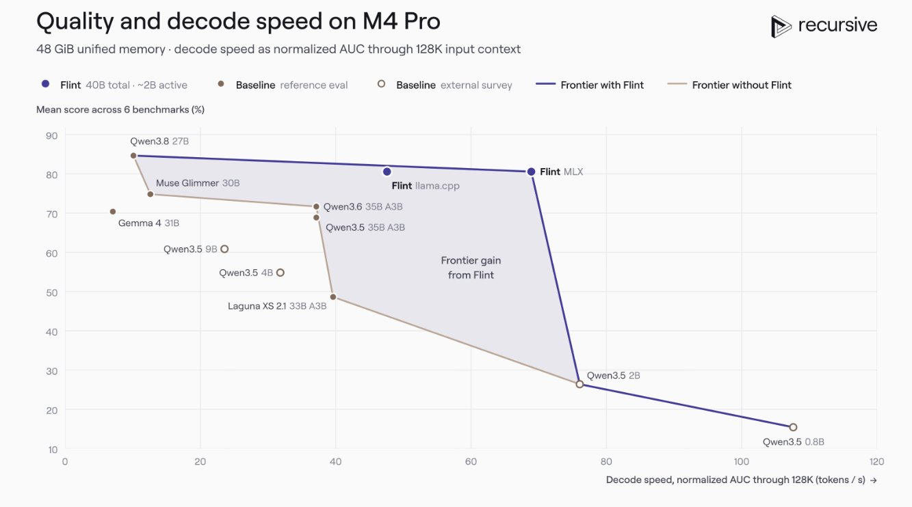
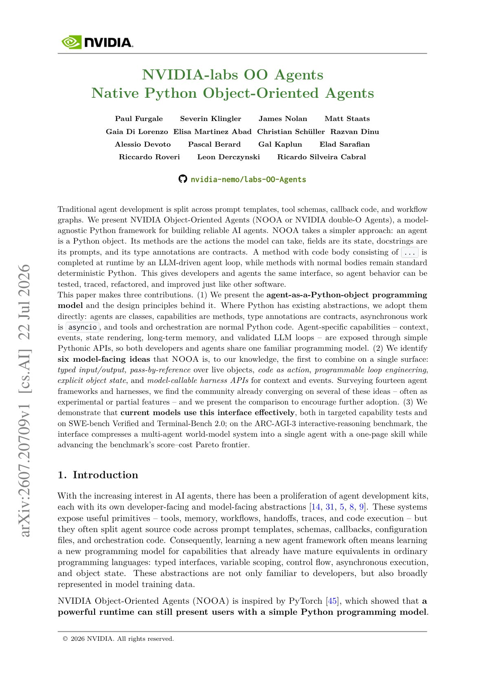
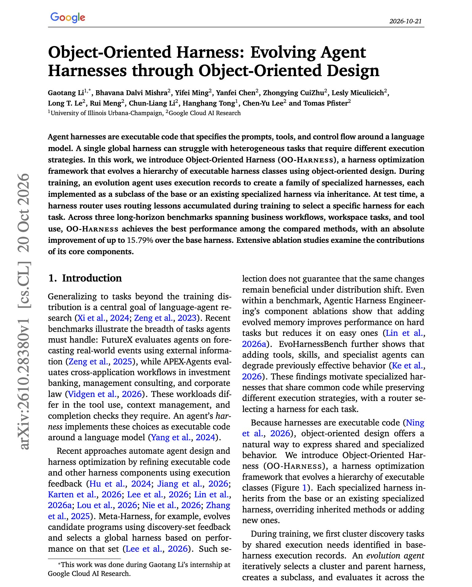

# 🐦 @omarsar0

## 📅 October 21, 2026

> 6 post(s) archived.

---

### 🕐 20:41 UTC · @omarsar0

> Anthropic just destroyed all proactive agent startups. That&apos;s what you&apos;ll see on your timeline. That couldn&apos;t be further from the truth. Personal agents, unlike other agent types, will exist in different flavors and personalities. It&apos;s nice that Claude Duet runs on Opus 5.5. Unlike other agent types, people will really think carefully about which personal agent to pick. Here, people think more carefully about trust, personality, intent understanding, continual learning, etc. The best personal agent is the one you can trust, not just the fastest one that gets the work done effectively. But I think people will use multiple personal agents for different types of tasks/work. I think we are about to see an explosion of vertical personal agents. Which one do I use? I am still testing a bunch of them (dots, Muse, and Grok Bot). But I have actually just built my own with Pi Durable. I like mine better because it is hyper-personalized to how I use personal agents. We’re opening a research preview of Claude Duet, a new app where Claude works as a proactive agent. It comes to you with what needs your attention, completes tasks you ask of it, keeps working when you step away, and checks with you before it acts on your behalf.

🔗 [View original post](https://x.com/omarsar0/status/2113007827736572035)

---

### 🕐 18:21 UTC · @omarsar0

> Goodbye, context engineering; hello, cache engineering. Jokes aside, this paper takes an interesting approach to the problem. We love papers that go deeper down the stack. This is a good example that shifts from agentic context engineering to agentic cache engineering. They also apply recursive self-improvement to cache policies to further reduce cost by 7.1% over expert design. Specifically, this work …

🔗 [View original post](https://x.com/omarsar0/status/2112972476955107610)

---

### 🕐 16:43 UTC · @omarsar0

> Bullish on automated AI research. Early signs of self-improving AI, no doubt. Flint is the first model from @recursive_si. Their Eureka Machine contributed to nearly every part of the stack, from data and training recipes to the inference kernels, and the team built it from scratch in under four months! It is a 40B MoE with 2.5B active parameters and open weights under Apache 2.0. It runs at 125+ tokens/s on an M4 Pro MacBook Pro at short contexts. Highly recommend checking it out. We will be testing this in our internal autoresearch evals. Introducing Flint, @Recursive_SI’s first model: a fast local coding model built with our automated research system, the Eureka Machine. • Best-in-class fast local coding • Up to 2x faster than comparable models: 125+ tokens/sec on a MacBook Pro, 150+ on RTX Spark • Built from scr…

🔗 [View original post](https://x.com/omarsar0/status/2112947912137122135)

---

### 🕐 15:39 UTC · @omarsar0

> Beyond agent harnesses, I believe agent interfaces are an important direction for the development of self-evolving agents. This is connected to the idea of building for agents. You can pack so much into a good harness and interface that agents understand well. Think about the efficiencies you get. Costs you can reduce. More importantly, this lets agents work more effectively and reliably with interfaces that make sense for the task at hand. With Artifacts, we&apos;ve already seen huge gains in productivity. It&apos;s a more natural interface for humans and agents to collaborate. We&apos;ll discover more of these interfaces over time, and agents will be able to build them on the fly, iterate on them, and evolve as needs arise. Excited about this emerging trend. Banger paper on evolving agent interfaces. Pay close attention to this new trend if you build with agents. Like optimizing harnesses, it&apos;s remarkable what you can achieve with agents that have access to better interfaces. Computer-use agents usually act through interfaces that pe…

🔗 [View original post](https://x.com/omarsar0/status/2112931809142939998)

---

### 🕐 14:27 UTC · @omarsar0

> I&apos;ve seen effective use of object-oriented design with agents before. You might find this NVIDIA paper interesting too: https://academy.dair.ai/papers/nooa

🔗 [View original post](https://x.com/omarsar0/status/2112913670544171298)

---

### 🕐 14:17 UTC · @omarsar0

> Build specialized harnesses, folks. This is a banger paper from Google Cloud AI Research on self-evolving agent harnesses. (bookmark it) They introduce OO-Harness, which raises AutomationBench from 61.6% to 77.4% with the same Gemini 3.5 Flash executor. It also beats Meta-Harness on all three benchmarks they test. More details below. Instead of evolving one global harness for every task, an evolution agent builds a class hierarchy of specialized harnesses from execution records. The design has three parts. &gt; Subclasses inherit the base harness and override only the methods a task cluster needs &gt; Design lessons record which changes helped and which ones failed &gt; A router reads the task and the base run, then picks a subclass or keeps the base result On Workspace-Bench, the score goes from 25.5% to 39.5%, and on Toolathlon-GYM strict pass goes from 31.2% to 37.5%. Spending extra inference on best-of-K sampling or self-refinement does not reliably help. Inheritance also improves results. On Workspace-Bench, harnesses built as subclasses score 4.96 points higher than the same evolved code copied into flat classes. https://arxiv.org/abs/2610.28380 Chat with Paper: https://academy.dair.ai/papers/object-oriented-harness-evolving-agent-harnesses-through-object-oriented-design-2610.28380

🔗 [View original post](https://x.com/omarsar0/status/2112911038098317422)

---
