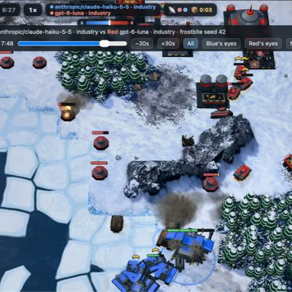
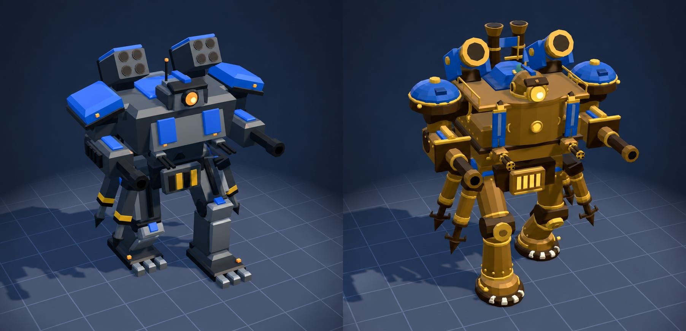

# 🐦 @simonw

## 📅 October 21, 2026

> 2 post(s) archived.

---

### 🕐 16:29 UTC · @simonw

> When I slapped an Apache 2.0 License on the code yesterday I did not expect anything this neat to come out of it, and certainly not so fast https://simonwillison.net/2026/Oct/20/battledrones/

🔗 [View original post](https://x.com/simonw/status/2112944299906347425)

---

### 🕐 16:28 UTC · @simonw

> There&apos;s a French fork of Battle Drones with new models and music (and a cinematic intro video) and it is SO cool! https://menufactory43.github.io/panache/ Here&apos;s the old v.s. new Goliath model Merci @simonw! 🎩 I forked Battle Drones into Panache: a French Belle Époque RTS, with dirigibles, steam tractors, clockwork soldiers in képis and Gargantua, a walking steam fortress. Fully in French, built with Claude Code. https://github.com/menufactory43/panache

🔗 [View original post](https://x.com/simonw/status/2112944161670488423)

---
