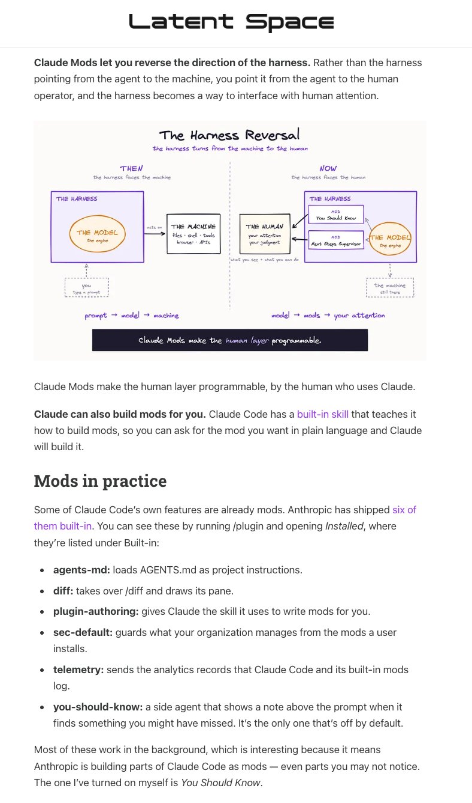

# 🐦 @swyx

## 📅 October 21, 2026

> 11 post(s) archived.

---

### 🕐 21:11 UTC · @swyx

> ok we are doing another high taste testers on the elizabeth holmes documentary: YOU CAN SEE EVERYTHING this Saturday in SF - who is in and has Hot Takes about the best movie of the year? 🆕 show: HIGH TASTE TESTERS We convene top Al power users to compare what actually works-and what falls apart once you start using it.@davis7, @benhylak, @dexhorthy, @allisonology, @altryne and @swyx give you unfiltered takes on @OpenAl DevDay, Dots vs Muse vs GrokBot vs Instinct…

🔗 [View original post](https://x.com/swyx/status/2113015355878850909)

---

### 🕐 20:59 UTC · @swyx

> https://x.com/transitive_bs/status/2113007529508970780 @swyx @trq212 @_catwu the link: https://www.latent.space/p/claude-mods

🔗 [View original post](https://x.com/swyx/status/2113012423892611493)

---

### 🕐 20:24 UTC · @swyx

> When we framed @trq212&apos;s pod about Claude Code&apos;s Next Era, we meant it. we took some directive from @_catwu and did a proper deep dive on the new Claude Mods and highilghted our faves and what you should try now. in the same way that LLMs had that evolution from specific -&gt; foundation -&gt; specific, CC is much more of a malleable, general purpose hardened harness that has &quot;pretrained&quot; on quadrillions of tokens of learning that you can now repurpose for any domain specific harness! thanks to @ricmac and @daniel_mac8 for working on our latest product dive. if you have stuff you&apos;d like us to test and write up, we&apos;re open to chat at business@latent.space There&apos;s not enough buzz around Claude Mods. Read this Claude Mods article if you want to: - Understand Claude Mods basics - Install and use the most useful mods today - Ponder where the agent-human interface will go For @latentspacepod.

🔗 [View original post](https://x.com/swyx/status/2113003628835553559)

---

### 🕐 19:40 UTC · @swyx

> highly recommend everyone to have private alt accounts*. the x web is bad at account switching, but on mobile it is frictionless. its basically the same &quot;group chat but its ok if you dont read everything&quot; experience but for your mutuals. tips - assume everything is public, screenshotting is real, dont be stupid. this is not the &quot;i shit talk people behind their back&quot;, the right attitude is &quot;this isnt high signal enough for my main account but i&apos;m 1) taking notes for self, 2) have a throwaway thought, 3) i&apos;m happy to chat about it&quot; - give mutuals critical feedback that they might appreciate. &quot;praise in public, criticise in private&quot;. because its not public, they know you actually do mean well - link/replyguy your alt for people to discover periodicially in case they dont know you have one * i like it so much that i call this the &quot;insta/finsta&quot; pattern - every social network should by default give people a public profile and a private one by default. tbd on the third account, the &quot;botsta&quot;.

🔗 [View original post](https://x.com/swyx/status/2112992347890106650)

---

### 🕐 17:36 UTC · @swyx

> this one also blowing up, one talk two W’s https://x.com/theturingpost/status/2112939226765439398?s=46 @swyx @jediahkatz @poteto love this talk, as you know it inspired me to record https://www.youtube.com/watch?v=pEHfZUrahGc&amp;t=6s

🔗 [View original post](https://x.com/swyx/status/2112961323550335062)

---

### 🕐 10:14 UTC · @swyx

> btw at 100k views in 24hrs, @jediahkatz&apos;s talk is an early candidate to be THE breakout talk of aie nyc the bar is set very high for @poteto&apos;s keynote at AIE CODE next month hahaha Inside Grok Bot: is the agent harness dead? @jediahkatz of @SpaceXSI explains why smarter models let Cursor remove prompts and guardrails, and why Grok Bot is adding them back. Watch his AI Engineer New York talk: https://www.youtube.com/watch?v=7Y4sbZgBdnc

🔗 [View original post](https://x.com/swyx/status/2112849969640259611)

---

### 🕐 07:34 UTC · @swyx

> @willcb i think its about throughput per mw being much better distributed first of all but also jevons. we are clearly living in a supply-constrained world, not demand constrained. more tokens = more revenue, not more tokens = less price = same revenue

🔗 [View original post](https://x.com/swyx/status/2112809642745380866)

---

### 🕐 07:13 UTC · @swyx

> i retired from the business of making single-stock calls a decade ago but trust me when i say that the stock market still has no idea that what happened every single gpu sold gained ~30% in lifetime value today and the stock should be up by about $600B lol the more you buy, the more you buy deepseek&apos;s production numbers are kinda wild: 155T tokens/day from one cluster (96% input cache hits) and $38 revenue/GPU-hour at off-peak prices. at $5–8/GPU-hour, that’s ~80% margin on GPU costs alone. at DeepSeek prices!! we dug into the math, their 72-hour cache, and what act…

🔗 [View original post](https://x.com/swyx/status/2112804427962970271)

---

### 🕐 06:11 UTC · @swyx

> Judge for yourself whether @seejayhess just made &quot;orbin&apos; out&quot; happen https://www.youtube.com/watch?v=Vki6cklFqxo Media

🔗 [View original post](https://x.com/sqs/status/2112788777433473480)

---

### 🕐 05:06 UTC · @swyx

> opus is great for writing... when you dont happen to have any random no-no words in your prompt. jfc, @CompleteSkeptic is right, give me prod, not god. i cant build an ai media org with this in the critical path. can confirm. ran @latentspacepod AINews side by side with 6 Sol and the difference was night and day: https://www.latent.space/p/ainews-claude-opus-55-the-new-default 5.5 Opus is the new default model for AINews going forward. so much more concise and tasteful reporting, with muc…

🔗 [View original post](https://x.com/swyx/status/2112772374823407870)

---

### 🕐 04:33 UTC · @swyx

> i tried to make codex make animated explainer videos but ngmi https://inf.latent.space/blender/story-dspark

🔗 [View original post](https://x.com/swyx/status/2112764130197451209)

---
