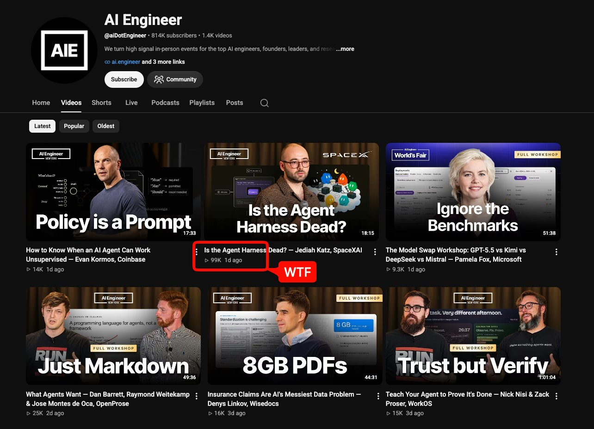
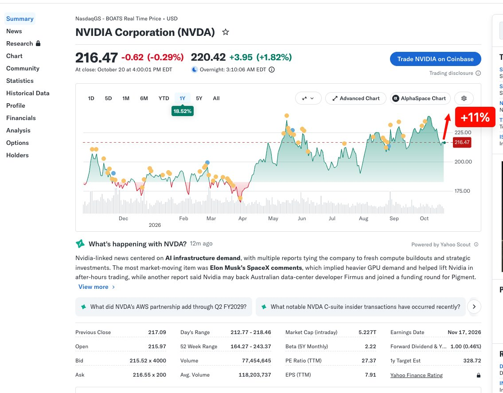
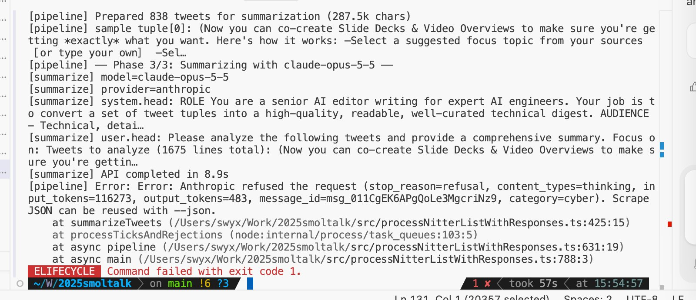

# 🐦 @swyx

## 📅 October 21, 2026

> 6 post(s) archived.

---

### 🕐 10:14 UTC · @swyx

> btw at 100k views in 24hrs, @jediahkatz&apos;s talk is an early candidate to be THE breakout talk of aie nyc the bar is set very high for @poteto&apos;s keynote at AIE CODE next month hahaha Inside Grok Bot: is the agent harness dead? @jediahkatz of @SpaceXSI explains why smarter models let Cursor remove prompts and guardrails, and why Grok Bot is adding them back. Watch his AI Engineer New York talk: https://www.youtube.com/watch?v=7Y4sbZgBdnc

🔗 [View original post](https://x.com/swyx/status/2112849969640259611)

---

### 🕐 07:34 UTC · @swyx

> @willcb i think its about throughput per mw being much better distributed first of all but also jevons. we are clearly living in a supply-constrained world, not demand constrained. more tokens = more revenue, not more tokens = less price = same revenue

🔗 [View original post](https://x.com/swyx/status/2112809642745380866)

---

### 🕐 07:13 UTC · @swyx

> i retired from the business of making single-stock calls a decade ago but trust me when i say that the stock market still has no idea that what happened every single gpu sold gained ~30% in lifetime value today and the stock should be up by about $600B lol the more you buy, the more you buy deepseek&apos;s production numbers are kinda wild: 155T tokens/day from one cluster (96% input cache hits) and $38 revenue/GPU-hour at off-peak prices. at $5–8/GPU-hour, that’s ~80% margin on GPU costs alone. at DeepSeek prices!! we dug into the math, their 72-hour cache, and what act…

🔗 [View original post](https://x.com/swyx/status/2112804427962970271)

---

### 🕐 06:11 UTC · @swyx

> Judge for yourself whether @seejayhess just made &quot;orbin&apos; out&quot; happen https://www.youtube.com/watch?v=Vki6cklFqxo Media

🔗 [View original post](https://x.com/sqs/status/2112788777433473480)

---

### 🕐 05:06 UTC · @swyx

> opus is great for writing... when you dont happen to have any random no-no words in your prompt. jfc, @CompleteSkeptic is right, give me prod, not god. i cant build an ai media org with this in the critical path. can confirm. ran @latentspacepod AINews side by side with 6 Sol and the difference was night and day: https://www.latent.space/p/ainews-claude-opus-55-the-new-default 5.5 Opus is the new default model for AINews going forward. so much more concise and tasteful reporting, with muc…

🔗 [View original post](https://x.com/swyx/status/2112772374823407870)

---

### 🕐 04:33 UTC · @swyx

> i tried to make codex make animated explainer videos but ngmi https://inf.latent.space/blender/story-dspark

🔗 [View original post](https://x.com/swyx/status/2112764130197451209)

---
