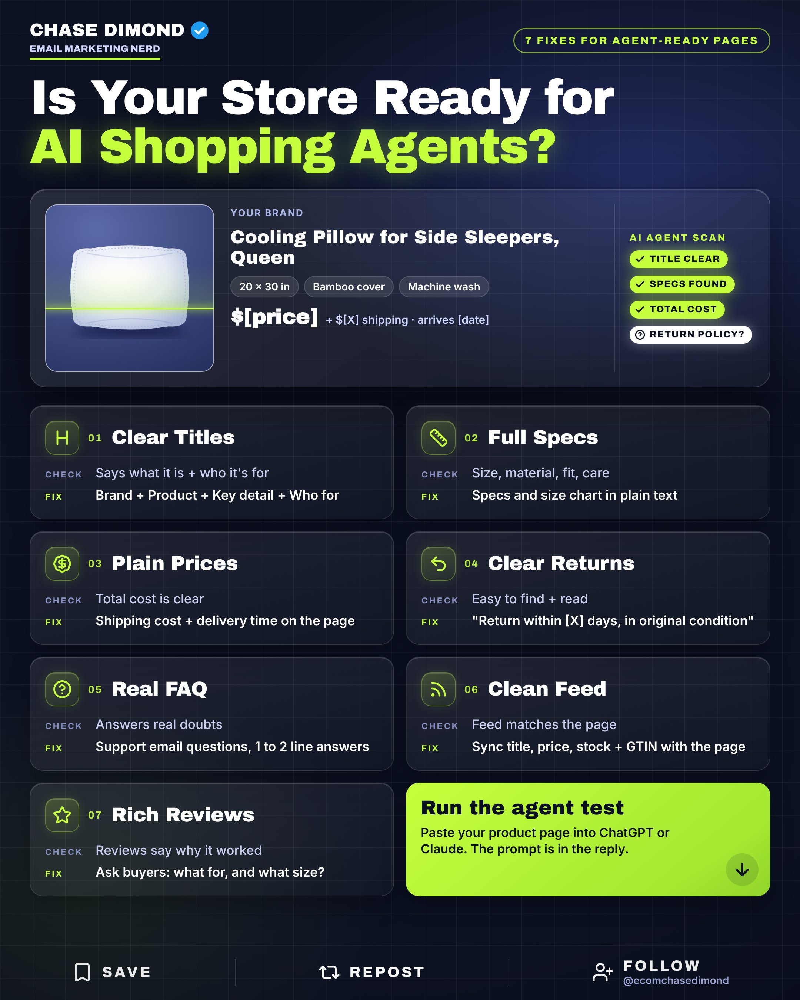
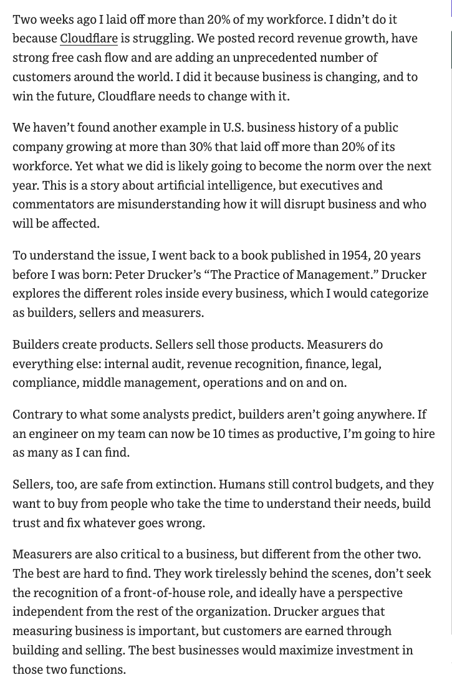

# 🐦 @AiEvolutio58513

## 📅 October 22, 2026

> 4 post(s) archived.

---

### 🕐 15:49 UTC · @AiEvolutio58513

> AI agents are starting to shop for your customers. Walmart just opened its doors to them with a beta for developers. Is your store ready? 7 fixes:

🔗 [View original post](https://x.com/ecomchasedimond/status/2113296813159821540)

---

### 🕐 14:00 UTC · @AiEvolutio58513

> &gt; be Alexandr Wang &gt; raised in Los Alamos by two physicists from the national lab &gt; leave MIT at 19 &gt; found Scale AI, labeling the data every AI lab trains on &gt; world&apos;s youngest self-made billionaire at 24 &gt; Zuckerberg pays $14.3B for 49% of your company &gt; then hands you Meta&apos;s superintelligence lab &gt; rebuild Meta&apos;s entire AI org within months &gt; Zuck signs off on $100-200 billion &gt; asks if you&apos;re sure it&apos;ll work &gt; &quot;certainly not clear at all that it was going to work.&quot; &gt; ship Muse Wonder anyway &gt; Meta&apos;s internal tests rank it next to Fable 5.1 and GPT-6 Astra Interested in AI? Follow @AiEvolutio58513 and never fall behind. I track ChatGPT, Claude, and every tool quietly changing how we work and create, then hand you the tested signals. Media

🔗 [View original post](https://x.com/AiEvolutio58513/status/2113269203704963265)

---

### 🕐 13:00 UTC · @AiEvolutio58513

> Cloudflare CEO Matthew Prince on how AI decides who gets laid off first: He just cut more than 20% of his workforce, in a record revenue year. His explanation: “AI isn’t coming for builders or sellers, but it is coming for measurers.” Who went: 1. Middle managers, because “AI allows us to have more direct reports per manager while still measuring and mentoring our teams effectively.” 2. Most of marketing, which “like in most companies, was teeming with measurers.” 3. Parts of finance, folded together and automated. The part every CEO will read: “We haven’t found another example in U.S. business history of a public company growing at more than 30% that laid off more than 20% of its workforce. Yet what we did is likely going to become the norm over the next year.” Meanwhile, almost a million people applied for 1,111 paid internships. Every intern hired is a builder or a seller. Interested in AI? Follow @AiEvolutio58513 and never fall behind. I track ChatGPT, Claude, and every tool quietly changing how we work and create, then hand you the tested signals.

🔗 [View original post](https://x.com/AiEvolutio58513/status/2113254107171717220)

---

### 🕐 11:02 UTC · @AiEvolutio58513

> Dario Amodei explains why up to $20 trillion of capital is now betting on one thing: building AI as fast as possible, and why he keeps warning about it anyway. &quot;Hundreds of billions to trillions to I would say maybe 20 trillion of capitals on the side of accelerate AI as fast as possible.&quot; Why the money is coming: 1. &quot;If I&apos;m right, in a couple years, it&apos;ll be the biggest source of revenue in the world.&quot; 2. &quot;It&apos;ll be the biggest industry in the world. And people who run companies already think it.&quot; 3. Next to that pile, he says Anthropic &quot;looks very small.&quot; And the people pushing back on him are not small either: &quot;I have people who run $4 trillion companies criticizing me for talking about the dangers of the technology.&quot; &quot;Every time I do that, I get attacked by many of my peers.&quot; His answer: &quot;And yet, I&apos;m going to continue to do it.&quot; Interested in AI? Follow @AiEvolutio58513 and never fall behind. I track ChatGPT, Claude, and every tool quietly changing how we work and create, then hand you the tested signals. Media

🔗 [View original post](https://x.com/AiEvolutio58513/status/2113224389617680455)

---
