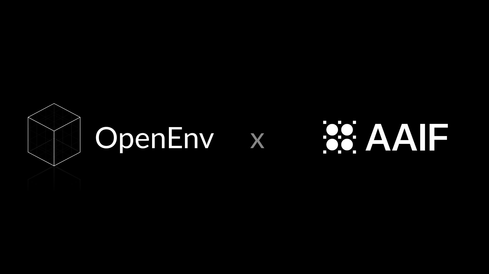
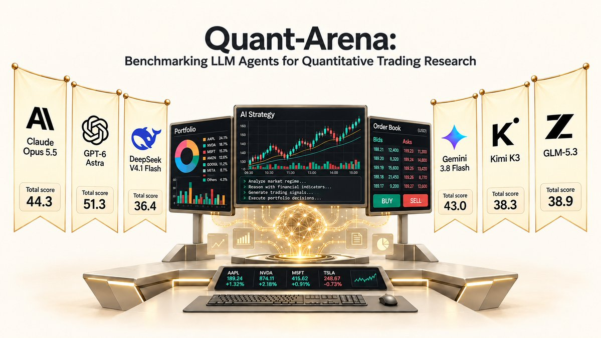
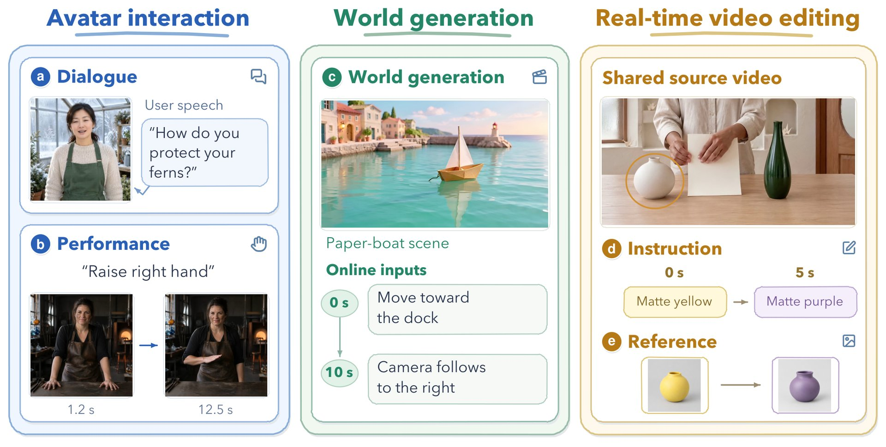

# 🐦 @_akhaliq

## 📅 October 22, 2026

> 7 post(s) archived.

---

### 🕐 17:00 UTC · @_akhaliq

> We&apos;re announcing the public beta of http://datavendor.ai We spent the last two years building the best solution for people buying and selling data, whether you&apos;re a researcher in a lab or a company trying to sell data. Data is the fundamental bottleneck for AI progress, and DataVendor will be the infra that solves it. Media

🔗 [View original post](https://x.com/datavendor_ai/status/2113314504859852832)

---

### 🕐 16:44 UTC · @_akhaliq

> Today distributed cognition exits out of stealth with backing by Verdict Capital. Our mission is to replicate humanity&apos;s collective intelligence. Read more: https://dcog.com/research/our-imperative-duty-to-exist Most of today&apos;s AI power is held in the hands of a few, who can choose what you&apos;re allowed to think and what you&apos;re permitted to do. We stand on three substantially different foundational beliefs: - You shouldn&apos;t ask permission for intelligence. - Superintelligence will be a distributed collective. - Humans are not meant to be relegated to a permanent underclass. If we don&apos;t distribute intelligence, nobody will. Media

🔗 [View original post](https://x.com/distcog/status/2113310654367158716)

---

### 🕐 16:12 UTC · @_akhaliq

> SpatialScout: Can VLM agents actively explore and map 3D scenes? A new benchmark for evaluating vision-language models on active object-level 3D mapping across 80 scenes and 3,140 objects. Media

🔗 [View original post](https://x.com/HuggingPapers/status/2113302391839760403)

---

### 🕐 15:55 UTC · @_akhaliq

> So proud to share that @huggingface is giving OpenEnv to the AAIF and Linux Foundation so that it can be neutrally governed and shared by all. This is a pivotal moment for RL, agents, and the whole field, and making agents’ learning environments open source is only getting more important by the day. We believe, now more than ever, that democratizing AI requires a fully open stack. Reinforcement Learning environments are a fundamental part of that stack because they teach agents the capabilities they will use in the real world. The committee behind OpenEnv is proud to bring AAIF into Reinforcement Learning, and further down the stack, by sharing what we’ve built and used at; Hugging Face, Microsoft, Reflection, Meta-PyTorch, Fleet, Mercor, RadixArk, Nebius, Modal, Prime Intellect, Unsloth, and more.

🔗 [View original post](https://x.com/ben_burtenshaw/status/2113298265857007801)

---

### 🕐 14:44 UTC · @_akhaliq

> Looking Ahead Modeling Future Evolution in Autoregressive Video Generation paper: https://huggingface.co/papers/2610.29989 Media

🔗 [View original post](https://x.com/_akhaliq/status/2113280305301971067)

---

### 🕐 14:30 UTC · @_akhaliq

> Predicting a stock&apos;s next move? That&apos;s the warm-up act. The real exam for LLM agents: building signals from raw data, learning from losses, and making money on data it has never seen before. That&apos;s exactly what we built. Today we’re releasing Quant-Arena, a benchmark for end-to-end quantitative research on real A-share market data. 9 frontier models. 3,042 stocks. One sealed year, 2024. Only 4 of the 9 models made money.Quant research is still wide open. Full breakdown 👇 Project: https://lab.einsia.ai/quant-arena Paper: http://arxiv.org/abs/2610.30113 Arena: https://quant.lab.einsia.ai/arena

🔗 [View original post](https://x.com/EinsiaAI/status/2113276693108408812)

---

### 🕐 12:16 UTC · @_akhaliq

> StreamEval: The first benchmark for interactive streaming video generation It evaluates 37 models across 5 tasks with 300 scripted test cases, revealing that reliable request execution remains a central challenge.

🔗 [View original post](https://x.com/HuggingPapers/status/2113243173606826159)

---
