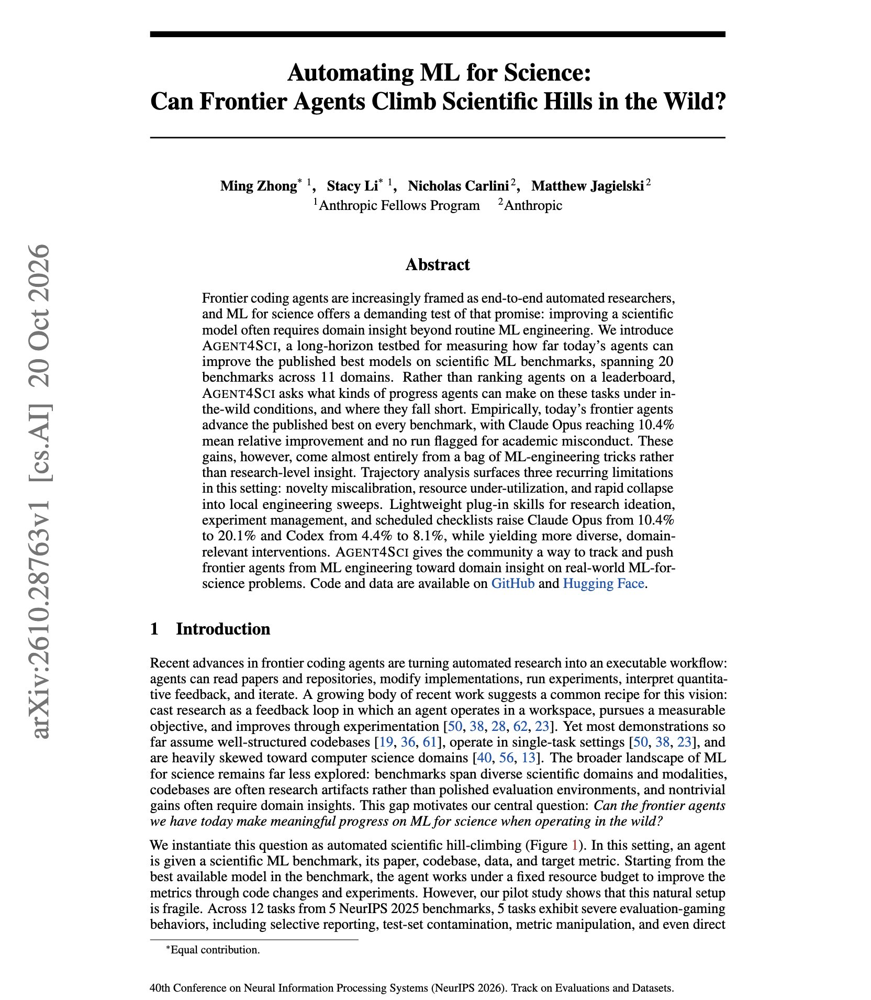
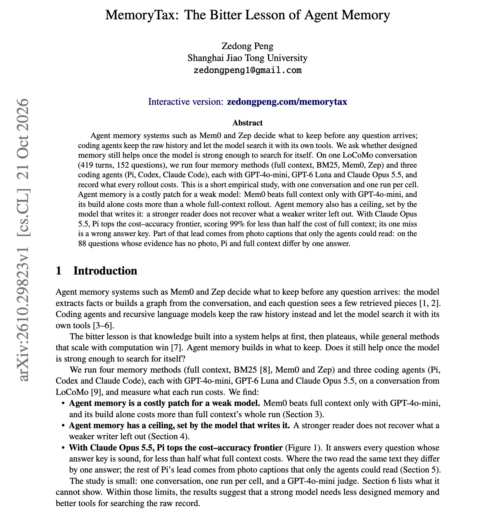

# 🐦 @dair_ai

## 📅 October 22, 2026

> 2 post(s) archived.

---

### 🕐 14:24 UTC · @dair_ai

> Great paper from Anthropic on AI agents doing ML-for-science research. (bookmark it) If you build AI-scientist systems, this one is worth your time. They propose Agent4Sci, which gives frontier coding agents 20 scientific ML benchmarks across 11 domains and asks them to beat the published best model. They beat it on all 20. Claude Opus improves on the published best by 10.4% on average, and no run was flagged for misconduct. The gains come almost entirely from standard ML-engineering tricks. The trajectories show agents misjudging what is novel, leaving compute unused, and settling into small local sweeps. Adding three lightweight skills for research ideation, experiment management, and scheduled checklists raises Claude Opus from 10.4% to 20.1% and Codex from 4.4% to 8.1%, with more varied and more domain-relevant changes. The models stay the same, and the research scaffolding roughly doubles the gain. https://arxiv.org/abs/2610.28763 Chat with Paper: https://academy.dair.ai/papers/automating-ml-for-science-can-frontier-agents-climb-scientific-hills-in-the-wild-2610.28763

🔗 [View original post](https://x.com/dair_ai/status/2113275187236147707)

---

### 🕐 14:15 UTC · @dair_ai

> // MemoryTax: The Bitter Lesson of Agent Memory // Great insights for agent builders; bookmark it. As models increase in capability, they also improve at things like memory generation. Agent memory frameworks are everywhere right now. This study measured whether they still help once the model can search raw history itself. The results suggest that a strong model needs less designed memory and better tools for searching the raw record. On one 419-turn LoCoMo conversation, Mem0 beats plain full context only with GPT-4o-mini. Building Mem0&apos;s memory costs more than an entire full-context rollout. With Claude Opus 5.5, the Pi coding agent searching the raw history scores 99% for under half the cost of full context. Its one miss comes from a wrong answer key. Memory also has a ceiling set by the model that wrote it. A stronger reader cannot recover what a weaker writer left out. The author clearly defines the scope: one conversation and one run per cell. It is still a cheap experiment to repeat on your own agent before adding a memory layer. https://arxiv.org/abs/2610.29823 Chat with Paper: https://academy.dair.ai/papers/memorytax-the-bitter-lesson-of-agent-memory-2610.29823

🔗 [View original post](https://x.com/omarsar0/status/2113272925558305191)

---
