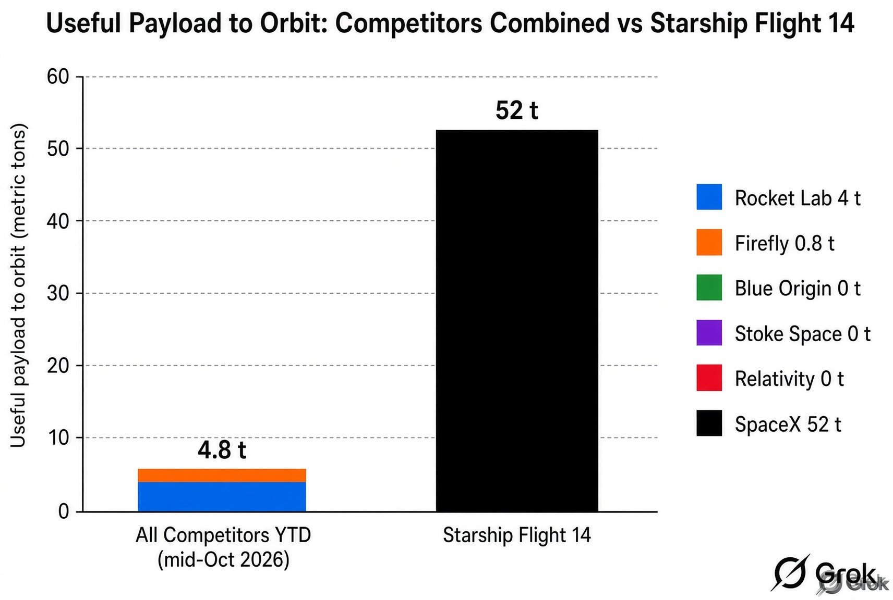
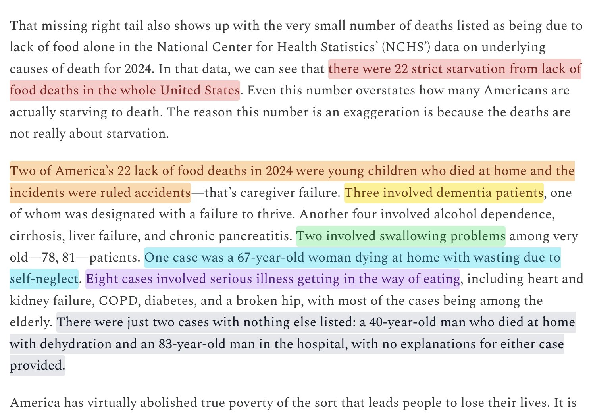
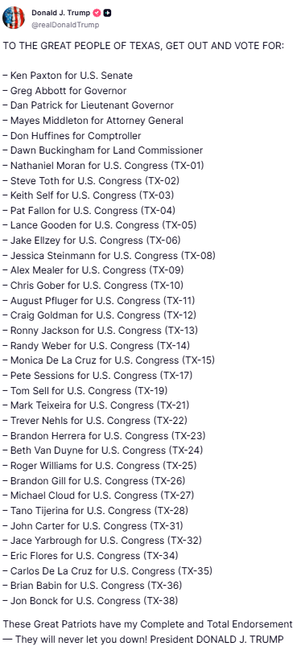

# 🐦 @elonmusk

## 📅 October 22, 2026

> 23 post(s) archived.

---

### 🕐 17:19 UTC · @elonmusk

> Talarico hates Texas and America Democrat Nominee for U.S. Senate in Texas James Talarico says he hates Voter ID with every fiber of his being and calls it Anti-American. 84% of Americans support Voter ID…

🔗 [View original post](https://x.com/elonmusk/status/2113319277092642942)

---

### 🕐 17:09 UTC · @elonmusk

> Important to vote TO THE GREAT PEOPLE OF TEXAS, GET OUT AND VOTE FOR: – Ken Paxton for U.S. Senate – Greg Abbott for Governor – Dan Patrick for Lieutenant Governor – Mayes Middleton for Attorney General – Don Huffines for Comptroller – Dawn Buckingham for Land Commissioner – Nathaniel Moran for U.…

🔗 [View original post](https://x.com/elonmusk/status/2113316775291142572)

---

### 🕐 17:02 UTC · @elonmusk

> Go vote! TO THE GREAT PEOPLE OF TEXAS, GET OUT AND VOTE FOR: – Ken Paxton for U.S. Senate – Greg Abbott for Governor – Dan Patrick for Lieutenant Governor – Mayes Middleton for Attorney General – Don Huffines for Comptroller – Dawn Buckingham for Land Commissioner – Nathaniel Moran for U.…

🔗 [View original post](https://x.com/KenPaxtonTX/status/2113315072563163174)

---

### 🕐 16:22 UTC · @elonmusk

> Grok @Bot Grok Bot genuinely changed my life. My Bots are now part of pretty much everything I do, both at work and in my personal life. It’s actually crazy how much I rely on them now.

🔗 [View original post](https://x.com/elonmusk/status/2113304960326652163)

---

### 🕐 15:22 UTC · @elonmusk

> Grok is attracting a higher share of new users than every other major SI website In September 2026 alone, 40.91% of https://Grok.com traffic came from new users…..the highest share among ChatGPT, Gemini, Claude and DeepSeek Among the leading Gen AI tools, Grok had the highest percentage of new users visiting its website in September 2026.

🔗 [View original post](https://x.com/XFreeze/status/2113289921104613728)

---

### 🕐 15:18 UTC · @elonmusk

> Yup Hillary wants the Supreme Court expanded to 13 Justices -- but not until &quot;Democrats are in power.&quot; Because it&apos;s all about making the court less partisan and has nothing to do with entrenching Democrat power, of course.

🔗 [View original post](https://x.com/elonmusk/status/2113288958738366650)

---

### 🕐 14:50 UTC · @elonmusk

> Estimated metric tons of useful payload delivered to orbit in Year-to-Date 2026 by Rocket Lab, Firefly, Blue Origin, Stoke Space, and Relativity combined... ... versus useful payload SpaceX put in orbit on only September 28, 2026. 👀 Chart courtesy: @Grok $SPCX

🔗 [View original post](https://x.com/ICannot_Enough/status/2113281788072149401)

---

### 🕐 14:24 UTC · @elonmusk

> How many Americans actually just straight-up starve to death? In the latest data, from 2024, there were 22 cases. And not even one of them was about poverty making it unaffordable to obtain food. How many Americans live paycheck-to-paycheck? How many are starving? The answer to both questions is--despite what you might have heard from the news media--not many. Link: https://www.cremieux.xyz/p/how-many-americans-live-paycheck

🔗 [View original post](https://x.com/cremieuxrecueil/status/2113275220551451037)

---

### 🕐 13:47 UTC · @elonmusk

> Today is a great day to vote early in person for @KenPaxtonTX. If Texas falls, there is no future for our country.

🔗 [View original post](https://x.com/ScottPresler/status/2113265992667148580)

---

### 🕐 10:38 UTC · @elonmusk

> Grok Bot is now on X Chat

🔗 [View original post](https://x.com/techdevnotes/status/2113218324809269398)

---

### 🕐 10:13 UTC · @elonmusk

> How it started vs how it’s going Seven years ago, Starhopper barely left the ground. Today, Starship has reached space Media

🔗 [View original post](https://x.com/XFreeze/status/2113212166497357963)

---

### 🕐 10:07 UTC · @elonmusk

> True Margaret Thatcher explained this perfectly back in 1983 The government doesn&apos;t have money of its own. Every time politicians promise to spend more, someone has to pay for it And people somehow still think it&apos;s someone else&apos;s money “There is no such thing as public money. There is…

🔗 [View original post](https://x.com/elonmusk/status/2113210745710162001)

---

### 🕐 09:57 UTC · @elonmusk

> 🚨 TEXAS: President Trump just dropped his FULL endorsement slate, and every one of these Patriots needs your vote. Ken Paxton for U.S. Senate. Greg Abbott for Governor. Dan Patrick for Lieutenant Governor. Mayes Middleton for Attorney General. And 30 America First fighters for Congress, all the way down the ballot. Early voting is open RIGHT NOW and runs through Friday, October 30. Election Day is November 3. The Democrats are pouring money in because they think Texas is up for grabs. Prove them wrong. Vote straight Republican. Keep Texas RED. 🇺🇸

🔗 [View original post](https://x.com/GuntherEagleman/status/2113208193631301855)

---

### 🕐 09:38 UTC · @elonmusk

> From what I can tell from my exposure to it, the Japanese voice on this platform is the most blessed and wholesome signal in world media. 🩷🇯🇵

🔗 [View original post](https://x.com/xenocosmography/status/2113203265341165866)

---

### 🕐 09:05 UTC · @elonmusk

> Mercedes sold its Tesla stake for $780 million. that same 4 percent is worth about $56 billion today. in the clip below Musk explains how Mercedes ended up there. the US government gave Tesla almost $500 million, and he is asked directly whether that loan saved the company. he says no. what saved it was a $50 million check from Daimler in May 2009. all of Tesla was worth $550 million then. &quot;they were the only ones. there was no other company, no other entity of any kind from which we could get investments.&quot; Tesla repaid the government&apos;s $500 million with interest and a prepayment penalty, ten years early. he sent a thank you note with it. &quot;i don&apos;t like having a lot of debt. the taxpayers supported Tesla, we ought to repay them as soon as we can.&quot; Mercedes turned $50 million into $780 million and walked away in 2014. so was that a great investment - or the most expensive mistake in car industry history? Media

🔗 [View original post](https://x.com/Di_Krass_/status/2113194901341085989)

---

### 🕐 08:48 UTC · @elonmusk

> How to share 𝕏.com links with friends and family? → Use the &apos;&apos;Share icon&apos;&apos; located at the bottom right of the post. Unfortunately, many people still believe everything they see on the news. Do your part in spreading the truth — forward 𝕏 posts. Media

🔗 [View original post](https://x.com/cb_doge/status/2113190860691214348)

---

### 🕐 08:40 UTC · @elonmusk

> True In September 2014, Elon stood under a tent on an almost empty beach at the very tip of South Texas, waves crashing just over the dunes, and broke ground on a launch site. In May 2025, he stood in front of a crowd at that same corner of Texas and said it plainly: &quot;not that long ag…

🔗 [View original post](https://x.com/elonmusk/status/2113188655225618459)

---

### 🕐 08:39 UTC · @elonmusk

> Something deeply wrong with Talarico James talarico headlined a Pride event alongside an 11-year-old child drag queen named &quot;Kween Kee Kee.&quot; One attendee posted video of the young boy doing the splits. Another performance was by an adult man who goes by the raunchy name &quot;Sedonya Face.&quot; The event touted more than 30 …

🔗 [View original post](https://x.com/elonmusk/status/2113188454788174293)

---

### 🕐 02:21 UTC · @elonmusk

> “Noncitizens don’t vote,” they said. So how is it that 28% of noncitizens in California have voted? These things can’t both be true. EXTREMELY IMPORTANT 🚨 Federal Lawsuit against California shows that 28.8% of noncitizens in California HAVE A VOTING HISTORY California elections are not legitimate, noncitizens are voting at an extremely large scale - Los Angeles County elections officials took a sample batch o…

🔗 [View original post](https://x.com/BasedMikeLee/status/2113093322172768706)

---

### 🕐 01:57 UTC · @elonmusk

> James Talarico: The least-Texan man in Texas Media

🔗 [View original post](https://x.com/BasedMikeLee/status/2113087245544722459)

---

### 🕐 01:46 UTC · @elonmusk

> Today I early voted in Texas. Straight Republican. Dems are not worth the risk to all the great builders and projects here. Can&apos;t stop, won&apos;t stop.

🔗 [View original post](https://x.com/SERobinsonJr/status/2113084517674254688)

---

### 🕐 01:33 UTC · @elonmusk

> Talarico hates Texas Democrat Nominee for U.S. Senate in Texas James Talarico calls for “a pathway for citizenship” for illegal aliens. 10 million illegal aliens came into the country in just 4 years under Biden alone.

🔗 [View original post](https://x.com/elonmusk/status/2113081289570127971)

---

### 🕐 01:21 UTC · @elonmusk

> @jamestalarico In your own words … Every word is James Talarico’s. 27 clips. 4 minutes. 2019–2026. “God is non-binary.” “…many more than two biological sexes. In fact, there are six.” “If you deny your child’s gender identity… it’s abusive for sure.” “There’s only one person who can determine a child’s gender iden…

🔗 [View original post](https://x.com/elonmusk/status/2113078348075209056)

---
