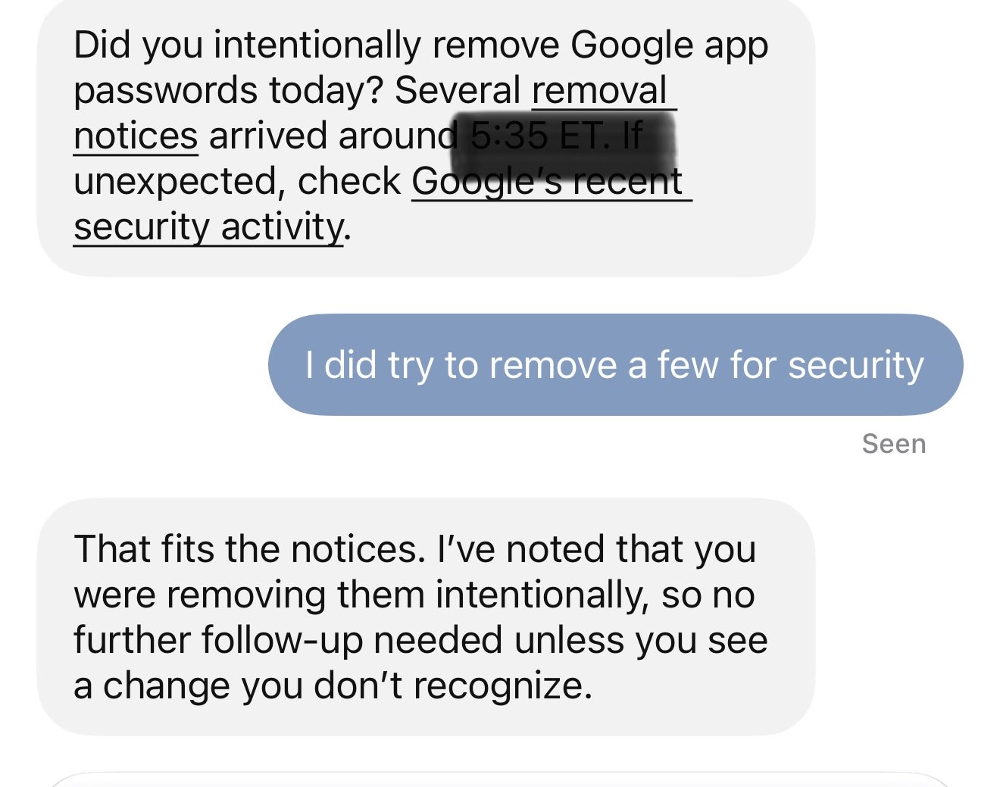
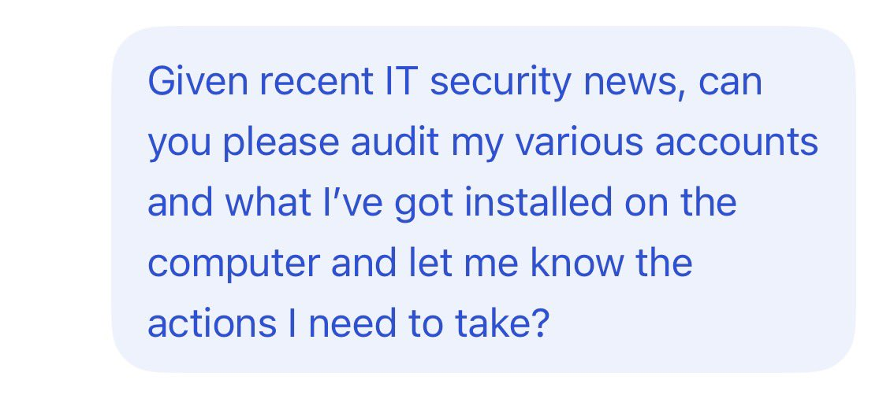
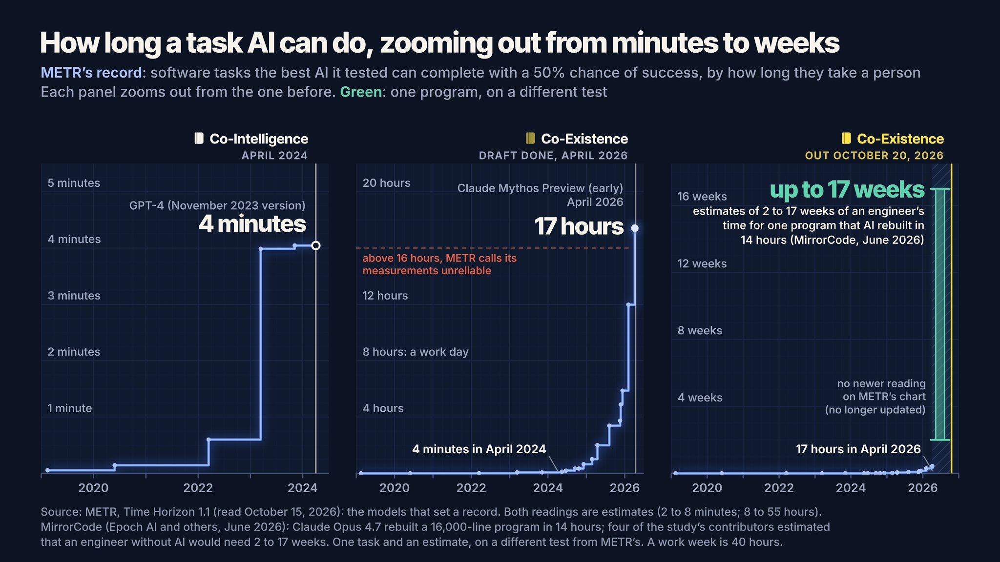

# 🐦 @emollick

## 📅 October 22, 2026

> 5 post(s) archived.

---

### 🕐 22:35 UTC · @emollick

> And my Dot acted as a nice second line of defense. I just got this message from It.

🔗 [View original post](https://x.com/emollick/status/2113398973872455996)

---

### 🕐 20:06 UTC · @emollick

> Very useful prompt for Codex with computer use.

🔗 [View original post](https://x.com/emollick/status/2113361252173091114)

---

### 🕐 17:47 UTC · @emollick

> To be clear, it doesn’t take the AI 17 weeks to do 17 weeks of human equivalent work (and success rates are higher than 50% as well). And the study I pulled that from found it cost something like $241 in tokens to replicate the 17 weeks of human engineering work.

🔗 [View original post](https://x.com/emollick/status/2113326345682092263)

---

### 🕐 17:36 UTC · @emollick

> When my first AI book was published in 2024, the best AI could do 4 minutes of human work with a 50% chance of success When I turned in the draft of Co-Existence earlier this year, it was 17 hours When it was published two days ago, AI could do 17 weeks https://open.substack.com/pub/oneusefulthing/p/30-months-on-the-exponential-in-charts?r=i5f7&amp;utm_medium=ios

🔗 [View original post](https://x.com/emollick/status/2113323645284344215)

---

### 🕐 00:22 UTC · @emollick

> A visible sign of what AI insiders have been warning about since at least the Mythos release. Acceleration of attack and defense, at inhuman speeds, interacting with the very human systems that need to react to them. So basically, today PHP got two critical bugs that let anyone run code on your server without even logging in, which is bad, and then the details leaked before the patch was even out, which is worse, and it works on WordPress and MediaWiki and Magento and Joomla and Laravel, and …

🔗 [View original post](https://x.com/emollick/status/2113063313810792916)

---
