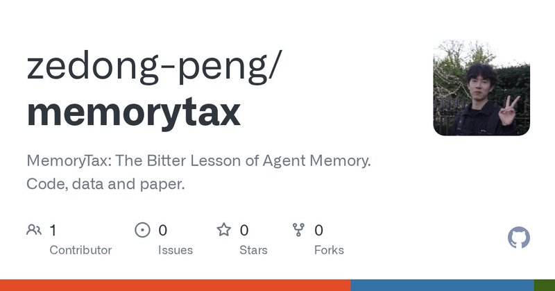

# 🐦 @omarsar0

## 📅 October 22, 2026

> 2 post(s) archived.

---

### 🕐 15:53 UTC · @omarsar0

> Recommended reading. I&apos;ve been testing decision models such as Jev and Drex Max for research tasks (e.g., paper classification). Just published our initial exploratory work on it. Drex Max is a strong fit for our use cases, and we are already planning production efforts around it. Multimodal decision models also open up a whole range of exciting areas. We&apos;ll share more results and resources soon. https://x.com/i/article/2113280256119312384

🔗 [View original post](https://x.com/omarsar0/status/2113297633737691572)

---

### 🕐 14:30 UTC · @omarsar0

> There is also code for it: https://github.com/zedong-peng/memorytax I think this is worth investigating, since newer models are much better at memory. Here is a somewhat related post: https://x.com/omarsar0/status/2113034713774363040?s=20 Recommended reading and a super-interesting benchmark for measuring continual learning capabilities through memory. Agent memory is largely unsolved. As agents advance in capabilities like long-horizon work, it&apos;s unclear which models or harnesses work best, or which memory system…

🔗 [View original post](https://x.com/omarsar0/status/2113276831969235226)

---
