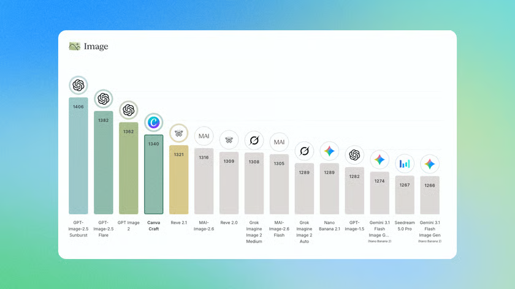
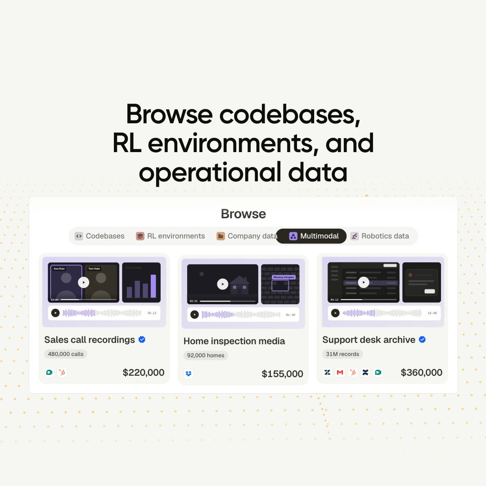
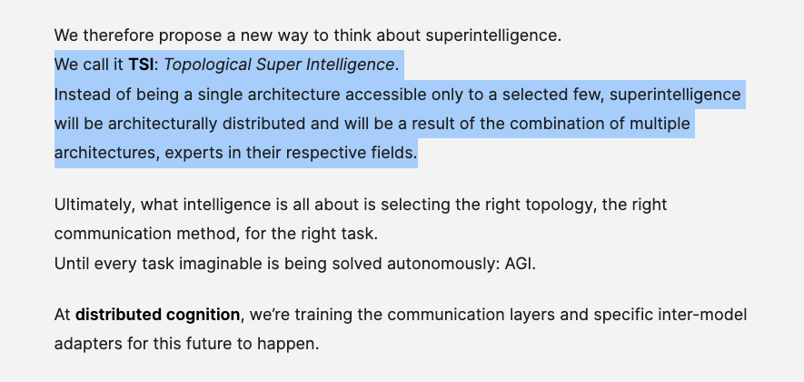
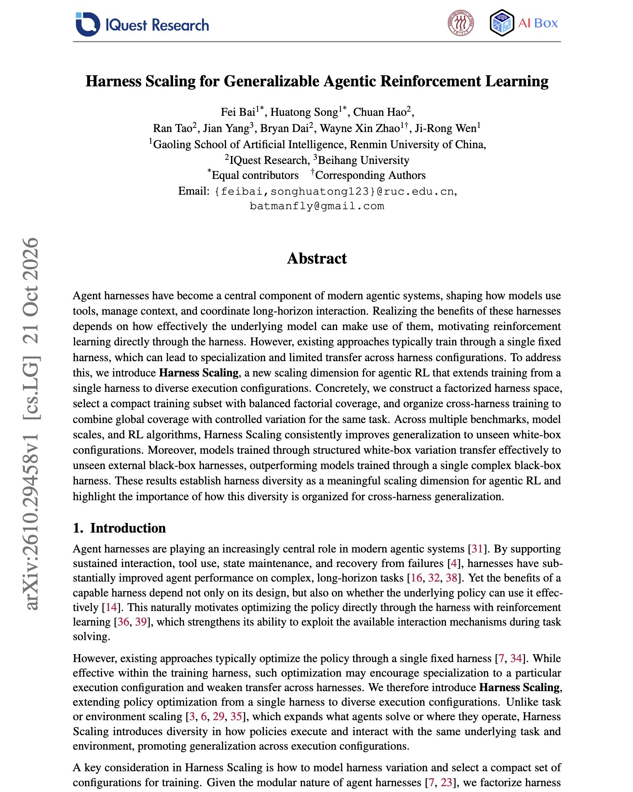

# 🐦 @omarsar0

## 📅 October 22, 2026

> 9 post(s) archived.

---

### 🕐 22:13 UTC · @omarsar0

> Crazy how good this is. I like the idea of making AI more collaborative. Kylon Annotations made this short clip of me. The paper stacks are accurate. 😅 It&apos;s very collaborative and lets a team analyze, annotate, and remix a video together. Media Copying is easy. Making it yours is hard. Meet Kylon Annotations: analyze, annotate and remix to add your team&apos;s taste together. Drop a video below and @kylon_ai , we&apos;ll remix for you.

🔗 [View original post](https://x.com/omarsar0/status/2113393347347763403)

---

### 🕐 19:37 UTC · @omarsar0

> Design Arena: https://x.com/DesignArena/status/2113349031762268476?s=20 Canva Craft, the first ever image model by @canva, takes the #4 spot on DesignArena&apos;s Image leaderboard. This makes Canva the #2 Image Lab after @OpenAI! Notably, it wins most often on photorealistic product and object shots, setting up studio-style lighting and detailed material…

🔗 [View original post](https://x.com/omarsar0/status/2113353954574631090)

---

### 🕐 19:32 UTC · @omarsar0

> Let&apos;s go!!! Extremely bullish on specialized models. And Canva just entered the frontier image model race. Craft is Canva&apos;s first image model for design, built by their Canva Research team. It can plan the composition before it renders anything. We use Canva at our company, so it&apos;s exciting to see where this goes, given their expertise. Introducing Canva Craft 🚀 Extraordinary image generation is now available to everyone, powered by our first frontier model built specifically for design. With Craft, Canva is now the world&apos;s second most advanced AI lab for image generation on @DesignArena&apos;s global leaderboard. S…

🔗 [View original post](https://x.com/omarsar0/status/2113352933874041325)

---

### 🕐 17:18 UTC · @omarsar0

> Data remains the workhorse of frontier AI models. Private, high-quality, domain-specific data is especially in demand. Great to see new marketplaces like HUD where individuals and companies license their data to AI labs. Listings include private codebases with full Git history and PRs, RL environments with their tasksets, and raw company records. We&apos;re announcing the public beta of http://datavendor.ai We spent the last two years building the best solution for people buying and selling data, whether you&apos;re a researcher in a lab or a company trying to sell data. Data is the fundamental bottleneck for AI progress, and DataV…

🔗 [View original post](https://x.com/omarsar0/status/2113318990424555560)

---

### 🕐 17:05 UTC · @omarsar0

> I like the vision of distributed superintelligence. But I do worry it&apos;s becoming less distributed. @distcog is exploring collective intelligence through networks of specialized models that work together. I like this research direction. I&apos;d be interested to see which tasks benefit from specialization and how much coordination costs as the network grows. Great vision and a nice article with interesting ideas. Recommended read. Today distributed cognition exits out of stealth with backing by Verdict Capital. Our mission is to replicate humanity&apos;s collective intelligence. Read more: https://dcog.com/research/our-imperative-duty-to-exist Most of today&apos;s AI power is held in the hands of a few, who can choo…

🔗 [View original post](https://x.com/omarsar0/status/2113315870491439132)

---

### 🕐 17:03 UTC · @omarsar0

> Brilliant work on using many harness configurations to scale agentic RL. Many approaches use mainly one fixed harness, which specializes the model but doesn&apos;t generalize well. This work uses many harness configurations as a scaling dimension. But the big question is whether it can generalize to harness configurations never seen in training. They pick a compact training subset with balanced factorial coverage, and vary one part of the harness at a time on the same task. Across benchmarks, model sizes, and RL algorithms, this improves results on harness configurations never seen in training. Models trained this way also transfer to unseen external black-box harnesses better than models trained through one complex black-box harness. If your model will run inside harnesses you did not train it in, treat harness diversity as its own scaling axis. https://arxiv.org/abs/2610.29458 Chat with Paper: https://academy.dair.ai/papers/harness-scaling-for-generalizable-agentic-reinforcement-learning-2610.29458

🔗 [View original post](https://x.com/omarsar0/status/2113315202414596098)

---

### 🕐 15:53 UTC · @omarsar0

> Recommended reading. I&apos;ve been testing decision models such as Jev and Drex Max for research tasks (e.g., paper classification). Just published our initial exploratory work on it. Drex Max is a strong fit for our use cases, and we are already planning production efforts around it. Multimodal decision models also open up a whole range of exciting areas. We&apos;ll share more results and resources soon. https://x.com/i/article/2113280256119312384

🔗 [View original post](https://x.com/omarsar0/status/2113297633737691572)

---

### 🕐 15:48 UTC · @omarsar0

> https://x.com/i/article/2113280256119312384

🔗 [View original post](https://x.com/omarsar0/status/2113296402289676594)

---

### 🕐 14:30 UTC · @omarsar0

> There is also code for it: https://github.com/zedong-peng/memorytax I think this is worth investigating, since newer models are much better at memory. Here is a somewhat related post: https://x.com/omarsar0/status/2113034713774363040?s=20 Recommended reading and a super-interesting benchmark for measuring continual learning capabilities through memory. Agent memory is largely unsolved. As agents advance in capabilities like long-horizon work, it&apos;s unclear which models or harnesses work best, or which memory system…

🔗 [View original post](https://x.com/omarsar0/status/2113276831969235226)

---
