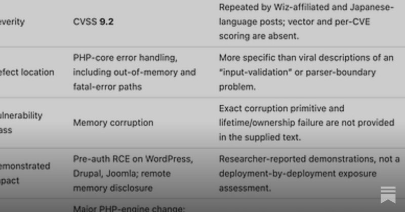

# 🐦 @swyx

## 📅 October 22, 2026

> 11 post(s) archived.

---

### 🕐 21:47 UTC · @swyx

> Deep stuff on @latentspacepod about GPU markets, why sandboxes are having a moment, and what&apos;s next for Modal. Thanks for having me!! Last week, @bernhardsson (Founder &amp; CEO, @modal) announced a $750M Series D. I sat down with him the prior week to discuss a ton of stuff about the business. We got into: -why 2027 might finally be the year of non-Nvidia chips -why open-source models made fine-tuning a lot less n…

🔗 [View original post](https://x.com/bernhardsson/status/2113386790023291203)

---

### 🕐 20:37 UTC · @swyx

> Last week, @bernhardsson (Founder &amp; CEO, @modal) announced a $750M Series D. I sat down with him the prior week to discuss a ton of stuff about the business. We got into: -why 2027 might finally be the year of non-Nvidia chips -why open-source models made fine-tuning a lot less necessary -how Modal&apos;s team grew 4x in a year and could hit ~700 people next year -why the frontier labs have the same business model as music artists and much, much, more… Enjoy! Timestamps: 0:00 What @modal does 1:25 From Spotify to building Modal 4:19 Founding before the generative AI boom 7:43 First customers and fundraising 10:00 Building for inference and autoscaling 13:21 Where Modal gets GPU capacity 15:39 Renting vs. owning infrastructure 19:45 The risk of GPU prices falling 24:18 Is AI demand infinite? 26:12 Alternatives to @nvidia 28:25 What Modal can learn from neoclouds 30:26 GPUs as an asset class 31:55 Modal’s products: functions and sandboxes 36:03 The case for smaller training workloads 41:21 How agent sandboxes are changing 46:48 @AnthropicAI and sandbox security 49:29 Using agents to test security 52:51 Developer experience in the age of agents 57:45 What Modal’s forward-deployed engineers do 59:55 Modal’s approach to product management 1:03:29 Optional code reviews and engineering culture 1:05:56 Cloud, on-prem and bring-your-own-cloud 1:09:25 Capacity, fundraising and growth 1:13:07 Scaling the team 1:17:28 Erik’s tweets: ephemeral sandboxes 1:18:31 The problem with rectangular GPU contracts 1:21:20 Inference providers vs. model builders 1:23:25 Where models improve next Media

🔗 [View original post](https://x.com/realbasilchatha/status/2113369200228253882)

---

### 🕐 19:57 UTC · @swyx

> imo this is the right attitude - dont blame AI for finding the bugs, just fucking lock in on clearing all the bugs asap https://www.latent.space/p/ainews-openais-patch-the-planet-program The folks at @latentspacepod with the perfect take, as usual:

🔗 [View original post](https://x.com/swyx/status/2113359027682050352)

---

### 🕐 16:15 UTC · @swyx

> I’m starting a new early-stage AI fund, doing what I love: partnering with founders from company formation on bold bets, long before consensus. The fund’s LPs will include Sequoia, Jeff Dean, Sachin Katti, Philip Wong (my Stanford professor and Chief Scientist adviser to TSMC), and others whose work has shaped our industry and how I think about AI’s future. I’ll remain a partner at Sequoia and keep serving on my boards on Sequoia’s behalf. Sequoia has been my home for the past 11 years. I joined as the youngest investor the firm had ever hired. I grew up here. Through years of intense debate and shared work, I found lifelong mentors and friends who took me under their wing and taught me this craft. They taught me to aim high and take big swings. I’ll carry that into what I build: outsized ambition, relentless truth-seeking and curiosity, and a refusal to become complacent. Working alongside founders has made me want to build something of my own: a firm shaped from day one around the convictions I’ve developed over the past decade. Life has taught me not to take time for granted. This is how I want to spend mine. Why now We’re seeing a new way of building companies in today’s AI era. Research and products often advance together. A breakthrough can open a market or accelerate a business far faster than expected. Some companies require extraordinary capital and compute early on. Others reach meaningful scale with remarkably small teams. The rules for how big these businesses can get, and how fast, are being rewritten. But early on, the technology is unproven, the resources required enormous, and the vision seemingly implausible. This is what I love most: seeing the potential right from the beginning, and helping founders realize their full scale of ambition. More than ever, it starts with an extreme willingness to believe early, with bold, independent conviction in a founder’s technical insight before any product or market validation. Then, it means helping founders take the biggest swings, giving the rare, long-term patience to see those bets through uncertainty, ambiguity, and turbulence, and serving as a level head when the stakes are highest. I learned this kind of partnership at Sequoia. It’s the foundation of the firm I’m building. Believing before consensus My fascination with AI’s potential took root at Stanford in the early-to-mid 2010s, studying computer science and working in Andrew Ng’s lab. The friendships I formed connected me to a community whose people and ideas would help shape modern AI and build some of our generation’s defining companies. What stayed with me was the gap between what those people saw was possible and what the wider world could imagine. I’m drawn to founders pursuing ambitions that sound impossible today. I start with a simple question: “What if everything goes right?” Then we work backward together to make it happen. In 2023, Deepak and Abhinav set out to build a general-purpose robot brain at @SkildAI, before physical AI was a consensus bet. Their sim-to-real breakthroughs gave me conviction where earlier robotics approaches had fallen short. But the data flywheel required deployment at scale. We made commercialization as urgent as research and brought in strategic partners like NVIDIA and SoftBank to support the ambition. Three years in, Skild is advancing the frontier of physical AI with nine figures in annualized revenue. In 2024, Ioannis and Misha founded @reflection_ai with an insight into scaling reinforcement learning. As that grew into the ambition to build a Western frontier lab for open models, the hard question was how a startup competes with labs spending tens of billions. An introduction to NVIDIA and many compute calls and recruiting events later, the team has built Beam, now one of the leading US open models. In 2025, Anna and Azalia, the co-creators of AlphaChip, founded @RicursiveAI to design models and hardware together. From day one, we made early customers and ecosystem partners a priority. Today, they are showing order-of-magnitude improvements on real workloads, working with some of the industry’s most consequential players, and reaching a defining inflection point. The ambition keeps growing as these companies scale. @linear has always had a kind of magic to it. Now it’s the system a new generation of AI companies builds on, for teams and agents alike. @tavus saw early that we’d one day talk to AI the way we talk to each other. Today, it’s building the human computing interface for a world of AI colleagues. @Mach_Industries began as hydrogen experiments in an MIT dorm room. It has since become one of the most exciting next-generation defense companies. Making the ambition possible Being a first believer is only the beginning. Compute falls through. A deep-pocketed incumbent makes your mission its top priority. A breakthrough changes the opportunity and the capital required overnight. These are stomach-churning moments, and early belief carries a responsibility to help make the bet work. This is the partnership I love: turning the full ambition into concrete steps. Raising capital, securing compute and strategic partners, recruiting exceptional people, and winning the first customers together. Thinking several moves ahead while solving what’s in front of us. And as breakthroughs open new possibilities, helping founders dream even bigger. Thank you To the founders I’ve worked with: thank you for trusting me and Sequoia to be your first partner and first believer. It’s been the joy of a lifetime, and I can’t wait to keep building together. Thank you to Alfred and Pat for your leadership of Sequoia and your support of my next chapter. To Roelof, for bringing me into Sequoia and believing in me from the beginning. Alfred and Roelof, you have been mentors in investing and in life. So much of what I know, and the investor I’ve become, comes from your guidance and generosity over the years. To Bill, for the close partnership and wealth of knowledge, always wrapped in humility. To Shaun, for showing me how to think deeply and imaginatively. To Michael Moritz, for inspiring 22-year-old me to dream big. To Doug, for teaching me to keep things simple. To Bogie and Jess, for bringing joy to the everyday and perspective on what matters. And to all my Sequoia teammates, for the friendship, camaraderie, and lessons I’ll carry with me. To my family, especially my husband and my brother, who have each started companies of their own: thank you for giving me the courage to take this leap. Let’s get to work!

🔗 [View original post](https://x.com/stephzhan/status/2113303172894867859)

---

### 🕐 14:56 UTC · @swyx

> Opus 5.5 is the best work estimator model i&apos;ve ever used. This is calibration that is increasingly important as we delegate more and more work — don&apos;t tell me that it&apos;s going to take 2-3 working days (what a human would do) when for you, an enthusiastic, indefatigable, and embarrasingly parallelizable AGI, can get it done in 2-3 hours.

🔗 [View original post](https://x.com/swyx/status/2113283272130412684)

---

### 🕐 14:25 UTC · @swyx

> My AIE talk is live! I talk about the benchmark I&apos;ve been building for 5 months now and released it publicly for the first time there :) Louis-François Bouchard of Towards AI breaks down what makes AI writing feel like slop: overused words, vague generalities, saying nothing, repetition, hallucination and a voice that sounds like everyone at once. He then shows how his team built a benchmark to measure whether a model can write a video script in his own voice: 10 scripts, 5 drafts per model, 4 LLM judges, nine scoring metrics and 1,000 human A/B checks. He shares what it cost, why judges favor their own model family, and practical tips for writing with AI: very long prompts full of examples, one review pass from a strong model, many cheap drafts merged together, and always a human edit. Thanks again @aiDotEngineer, @swyx for inviting me and hosting yet another amazing event. Watch it here: https://youtu.be/_dTF3NpPzGo

🔗 [View original post](https://x.com/Whats_AI/status/2113275444900360264)

---

### 🕐 13:50 UTC · @swyx

> THIS THING CAN LIFT A CAR?? Unitree Introducing: H2-X Kung Fu Legend Guardian🤖 Powerful performance to serve and guard you, with a maximum endurance of approximately 8 hours. Please use the robot safely and in a friendly manner.

🔗 [View original post](https://x.com/swyx/status/2113266623260004422)

---

### 🕐 06:09 UTC · @swyx

> ratioed @cognition lololololol never change twitter

🔗 [View original post](https://x.com/swyx/status/2113150715099234673)

---

### 🕐 04:55 UTC · @swyx

> @cognition get cooked @DevinAI Most of these people spend too much time talking to me to be here on X. Luckily, I can do both!

🔗 [View original post](https://x.com/swyx/status/2113132130465395084)

---

### 🕐 04:51 UTC · @swyx

> guys you are making me look bad by @cognition stop RTing this tweet

🔗 [View original post](https://x.com/swyx/status/2113131062675267841)

---

### 🕐 02:40 UTC · @swyx

> this is my quant Media 18 million miles traveled, 400 red hoodies, one 260-digit number, and 130+ former founders. We asked some of the people building Devin to tell us how they got here and what life at Cognition is really like. Here’s what they shared.

🔗 [View original post](https://x.com/swyx/status/2113098033705664650)

---
