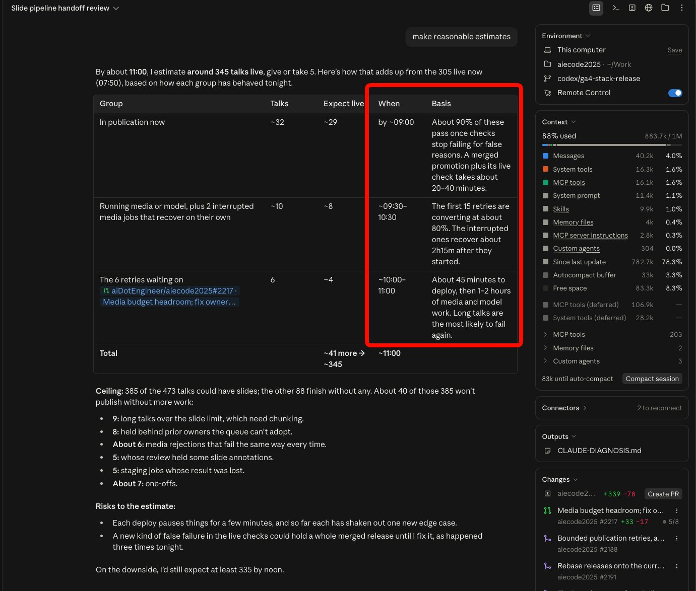
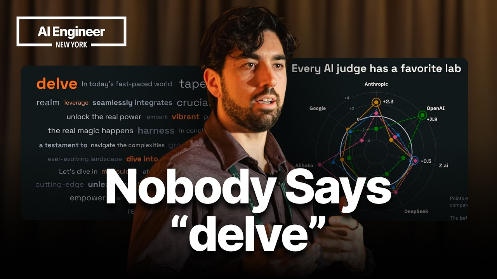
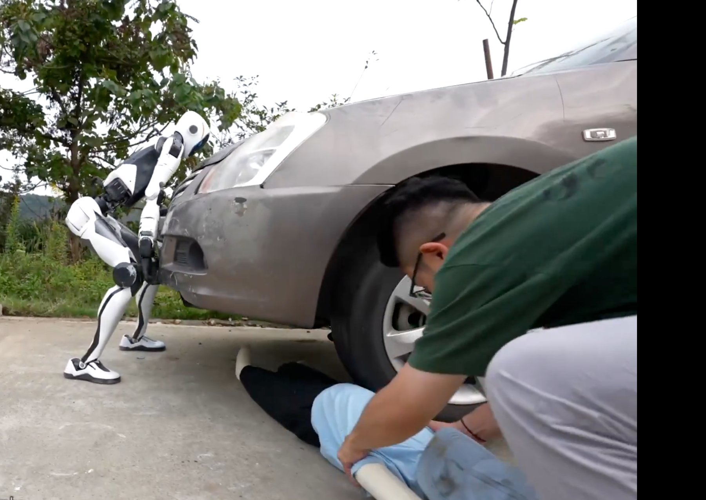

# 🐦 @swyx

## 📅 October 22, 2026

> 7 post(s) archived.

---

### 🕐 14:56 UTC · @swyx

> Opus 5.5 is the best work estimator model i&apos;ve ever used. This is calibration that is increasingly important as we delegate more and more work — don&apos;t tell me that it&apos;s going to take 2-3 working days (what a human would do) when for you, an enthusiastic, indefatigable, and embarrasingly parallelizable AGI, can get it done in 2-3 hours.

🔗 [View original post](https://x.com/swyx/status/2113283272130412684)

---

### 🕐 14:25 UTC · @swyx

> My AIE talk is live! I talk about the benchmark I&apos;ve been building for 5 months now and released it publicly for the first time there :) Louis-François Bouchard of Towards AI breaks down what makes AI writing feel like slop: overused words, vague generalities, saying nothing, repetition, hallucination and a voice that sounds like everyone at once. He then shows how his team built a benchmark to measure whether a model can write a video script in his own voice: 10 scripts, 5 drafts per model, 4 LLM judges, nine scoring metrics and 1,000 human A/B checks. He shares what it cost, why judges favor their own model family, and practical tips for writing with AI: very long prompts full of examples, one review pass from a strong model, many cheap drafts merged together, and always a human edit. Thanks again @aiDotEngineer, @swyx for inviting me and hosting yet another amazing event. Watch it here: https://youtu.be/_dTF3NpPzGo

🔗 [View original post](https://x.com/Whats_AI/status/2113275444900360264)

---

### 🕐 13:50 UTC · @swyx

> THIS THING CAN LIFT A CAR?? Unitree Introducing: H2-X Kung Fu Legend Guardian🤖 Powerful performance to serve and guard you, with a maximum endurance of approximately 8 hours. Please use the robot safely and in a friendly manner.

🔗 [View original post](https://x.com/swyx/status/2113266623260004422)

---

### 🕐 06:09 UTC · @swyx

> ratioed @cognition lololololol never change twitter

🔗 [View original post](https://x.com/swyx/status/2113150715099234673)

---

### 🕐 04:55 UTC · @swyx

> @cognition get cooked @DevinAI Most of these people spend too much time talking to me to be here on X. Luckily, I can do both!

🔗 [View original post](https://x.com/swyx/status/2113132130465395084)

---

### 🕐 04:51 UTC · @swyx

> guys you are making me look bad by @cognition stop RTing this tweet

🔗 [View original post](https://x.com/swyx/status/2113131062675267841)

---

### 🕐 02:40 UTC · @swyx

> this is my quant Media 18 million miles traveled, 400 red hoodies, one 260-digit number, and 130+ former founders. We asked some of the people building Devin to tell us how they got here and what life at Cognition is really like. Here’s what they shared.

🔗 [View original post](https://x.com/swyx/status/2113098033705664650)

---
