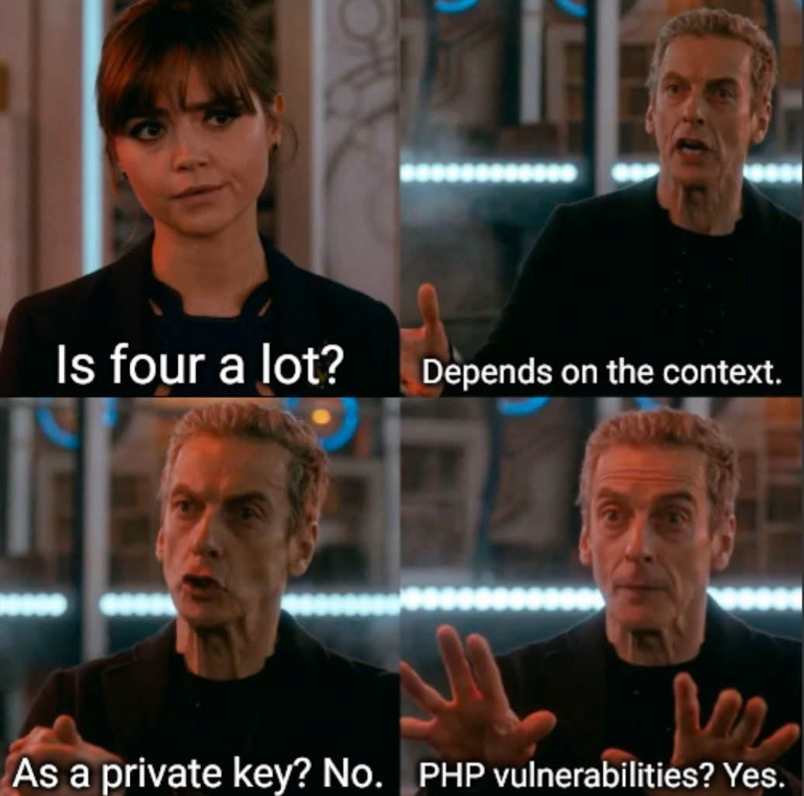

# 🐦 @tunguz

## 📅 October 22, 2026

> 17 post(s) archived.

---

### 🕐 21:10 UTC · @tunguz

> Orcs have left for Valinor.

🔗 [View original post](https://x.com/tunguz/status/2113377587908972942)

---

### 🕐 20:54 UTC · @tunguz

> 18 months to fix the cyber. 🚨 Anthropic&apos;s deputy security chief warns: “as bad as things have gotten in the past 4 days, they are going to get a lot worse…” BRACE FOR IMPACT.⁠

🔗 [View original post](https://x.com/tunguz/status/2113373467546710361)

---

### 🕐 20:19 UTC · @tunguz

> Yes 4

🔗 [View original post](https://x.com/tunguz/status/2113364652197609541)

---

### 🕐 19:50 UTC · @tunguz

> And after that the world will change every few days. The next few weeks will change the world

🔗 [View original post](https://x.com/tunguz/status/2113357448425717976)

---

### 🕐 19:47 UTC · @tunguz

> Oh you are a cybersecurity researcher? Name five previously undisclosed zero-day exploits.

🔗 [View original post](https://x.com/tunguz/status/2113356488332714092)

---

### 🕐 17:36 UTC · @tunguz

> If you ever feel cornered, add a dimension or two to your problem.

🔗 [View original post](https://x.com/tunguz/status/2113323648845062223)

---

### 🕐 17:22 UTC · @tunguz

> Real Macedonia has never been tried.

🔗 [View original post](https://x.com/tunguz/status/2113320065361686903)

---

### 🕐 17:12 UTC · @tunguz

> Got it!

🔗 [View original post](https://x.com/tunguz/status/2113317702584455366)

---

### 🕐 16:47 UTC · @tunguz

> Any moment now ... Lands tomorrow before 10am PST.

🔗 [View original post](https://x.com/tunguz/status/2113311201195118806)

---

### 🕐 15:10 UTC · @tunguz

> I like this. A lot. Introducing Locals: an Apple Silicon engine that runs local LLMs up to 3x faster. It is built with a single mission: to free you from cloud providers and run frontier-class models locally without needing massive compute resources. It’s simple. Run our engine, and your coding harn…

🔗 [View original post](https://x.com/tunguz/status/2113286793378369831)

---

### 🕐 12:52 UTC · @tunguz

> Updated version of metal-graph is out! Install it simply on your Mac and let me know what you think. python3 -m pip install --upgrade metal-graph==0.1.2 We are releasing an improved version of metal-graph library, 0.1.2. We&apos;ve made some substantial changes to the underlying algorithms, which has resulted in significant speedups in our testing. This is still a very early experimental release, and we need to implement a lot more te…

🔗 [View original post](https://x.com/tunguz/status/2113252038540734912)

---

### 🕐 12:13 UTC · @tunguz

> This is why we need to unplug the internet. Dario Altman

🔗 [View original post](https://x.com/tunguz/status/2113242444204822969)

---

### 🕐 11:22 UTC · @tunguz

> Hedge fund? You mean our gardening expenses?

🔗 [View original post](https://x.com/tunguz/status/2113229565204074744)

---

### 🕐 10:58 UTC · @tunguz

> Not foolproof. I once asked a girl for a date, and she was all like “MM-DD-YYYY or DD-MM-YYYY?” I keep hearing stories that validate this piece of advice. Say the word &quot;date&quot;.

🔗 [View original post](https://x.com/tunguz/status/2113223495488581772)

---

### 🕐 00:52 UTC · @tunguz

> I love this kind of optimism. In the long run, AI is going to make software so much more capable, and so much more secure. And reliable. But before that ...

🔗 [View original post](https://x.com/tunguz/status/2113070851340083429)

---

### 🕐 00:51 UTC · @tunguz

> I&apos;ve never been a big fan. Too autistic for my taste. Johann Sebastian Bach is the Shakespeare of music. Best there ever was.

🔗 [View original post](https://x.com/tunguz/status/2113070592618561717)

---

### 🕐 00:15 UTC · @tunguz

> I just want all my loyal and regular followers and reply gals and guys to know that I really appreciate all of you for sticking with me for all these years.

🔗 [View original post](https://x.com/tunguz/status/2113061648311451719)

---
