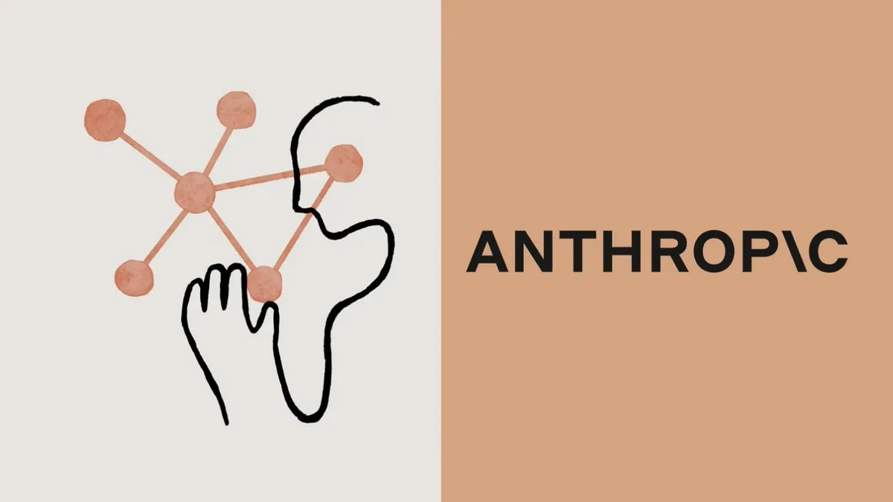

# 🐦 @AiEvolutio58513

## 📅 October 23, 2026

> 2 post(s) archived.

---

### 🕐 13:00 UTC · @AiEvolutio58513

> Anthropic has filed for its IPO, revealing 1,088% revenue growth and soaring AI compute costs. Revenue went from $386M to $4.59B in a single year, per the prospectus Reuters saw. What it cost to get there: • Operating loss: $8.06B, up from $2.98B • Net loss: $41.97B, up from $8.31B • Compute and infrastructure: $7.33B, up 190%, or 58% of all operating costs • Cash and short-term investments: $20.28B • Two customers bring in 24% of revenue, 12% each The fastest-growing company in AI is also one of the most expensive to run. Interested in AI? Follow @AiEvolutio58513 and never fall behind. I track ChatGPT, Claude, and every tool quietly changing how we work and create, then hand you the tested signals.

🔗 [View original post](https://x.com/AiEvolutio58513/status/2113616495293145469)

---

### 🕐 11:03 UTC · @AiEvolutio58513

> &quot;Humans manage agents.&quot; That&apos;s how Alexandr Wang, the founder Meta paid $14.3B to bring aboard, describes the end state of the economy. What he means: 1. Your last job is a manager&apos;s job: &quot;You&apos;re basically managing this sort of like this set of agents to do actual work.&quot; 2. The doomers think even that goes to AI. He doesn&apos;t: &quot;Management is very complicated.&quot; 3. &quot;We have a human demand and human desired driven economy. So those will be driven by humans.&quot; The catch is the last stretch: &quot;It&apos;s easy to get to 90%, very very hard to get to 99%.&quot; One young engineer already lives there. Offered his first management role, he said: &quot;Why would I want to manage people?&quot; His plan instead: &quot;I will just manage more agents.&quot; Interested in AI? Follow @AiEvolutio58513 and never fall behind. I track ChatGPT, Claude, and every tool quietly changing how we work and create, then hand you the tested signals. Media

🔗 [View original post](https://x.com/AiEvolutio58513/status/2113587067183911370)

---
