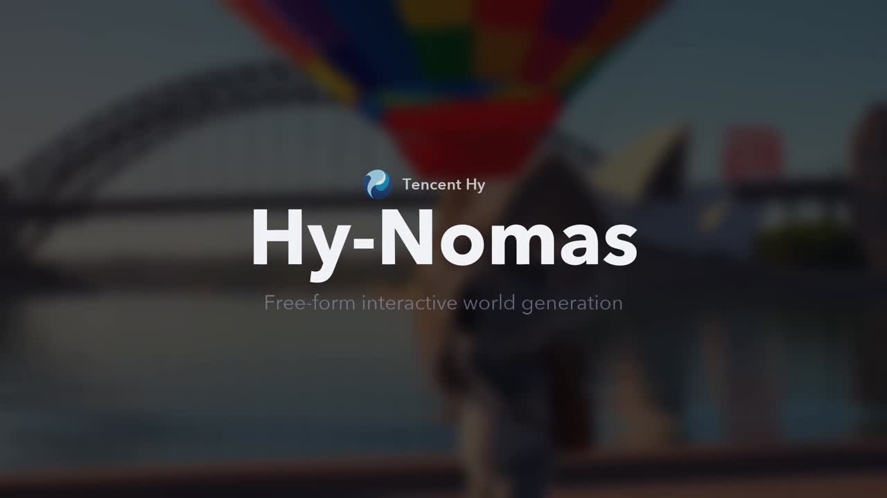
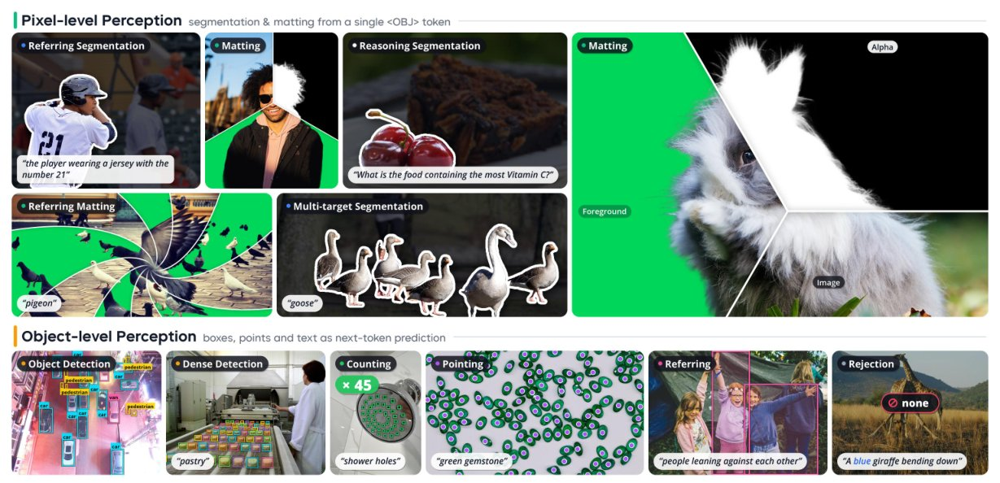

# 🐦 @_akhaliq

## 📅 October 23, 2026

> 4 post(s) archived.

---

### 🕐 15:20 UTC · @_akhaliq

> We started Mubit in Aberdeen. No network, no lab, nobody knew us. We just wanted AI systems that actually work. Today we work with some of the best companies and engineers in the world. And the thing we kept seeing: you and your competitor run the same AI. It should be yours. 🧵 Comment &quot;SAPLING&quot; in the next 48 hours for $100 free credits. Enterprises get the first month free. Media

🔗 [View original post](https://x.com/notanilp/status/2113651823131132155)

---

### 🕐 13:07 UTC · @_akhaliq

> Tencent just released Hy-Nomas-Bench on Hugging Face 280 test cases for interaction controllability in video world models, covering multi-turn text, camera navigation, interleaved control, and spatial memory.

🔗 [View original post](https://x.com/HuggingPapers/status/2113618374978863278)

---

### 🕐 12:14 UTC · @_akhaliq

> Tencent released WeVisOne-VL on Hugging Face One VLM for unified visual perception, from points and boxes to masks and alpha mattes. It handles detection, counting, OCR, segmentation and matting, and reliably rejects absent targets.

🔗 [View original post](https://x.com/HuggingPapers/status/2113604865691701408)

---

### 🕐 07:33 UTC · @_akhaliq

> MOSS image FAST AS HELL TURBO by @_akhaliq 50 steps → 4 steps ⚡ turbo feels like a sweet spot for generating lots of images fast regular text posters still look pretty good too. tiny lettering gets a bit blurry, so i&apos;d stick with the original SFT for text-heavy designs! Base 50 steps 🆚 SFT 50 steps 🆚 4-step version side by side comparison👇

🔗 [View original post](https://x.com/ting_/status/2113534296858480927)

---
