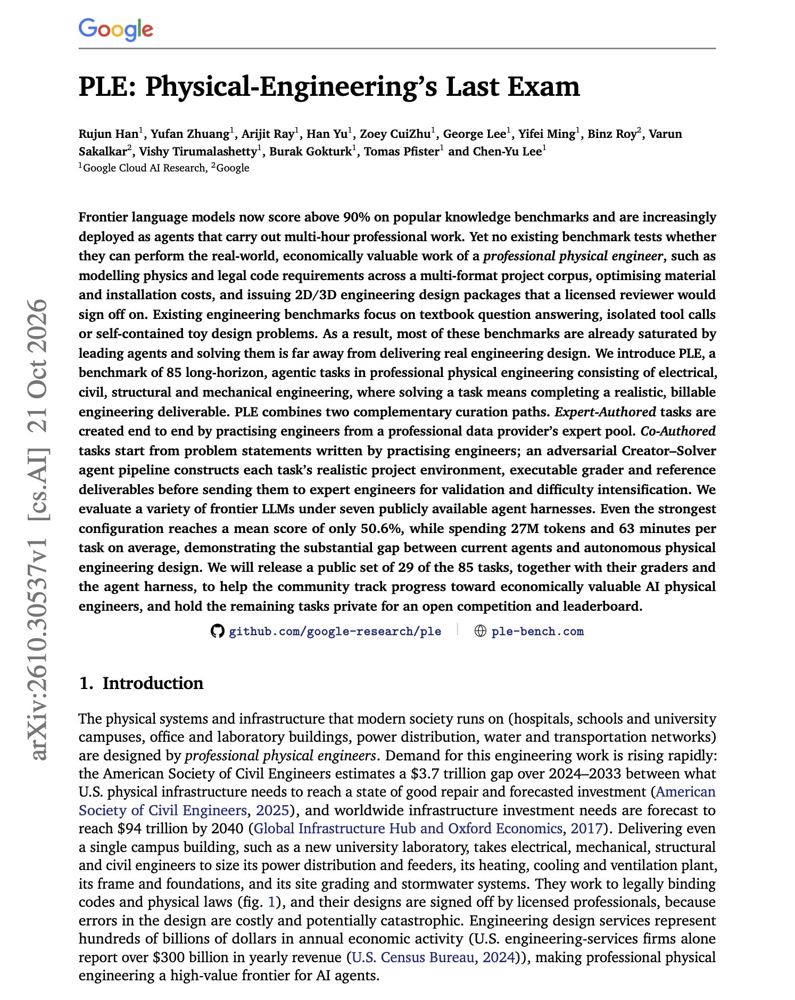
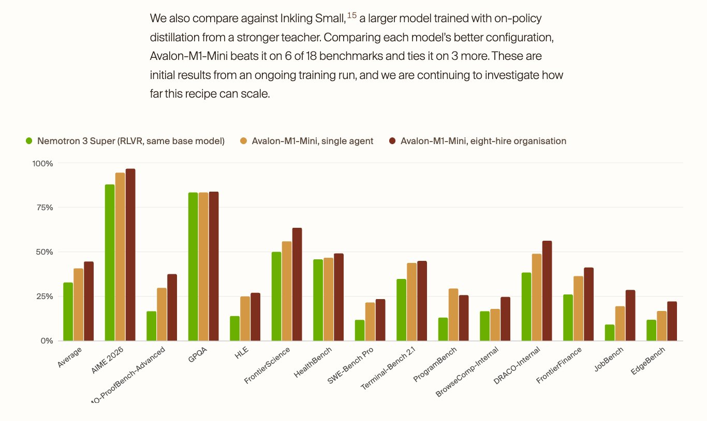
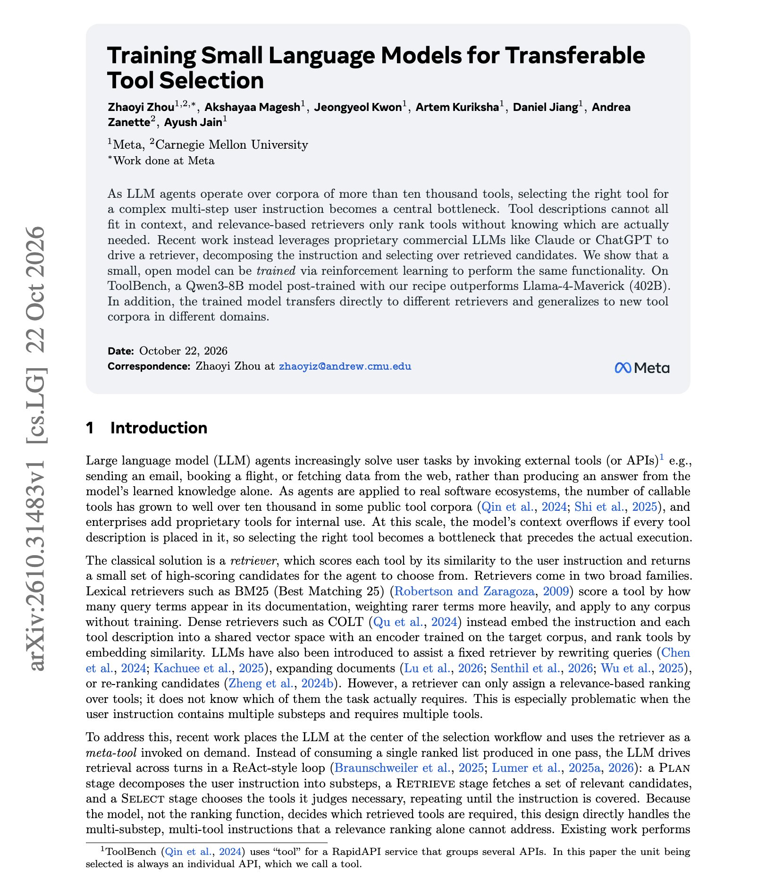
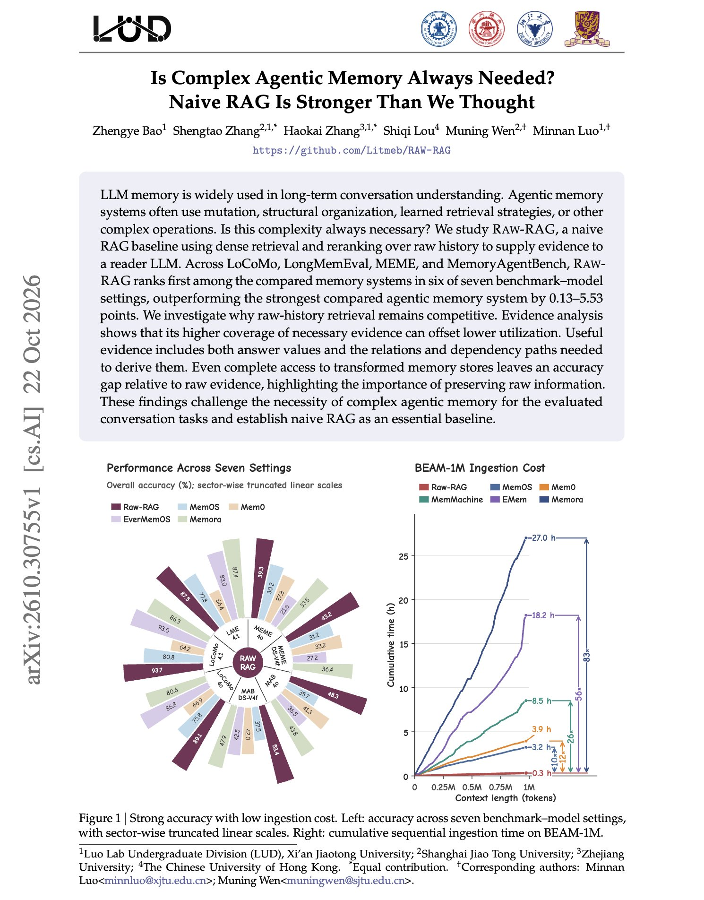

# 🐦 @dair_ai

## 📅 October 23, 2026

> 4 post(s) archived.

---

### 🕐 18:46 UTC · @dair_ai

> Banger paper from Google Cloud AI Research on agents doing professional engineering work. (bookmark it) For professional engineering deliverables, the best agent configuration averages 50.6%, using 27M tokens and 63 minutes per task. They introduce a benchmark called PLE (Physical-Engineering&apos;s Last Exam). It has 85 tasks across electrical, civil, structural, and mechanical engineering. Solving a task means producing a billable deliverable, such as a design package a licensed reviewer would sign off on, from a multi-format project corpus with physics and building-code requirements. Some tasks are written end to end by practicing engineers. Others start from an engineer&apos;s problem statement, and an adversarial Creator-Solver agent pipeline builds the project environment, grader, and reference deliverables before experts validate them and make them harder. Frontier models were tested under seven public agent harnesses. Most existing engineering benchmarks are textbook QA or toy design problems that leading agents already saturate. https://arxiv.org/abs/2610.30537 Chat with Paper: https://academy.dair.ai/papers/ple-physical-engineerings-last-exam-2610.30537

🔗 [View original post](https://x.com/dair_ai/status/2113703509548040295)

---

### 🕐 16:50 UTC · @dair_ai

> Really digging this new arc of specialized RL models. Bullish on this effort to understand and unlock collective intelligence. Highly recommend checking out the technical report. RLCR is just one of the latest efforts to train LLMs as agent organizations. Why is this a big deal, and why is it necessary? Coordination and organization are important primitives as we move into agentic long-horizon work. Agents should natively support these capabilities, which is mostly done through harnesses today. So far, multi-agent systems and how they coordinate are not well understood. This Avalon-M1-Mini model attempts to study this more closely. I think this could help us understand and discover efficient, safe ways to build effective multi-agent systems for domain-specific problems. Check out how they improve results with an eight-hire organization. Promising results. The safety risks are also worth a closer look. This is small-scale, but as they scale, I am particularly curious about whether optimal and novel organizational designs (hierarchical and coordination strategies) will emerge. I&apos;ll take a closer look at this approach and how it applies to automated research. I think there is so much to unlock there. Congrats to my former colleague, @rosstaylor90, and his team. Truly cracked 👏 Introducing Reinforcement Learning from Collective Rewards (RLCR). RLCR is a recipe that trains language models as agent organisations, which share a message board and workspace. We use it to train Avalon-M1-Mini (120B) and study its behaviour. We find a number of interesting res…

🔗 [View original post](https://x.com/omarsar0/status/2113674408564859198)

---

### 🕐 14:28 UTC · @dair_ai

> Great application of small language models by Meta. They find that an 8B model picks tools better than a 402B model when trained for the job. This work focuses on tool selection for agents with more than ten thousand tools. At that scale, tool descriptions won&apos;t fit in context, and a retriever can only rank candidates without knowing which tools the instruction actually needs. Many systems hand this step to a proprietary LLM. They train Qwen3 models on a Plan, Retrieve, Select workflow. The model splits the instruction into substeps, the retriever returns candidates for each one, and the model commits one tool per substep. Training is SFT on about 20K curated ToolBench instructions, then RL with a reward that scores how many gold tools are covered and at what rank. On ToolBench G3, the 8B model goes from 36.2% after SFT to 41.5% after RL, above prompted Llama-4-Maverick. The trained selector also works with different retrievers and on tool corpora from new domains. https://arxiv.org/abs/2610.31483 Chat with Paper: https://academy.dair.ai/papers/training-small-language-models-for-transferable-tool-selection-2610.31483

🔗 [View original post](https://x.com/dair_ai/status/2113638581818556920)

---

### 🕐 14:16 UTC · @dair_ai

> RAG is so back! This work shows that plain RAG over raw chat history beats complex agentic memory systems on most long-term memory benchmarks. (bookmark it) They tested Raw-RAG, which is just dense retrieval plus reranking over the raw conversation, feeding a reader LLM. Across LoCoMo, LongMemEval, MEME and MemoryAgentBench, it ranks first in six of seven benchmark and model settings, ahead of the strongest agentic memory system by 0.13 to 5.53 points. Ingestion on BEAM-1M takes 0.3 hours, against 3.2 to 27 hours for systems like Mem0, MemOS and Memora. Why does it hold up? Raw history keeps more of the evidence a question needs, including the relations and dependency paths behind an answer. Rewriting history into memory entries tends to drop those important bits. Even with complete access to the transformed memory stores, models answer less accurately than with raw evidence. Before adding a memory layer to your agent, at least run this baseline on your own data. https://arxiv.org/abs/2610.30755 Chat with Paper: https://academy.dair.ai/papers/is-complex-agentic-memory-always-needed-naive-rag-is-stronger-than-we-thought-2610.30755

🔗 [View original post](https://x.com/omarsar0/status/2113635562578178147)

---
