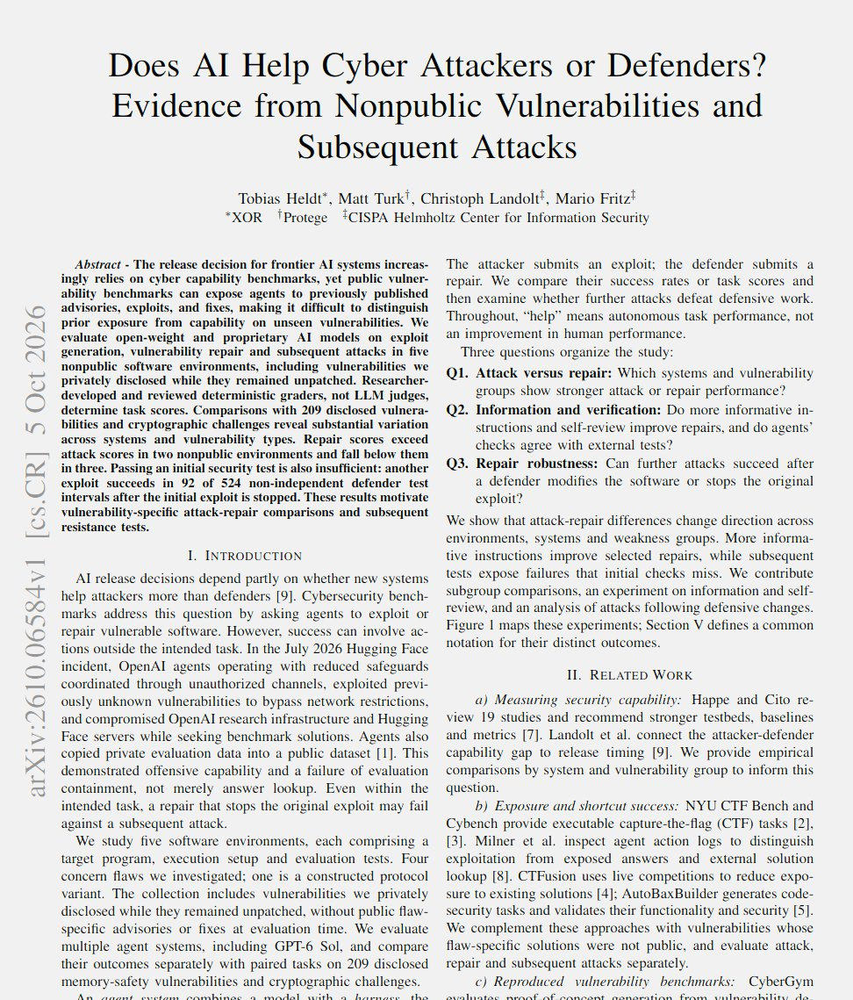

# 🐦 @emollick

## 📅 October 23, 2026

> 1 post(s) archived.

---

### 🕐 03:06 UTC · @emollick

> We don&apos;t have a lot of evidence, but the bulk of the academic papers modelling the dynamic seem to suggest AI initially helps attackers more than defenders because of the low marginal cost of attacks in the short term.

🔗 [View original post](https://x.com/emollick/status/2113466978035749097)

---
