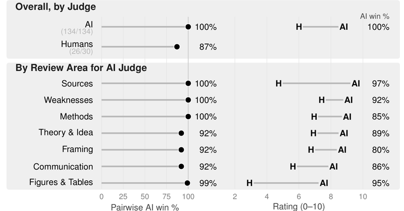
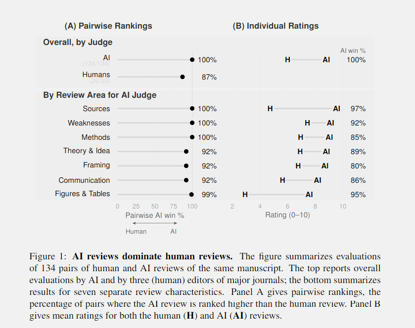

# 🐦 @emollick

## 📅 October 23, 2026

> 6 post(s) archived.

---

### 🕐 17:25 UTC · @emollick

> This does not require the companies to train on the data of their customers, which they insist they do not do (and could not do legally in most cases), but merely a recognition that there is more money in competing directly in finance than giving that capability to others.

🔗 [View original post](https://x.com/emollick/status/2113683254176031213)

---

### 🕐 17:19 UTC · @emollick

> As the gap between the internal models at the AI labs and the ones they release grow (due to safety concerns &amp; research advantages), it will be increasingly tempting for OpenAI &amp; Anthropic to exploit that advantage directly by entering new markets, especially in finance &amp; biotech

🔗 [View original post](https://x.com/emollick/status/2113681838611087572)

---

### 🕐 13:40 UTC · @emollick

> The inventor of the term &quot;prompt injection&quot; suspects (as do I) that this may not be as large a problem in new models. This matches our tests suggesting that you can&apos;t simply prompt inject a request for higher grades in a paper, anymore. @nateberkopec I&apos;m cautiously starting to suspect it may not be a problem with today&apos;s strongest models - Anthropic in particular are very confident about their ability to avoid prompt injections - but it&apos;s still a real concern for cheaper, weaker models

🔗 [View original post](https://x.com/emollick/status/2113626577623826515)

---

### 🕐 04:12 UTC · @emollick

> This is not going to be the only area in which AIs beat humans... Paper: https://gking.harvard.edu/peerless/

🔗 [View original post](https://x.com/emollick/status/2113483765917929536)

---

### 🕐 04:10 UTC · @emollick

> By every measure, Opus 4.8 beats human experts as peer reviewers in a study of 124 Harvard social science papers covering a range from statistical analyses to formal models to qualitative work. As academics, we need to figure out how to adapt the practice of science to AI, fast.

🔗 [View original post](https://x.com/emollick/status/2113483068174692831)

---

### 🕐 03:06 UTC · @emollick

> We don&apos;t have a lot of evidence, but the bulk of the academic papers modelling the dynamic seem to suggest AI initially helps attackers more than defenders because of the low marginal cost of attacks in the short term.

🔗 [View original post](https://x.com/emollick/status/2113466978035749097)

---
